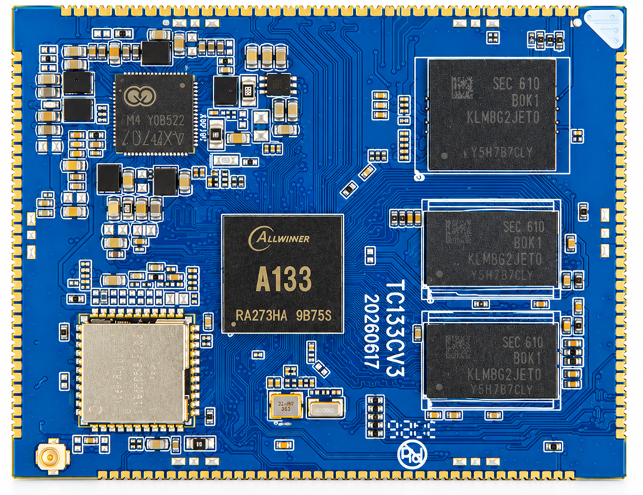

# 产品介绍

td133（型号 td133cv4）是基于全志 A133 的核心板，集成 DDR3、eMMC、双频 Wi-Fi 6 模组和 AXP707 电源管理芯片。核心板采用 155 针邮票孔封装，通过载板连接显示屏、摄像头和其他外设。

## 主要规格

| 项目 | 规格 |
| --- | --- |
| 处理器 | 全志 A133，四核 Cortex-A53，1.7 GHz |
| GPU | PowerVR GE8300 |
| 内存 | DDR3，512 MB 至 2 GB，标准配置 1 GB |
| 存储 | 板载 eMMC，可选 4、8、16、32 或 64 GB，标准配置 8 GB |
| 显示 | 1 路四通道 MIPI DSI、2 路 LVDS，部分信号复用 |
| 摄像头 | 2 路 MIPI CSI |
| USB | 2 路 USB 2.0 |
| 网络 | 板载双频 Wi-Fi 6，支持外接千兆以太网 PHY |
| 供电 | AXP707，主电源 5 V / 2 A |
| 系统 | Android / Linux |
| 温度 | 工作 0 至 70 °C，储存 −10 至 50 °C |

## 封装与尺寸

PCB 外形为 64 × 50 mm，厚度 1.2 mm，8 层板，邮票孔间距 1.2 mm。载板封装定位见[引脚定义](./td133-pin-definition.md)。

## 核心板外观

## 文档入口

- [引脚定义](./td133-pin-definition.md)
- [接口资源](./td133-interface-resources.md)
- [硬件设计与调试](./td133-hardware-design.md)
