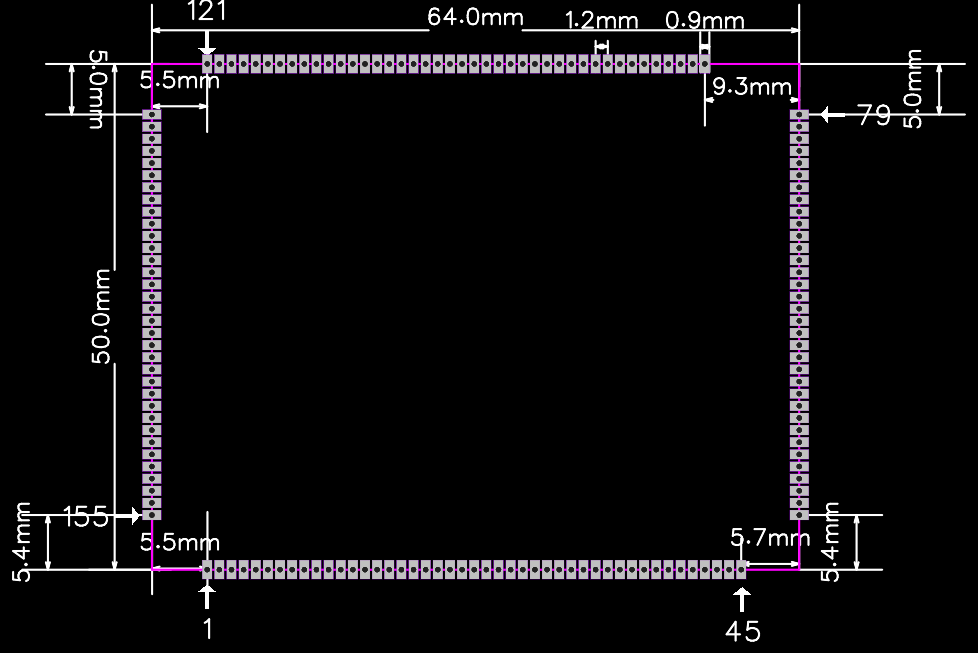

# 引脚定义

定位图标出第 1、45、79、121 和 155 脚。表中用斜线分隔同一焊盘的信号标注，具体功能取决于引脚复用设置。接线前按底板原理图核对引脚编号和电平。

## 引脚 1–45

| 引脚 | 信号 | 类型 | 说明 |
| --- | --- | --- | --- |
| 1 | `NMI` | 非屏蔽中断 | 上拉或下拉 |
| 2 | `PWRON` | 系统开机 | 低电平触发 |
| 3 | `RESET` | 主芯片复位 | 低电平触发 |
| 4 | `FEL` | 烧录模式进入 | 低电平触发 |
| 5 | `DCDCE` / `VCC3V3` | 电源输出 | PMIC的DLDO3 |
| 6 | `ALDO3` | 电源输出 | 3.3V |
| 7 | `PC7` | IO | 1.8V |
| 8 | `PC12` | IO | 1.8V |
| 9 | `BLDO4` / `DVDD-CSI` | 电源输出 | 2.8V |
| 10 | `AVDD-CSI` | 电源输出 | PMIC的DLDO3 |
| 11 | `VCC-CSI` | 电源输出 | 1.8V |
| 12 | `PD19` / `LCD0_DE` / `LVDS1_D3N` / `UART4_RX` / `EINK_STH` / `PD_EINT19` | IO | 3.3V/复用成LVDS则变1.8V |
| 13 | `PD18` / `LCD0_CLK` / `LVDS1_D3P` / `UART4_TX` / `EINK_CKH` / `PD_EINT18` | IO | 3.3V/复用成LVDS则变1.8V |
| 14 | `PD23` / `PWM0` / `TWI0_SDA` / `PD_EINT23` | IO | 3.3V/复用成LVDS则变1.8V |
| 15 | `PD21` / `LCD0_VSYNC` / `PWM3` / `UART4_CTS` / `EINK_MODE` / `PD_EINT21` | IO | 3.3V/复用成LVDS则变1.8V |
| 16 | `PD20` / `LCD0_HSYNC` / `PWM2` / `UART4_RTS` / `EINK_CKV` / `PD_EINT20` | IO | 3.3V/复用成LVDS则变1.8V |
| 17 | `PD22` / `PWM1` / `TWI0_SCK` / `EINK_STV` / `PD_EINT22` | IO | 3.3V/复用成LVDS则变1.8V |
| 18 | `PD16` / `LCD0_D22` / `LVDS1_CKP` / `UART3_RTS` / `EINK_OEH` / `PD_EINT16` | IO | 3.3V/复用成LVDS则变1.8V |
| 19 | `PD17` / `LCD0_D23` / `LVDS1_CKN` / `UART3_CTS` / `EINK_LEH` / `PD_EINT17` | IO | 3.3V/复用成LVDS则变1.8V |
| 20 | `PD8` / `LCD0_D12` / `LVDS0_D3P` / `DSI_DP3` / `EINK0_D8` / `PD_EINT8` | IO | 3.3V/复用成LVDS则变1.8V |
| 21 | `PD9` / `LCD0_D13` / `LVDS0_D3N` / `DSI_DM3` / `EINK0_D9` / `PD_EINT9` | IO | 3.3V/复用成LVDS则变1.8V |
| 22 | `PD4` / `LCD0_D6` / `LVDS0_D2P` / `DSI_CKP` / `EINK0_D4` / `PD_EINT4` | IO | 3.3V/复用成LVDS则变1.8V |
| 23 | `PD5` / `LCD0_D7` / `LVDS0_D2N` / `DSI_CKM` / `EINK0_D5` / `PD_EINT5` | IO | 3.3V/复用成LVDS则变1.8V |
| 24 | `PD6` / `LCD0_D10` / `LVDS0_CKP` / `DSI_DP2` / `EINK0_D6` / `PD_EINT6` | IO | 3.3V/复用成LVDS则变1.8V |
| 25 | `PD7` / `LCD0_D11` / `LVDS0_CKN` / `DSI_DM2` / `EINK0_D7` / `PD_EINT7` | IO | 3.3V/复用成LVDS则变1.8V |
| 26 | `PD2` / `LCD0_D4` / `LVDS0_D1P` / `DSI_DP1` / `EINK0_D2` / `PD_EINT2` | IO | 3.3V/复用成LVDS则变1.8V |
| 27 | `PD3` / `LCD0_D5` / `LVDS0_D1N` / `DSI_DM1` / `EINK0_D3` / `PD_EINT3` | IO | 3.3V/复用成LVDS则变1.8V |
| 28 | `PD0` / `LCD0_D2` / `LVDS0_D0P` / `DSI_DP0` / `EINK0_D0` / `PD_EINT0` | IO | 3.3V/复用成LVDS则变1.8V |
| 29 | `PD1` / `LCD0_D3` / `LVDS0_D0N` / `DSI_DM0` / `EINK0_D1` / `PD_EINT1` | IO | 3.3V/复用成LVDS则变1.8V |
| 30 | `PD14` / `LCD0_D20` / `LVDS1_D2P` / `UART3_TX` / `EINK0_D14` / `PD_EINT14` | IO | 3.3V/复用成LVDS则变1.8V |
| 31 | `PD15` / `LCD0_D21` / `LVDS1_D2N` / `UART3_RX` / `EINK0_D15` / `PD_EINT15` | IO | 3.3V/复用成LVDS则变1.8V |
| 32 | `PD12` / `LCD0_D18` / `LVDS1_D1P` / `SPI1_MOSI` / `EINK0_D12` / `PD_EINT12` | IO | 3.3V/复用成LVDS则变1.8V |
| 33 | `PD13` / `LCD0_D19` / `LVDS1_D1N` / `SPI1_MISO` / `EINK0_D13` / `PD_EINT13` | IO | 3.3V/复用成LVDS则变1.8V |
| 34 | `PD10` / `LCD0_D14` / `LVDS1_D0P` / `SPI1_CS` / `EINK0_D10` / `PD_EINT10` | IO | 3.3V/复用成LVDS则变1.8V |
| 35 | `PD11` / `LCD0_D15` / `LVDS1_D0N` / `SPI1_CLK` / `EINK0_D11` / `PD_EINT11` | IO | 3.3V/复用成LVDS则变1.8V |
| 36 | `GND` | 参考地 |  |
| 37 | `USB1-DM` | USB信号 | 不可做GPIO |
| 38 | `USB1-DP` | USB信号 | 不可做GPIO |
| 39 | `GND` | 参考地 |  |
| 40 | `USB0-DM` | USB信号 | 不可做GPIO |
| 41 | `USB0-DP` | USB信号 | 不可做GPIO |
| 42 | `GND` | 参考地 |  |
| 43 | `MCSIA-RST` / `PE9` / `BIST_RESULT3` / `I2S2_DIN0` / `PE_EINT9` | IO | 1.8V |
| 44 | `MCSIA-STBY` / `PE8` / `BIST_RESULT2` / `I2S2_DOUT0` / `PE_EINT8` | IO | 1.8V |
| 45 | `MCSIB-STBY` / `PE6` / `BIST_RESULT0` / `I2S2_BCLK` / `PE_EINT6` | IO | 1.8V |

## 引脚 46–79

| 引脚 | 信号 | 类型 | 说明 |
| --- | --- | --- | --- |
| 46 | `PE7` / `I2S2_LRCK` / `TCON_TRIG` / `PE_EINT7` | IO | 1.8V |
| 47 | `PE0` / `MIPI_MCLK0` / `PE_EINT0` | IO | 1.8V |
| 48 | `PE1` / `TWI2_SCK` / `PE_EINT1` | IO | 1.8V |
| 49 | `PE2` / `TWI2_SDA` / `PE_EINT2` | IO | 1.8V |
| 50 | `PE3` / `TWI3_SCK` / `PE_EINT3` | IO | 1.8V |
| 51 | `PE4` / `TWI3_SDA` / `PE_EINT4` | IO | 1.8V |
| 52 | `MCSIA-D0N` | MIPI CSI信号 | 不可做GPIO |
| 53 | `MCSIA-D0P` | MIPI CSI信号 | 不可做GPIO |
| 54 | `MCSIA-D1N` | MIPI CSI信号 | 不可做GPIO |
| 55 | `MCSIA-D1P` | MIPI CSI信号 | 不可做GPIO |
| 56 | `MCSIA-D3N` | MIPI CSI信号 | 不可做GPIO |
| 57 | `MCSIA-D3P` | MIPI CSI信号 | 不可做GPIO |
| 58 | `MCSIA-CLKN` | MIPI CSI信号 | 不可做GPIO |
| 59 | `MCSIA-CLKP` | MIPI CSI信号 | 不可做GPIO |
| 60 | `MCSIA-D2N` | MIPI CSI信号 | 不可做GPIO |
| 61 | `MCSIA-D2P` | MIPI CSI信号 | 不可做GPIO |
| 62 | `MCSIB-D0N` | MIPI CSI信号 | 不可做GPIO |
| 63 | `MCSIB-D0P` | MIPI CSI信号 | 不可做GPIO |
| 64 | `MCSIB-CLKN` | MIPI CSI信号 | 不可做GPIO |
| 65 | `MCSIB-CLKP` | MIPI CSI信号 | 不可做GPIO |
| 66 | `MCSIB-D1N` | MIPI CSI信号 | 不可做GPIO |
| 67 | `MCSIB-D1P` | MIPI CSI信号 | 不可做GPIO |
| 68 | `HPOUTL` | 耳机左声道输出 | 1.8V不可做GPIO |
| 69 | `HPOUTR` | 耳机右声道输出 | 1.8V不可做GPIO |
| 70 | `MBIAS` | 主MIC偏置电压输出 | 1.8V不可做GPIO |
| 71 | `HSOMIC` | 耳机麦克风检测 | 1.8V不可做GPIO |
| 72 | `HBIAS` | 次MIC偏置电压输出 | 1.8V不可做GPIO |
| 73 | `LINEOUTP` | 音频输出 | 不可做GPIO |
| 74 | `LINEOUTN` | 音频输出 | 不可做GPIO |
| 75 | `MICIN1N` | 麦克风输入 | 不可做GPIO |
| 76 | `MICIN1P` | 麦克风输入 | 不可做GPIO |
| 77 | `MICIN2N` | 麦克风输入 | 不可做GPIO |
| 78 | `MICIN2P` | 麦克风输入 | 不可做GPIO |
| 79 | `GND` | 参考地 |  |

## 引脚 80–121

| 引脚 | 信号 | 类型 | 说明 |
| --- | --- | --- | --- |
| 80 | `HP-DET` | IO | 1.8V |
| 81 | `PC2` | IO | 1.8V |
| 82 | `PC3` | IO | 1.8V |
| 83 | `PF0` / `SDC0_D1` / `JTAG_MS` / `JTAG_MS_GPU` / `PF_EINT0` | IO | 1.8V |
| 84 | `PF6` / `PF_EINT6` | IO | 1.8V |
| 85 | `PF5` / `SDC0_D2` / `JTAG_CK` / `JTAG_CK_GPU` / `PF_EINT5` | IO | 1.8V |
| 86 | `PF4` / `SDC0_D3` / `UART0_RX` / `PF_EINT4` | IO | 1.8V |
| 87 | `PF1` / `SDC0_D0` / `JTAG_DI` / `JTAG_DI_GPU` / `PF_EINT1` | IO | 1.8V |
| 88 | `PF3` / `SDC0_CMD` / `JTAG_DO` / `JTAG_DO_GPU` / `PF_EINT3` | IO | 1.8V |
| 89 | `PF2` / `SDC0_CLK` / `UART0_TX` / `PF_EINT2` | IO | 1.8V |
| 90 | `PH9` / `DMIC_DATA0` / `SPI2_CLK` / `I2S2_BCLK` / `MDC0` / `PH_EINT9` | IO | 3.3V |
| 91 | `PH8` / `DMIC_CLK` / `SPI2_CS` / `I2S2_MCLK` / `I2S2_DIN2` / `PH_EINT8` | IO | 3.3V |
| 92 | `PH11` / `DMIC_DATA2` / `SPI2_MISO` / `I2S2_DOUT0` / `I2S2_DIN1` / `PH_EINT11` | IO | 3.3V |
| 93 | `PH10` / `DMIC_DATA1` / `SPI2_MOSI` / `I2S2_LRCK` / `MDIO0` / `PH_EINT10` | IO | 3.3V |
| 94 | `PH12` / `DMIC_DATA3` / `TWI3_SCK` / `I2S2_DIN0` / `I2S2_DOUT1` / `PH_EINT12` | IO | 3.3V |
| 95 | `PB3` / `UART2_CTS` / `SPI2_MISO` / `JTAG_DI` / `PB_EINT3` | IO | 3.3V |
| 96 | `PB0` / `UART2_TX` / `SPI2_CS` / `JTAG_MS` / `PB_EINT0` | IO | 3.3V |
| 97 | `PB1` / `UART2_RX` / `SPI2_CLK` / `JTAG_CK` / `PB_EINT1` | IO | 3.3V |
| 98 | `PB2` / `UART2_RTS` / `SPI2_MOSI` / `JTAG_DO` / `PB_EINT2` | IO | 3.3V |
| 99 | `PH19` / `CIR_IN` / `I2S3_DOUT3` / `I2S3_DIN3` / `LEDC` / `PH_EINT19` | IO | 3.3V |
| 100 | `PH18` / `CIR_OUT` / `I2S3_DOUT2` / `I2S3_DIN2` / `RGMII0_TXD2` / `PH_EINT18` | IO | 3.3V |
| 101 | `PL10` / `S_PWM` / `S_PL_EINT10` | IO | 3.3V |
| 102 | `PH14` / `I2S3_BCLK` / `RGMII0_RXD3` / `RMII0_NULL` / `PH_EINT14` | IO | 3.3V |
| 103 | `GND` | 参考地 |  |
| 104 | `PB4` / `TWI1_SCK` / `I2S0_MCLK` / `JTAG_MS_GPU` / `PB_EINT4` | IO | 3.3V |
| 105 | `GND` | 参考地 |  |
| 106 | `PB5` / `TWI1_SDA` / `I2S0_BCLK` / `JTAG_CK_GPU` / `PB_EINT5` | IO | 3.3V |
| 107 | `PB6` / `I2S0_LRCK` / `JTAG_DO_GPU` / `PB_EINT6` | IO | 3.3V |
| 108 | `PB7` / `I2S0_DOUT0` / `I2S0_DIN1` / `PB_EINT7` | IO | 3.3V |
| 109 | `PB8` / `SPDIF_OUT` / `I2S0_DIN0` / `I2S0_DOUT1` / `PB_EINT8` | IO | 3.3V |
| 110 | `PB10` / `UART0_RX` / `TWI0_SDA` / `PWM1` / `PB_EINT10` | IO | 3.3V |
| 111 | `PB9` / `UART0_TX` / `TWI0_SCK` / `JTAG_DI_GPU` / `PB_EINT9` | IO | 3.3V |
| 112 | `PL7` / `S_JTAG_DI` / `S_PL_EINT7` | IO | 3.3V |
| 113 | `PL8` / `S_TWI1_SCK` / `S_PL_EINT8` | IO | 3.3V |
| 114 | `PL9` / `S_TWI1_SDA` / `S_PL_EINT9` | IO | 3.3V |
| 115 | `PL11` / `S_CPU_CUR_W` / `S_CIR_IN` / `S_PL_EINT11` | IO | 3.3V |
| 116 | `PH0` / `TWI0_SCK` / `RGMII0_RXD1` / `RMII0_RXD1` / `PH_EINT0` | IO | 3.3V |
| 117 | `PH1` / `TWI0_SDA` / `RGMII0_RXD0` / `RMII0_RXD0` / `PH_EINT1` | IO | 3.3V |
| 118 | `PH2` / `TWI1_SCK` / `CPU_CUR_W` / `RGMII0_RXCTL` / `PH_EINT2` | IO | 3.3V |
| 119 | `PH3` / `TWI1_SDA` / `CIR_OUT` / `RGMII0_CLKIN` / `RMII0_RXER` / `PH_EINT3` | IO | 3.3V |
| 120 | `LRADC` | 低速模数转换器 | 1.8V |
| 121 | `GND` | 参考地 |  |

## 引脚 122–155

| 引脚 | 信号 | 类型 | 说明 |
| --- | --- | --- | --- |
| 122 | `PH4` / `UART3_TX` / `SPI1_CS` | IO | 3.3V |
| 123 | `PH5` / `UART3_RX` / `SPI1_CLK` | IO | 3.3V |
| 124 | `PH6` / `UART3_RTS` / `SPI1_MOSI` | IO | 3.3V |
| 125 | `PH7` / `UART3_CTS` / `SPI1_MISO` | IO | 3.3V |
| 126 | `GND` | 参考地 |  |
| 127 | `PH15` / `I2S3_LRCK` | IO | 3.3V |
| 128 | `GND` | 参考地 |  |
| 129 | `PH17` / `I2S3_DOUT1` / `I2S3_DIN0` | IO | 3.3V |
| 130 | `GND` | 参考地 |  |
| 131 | `PH13` / `TWI3_SDA` / `I2S3_MCLK` | IO | 3.3V |
| 132 | `GND` | 参考地 |  |
| 133 | `PH16` / `I2S3_DOUT0` / `I2S3_DIN1` | IO | 3.3V |
| 134 | `GND` | 参考地 |  |
| 135 | `GND` | 参考地 |  |
| 136 | `GND` | 参考地 |  |
| 137 | `GND` | 参考地 |  |
| 138 | `GND` | 参考地 |  |
| 139 | `NC` / `GND` | 模拟输入 | 伪差分耳机地参考 |
| 140 | `USB0-DRVVBUS` | IO | PMIC的 VBUS 模式选择与控制 |
| 141 | `TS` | ADC输入 | PMIC的温度检测 |
| 142 | `VBUS` | 电源输入 | 5V/2A |
| 143 | `PMU-SDA` | I2C0数据 | 已接内部PMIC |
| 144 | `PUM-SCK` | I2C0时钟 | 已接内部PMIC |
| 145 | `AVCC` | 电源输出 | 1.8V/0.5A |
| 146 | `GND` | 参考地 |  |
| 147 | `GND` | 参考地 |  |
| 148 | `GND` | 参考地 |  |
| 149 | `PS` | 电源输入 | 5V/2A |
| 150 | `PS` | 电源输入 | 5V/2A |
| 151 | `PS` | 电源输入 | 5V/2A |
| 152 | `ACIN` | 电源输入 | 5V/2A |
| 153 | `ACIN` | 电源输入 | 5V/2A |
| 154 | `VBAT` | 电池输入 | 单节电池4.2V |
| 155 | `VBAT` | 电池输入 | 单节电池4.2V |
