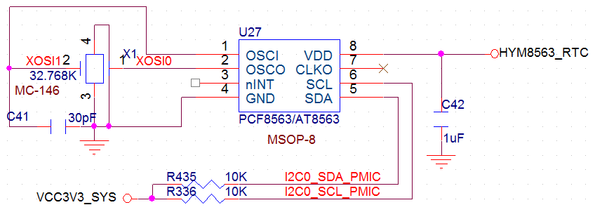

# 硬件设计

PX30芯片整体管脚不多，但是各种片内外设一应俱全，在电路设计时需要合理分配。

## DDR的选择

PX30即支持DDR3，也支持DDR4，考虑到性价比因素，x30cv1使用DDR3设计，随着DDR市场行情的变化，可能会更新到DDR4。x30cv2使用LPDDR3设计，单片即可支持到2GB，比用两片1GB的DDR3性价比要高。

## flash的选择

PX30即能支持nand flash，也能支持EMMC。从产品稳定性以及工作效能上看，EMMC要比nand flash优秀很多，唯一的缺点就是相比nand flash要稍微贵一些。x30cv1摒弃了nand flash，默认外挂了一个8GB的EMMC。

## 摄像头接口

PX30芯片即能支持MIPI摄像头，也能支持并口摄像头。值得注意的是，摄像头的并口占用了大量的IO口，为了降低管脚数量，芯片厂家将大量的并口IO和以太网管脚复用了。x30开发板仅预留了MIPI的摄像头接口，并口的摄像头口用作百兆以太网了。用户如果不需要以太网，可以根据产品的实际需求自行设计。

## 显示接口

PX30可支持MIPI、LVDS、RGB三种接口的屏。MIPI和LVDS复用一组管脚，RGB单独一组管脚。也就是说，MIPI和LVDS不能同时使用。x30开发板预留了两个显示接口，一个用来接MIPI或LVDS屏，另一个用来接RGB接口屏。值得注意的是，PX30本身并没有HDMI输出接口，如果要使用HDMI口，需要外扩转接芯片。

## 音频接口

PX30具有标准的I2S音频接口，配套的PMU RK809自带有音频codec，无需再外加音频解码芯片了。

## SDIO接口

PX30一起有三路SDIO接口，x30开发板给EMMC分配了一路，集成到核心板上；给WIFI/BT模块分配了一路，用于接AP6212等SDIO接口的模块；给TF卡分配了一路，用于扩展容量。

注意，SDMMC0通道除了分配给TF卡外，它的D0和D1两条数据线和UART2是复用的，在调试时我们通过UART2监控信息。注意，PX30有两个UART2，一个和SDMMC0的D0，D1复用，另一个用其他GPIO复用。任何时候只允许一路UART2使用，通过程序选择。

## 电源设计

我们只需要给x30核心板的第109，110管脚提供5V/1A的电源，再给第115脚提供5的RTC供电，核心板就能正常运行了，详细的电源管脚定义如下：

- 95脚：核心板PMU的LDO7输出，能提供400mA的电流输出，电压可程控；

- 96脚：核心板PMU的LDO8输出，能提供400mA的电流输出，电压可程控；

- 109、110脚：5V/1A电源输入接口，核心板的主电源输入；

- 111、112脚：核心板公共地；

- 113脚：核心板上PMU的控制脚，可用于使能外部的电源信号；

- 114脚：核心板上PMU的电源输出，可提供5V/1.5A的电压输出；

- 115脚：RTC电源输入，通常电压为5V；

- 116脚：核心板上PMU的DC电源输出，电压由1.5到3.6V可程控，电流达到2.5A；

- 117脚：核心板上PMU的LDO4输出，电压可程控，最大电流400mA；

- 118脚：核心板上PMU的LDO2输出，电压可程控，最大电流400mA；

:::danger RTC 供电时序

注意：核心板上第115脚RTC供电务必不能晚于第110脚的供电，否则会烧坏PMU，CPU等核心器件！原则上，RTC供电电压不能低于第110脚的供电电压。默认RK809的RTC静态工作电流在38uA左右，建议对时钟有要求的，在底板上加单独的RTC时钟芯片，推荐使用AT8563，静态工作电流能降到0.6uA，参考电路如下：

:::

## USB设计

PX30有一路HOST口和一路OTG口，默认USB2.0接口能达到480Mbps的速度。OTG和HOST都是高速信号线，在PCB走线时，务必走等长差分线，阻抗匹配为90欧，而且需要有完整的参考平面。以下是对应的差分对信号：

| 差分管脚编号 | 差分管脚名称 |
| --- | --- |
| 119、120 | OTG_DP、OTG_DM |
| 123、124 | USB_HOST_DM、USB_HOST_DP |

## MIPI设计

MIPI是2003年由ARM，Nokia，ST，TI等公司成立的一个联盟，目的是把手机内部的接口如摄像头、显示屏、射频基带接口等标准化，从而减少手机的设计复杂度，增加设计的灵活性。MIPI是一个比较新的标准，目前比较成熟的应用有DSI（显示接口）和CSI（摄相头接口）。

PX30支持DSI和CSI，DSI对应核心板的第7到16脚，用于接MIPI接口的显示屏；CSI对应核心板的第81到90脚，用于接MIPI接口的摄相头。MIPI接口的数据传输率要远大于LVDS接口，在走线时一定要走等长差分线，且阻抗匹配为100欧。
