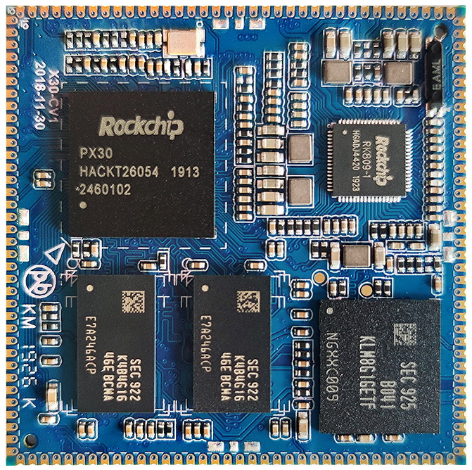
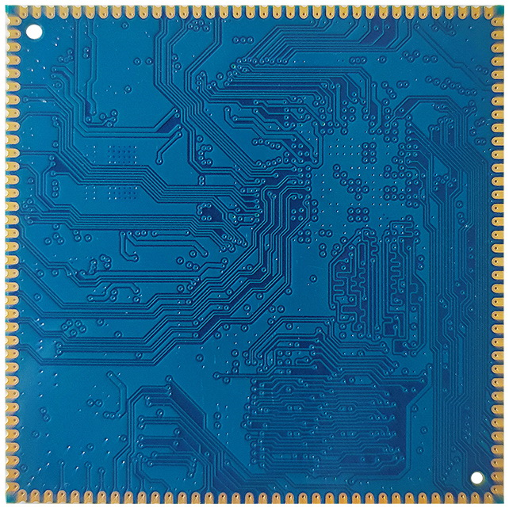
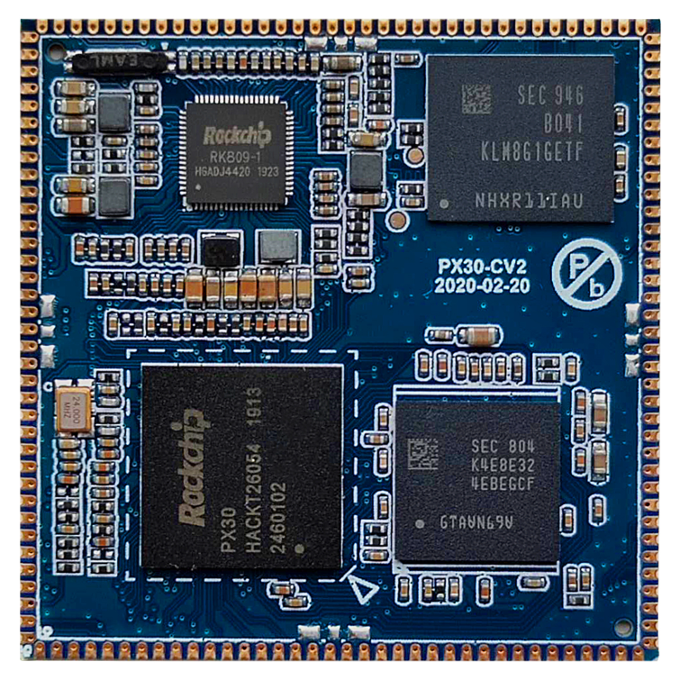
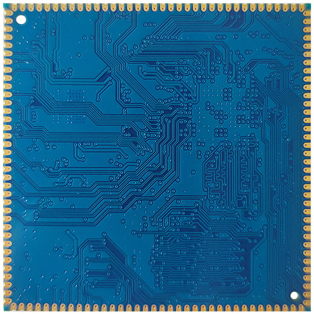
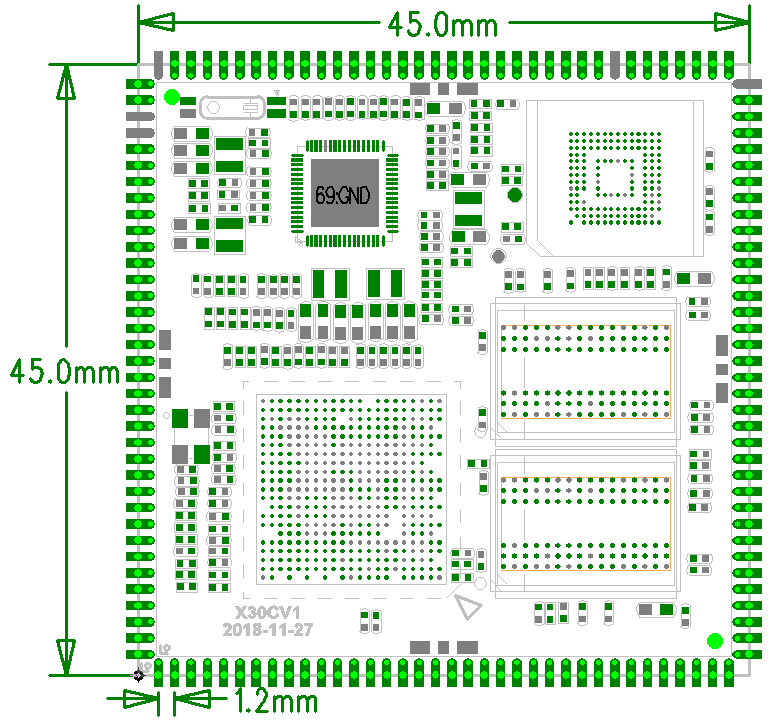

# 尺寸与结构

## X30CV1核心板外观

### X30CV1正面图

### X30CV1背面图

## X30CV2核心板外观

### X30CV2正面图

### X30CV2背面图

## 核心板结构图

核心板结构尺寸及管脚排列：

## 结构参数

| 项目 | 参数 |
| --- | --- |
| 外观 | 邮票孔方式 |
| 核心板尺寸 | 45mm*45mm*2.6mm |
| 引脚间距 | 1.2mm |
| 引脚焊盘尺寸 | 2.0mm*0.7mm |
| 引脚数量 | 144PIN |
| 板层 | 8层 |
| 翘曲度 | 小于0.5% |
