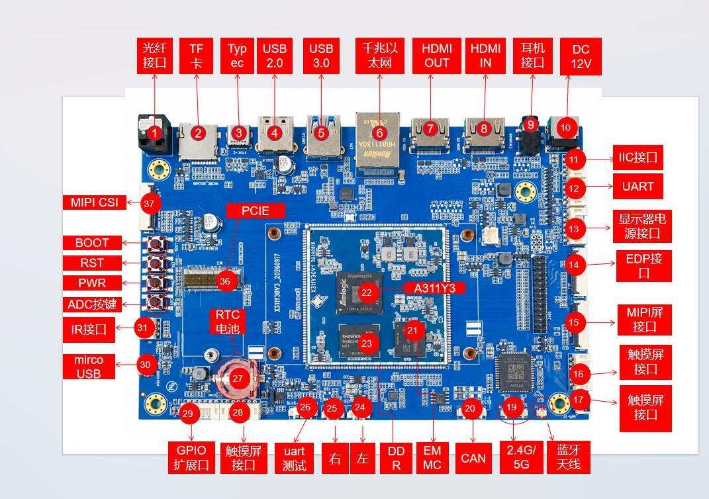

# 评估底板与接口速查

## 6.1 评估底板接口图

图 6-1 为基于 X311Y3CV1的评估底板接口示意，用于快速识别常见接口位置。该图展示的是评估底板，不是核心板本体；核心板尺寸、焊盘与引脚定义以第1章和第3章为准。

**图6-1 A311Y3评估底板接口示意**

评估底板覆盖 HDMI TX/RX、MIPI DSI/eDP、MIPI CSI、USB3.0/2.0、PCIe、千兆以太网、Wi-Fi/BT、音频、TF卡、RTC、红外、按键、GPIO 与调试串口，可作为底板设计的参考。实际产品应根据结构、认证与成本进行裁剪。

## 6.2 接口编号速查

表6-1与图6-1的红色编号一一对应，便于硬件调试与生产测试时快速定位。

**表6-1 评估底板接口编号速查**

| 编号 | 名称 | 编号 | 名称 |
| --- | --- | --- | --- |
| 1 | 光纤接口 | 20 | CAN接口 |
| 2 | TF卡接口 | 21 | EMMC |
| 3 | TypeC | 22 | A311Y3 |
| 4 | USB2.0 | 23 | DDR |
| 5 | USB3.0 | 24 | 左喇叭 |
| 6 | 千兆以太网 | 25 | 右喇叭 |
| 7 | HDMIOUT | 26 | UART调试 |
| 8 | HDMIIN | 27 | RTC电池 |
| 9 | 耳机接口 | 28 | 触摸屏接口 |
| 10 | DC12V | 29 | GPIO扩展接口 |
| 11 | IIC接口 | 30 | microUSB |
| 12 | UART接口 | 31 | IR接口 |
| 13 | 显示器电源接口 | 32 | ADC按键 |
| 14 | EDP屏接口 | 33 | PWR按键 |
| 15 | MIPI屏接口 | 34 | RST按键 |
| 16 | 触摸屏接口 | 35 | BOOT按键 |
| 17 | 触摸屏接口 | 36 | PCIE接口 |
| 18 | 蓝牙天线 | 37 | MIPI摄像头 |
| 19 | 2.4G/5G天线 |  |  |

## 6.3 典型应用建议

以评估底板为参考进行产品设计时，建议保留调试 UART、BOOT 键、RESET 键、Type-COTG与测试点；根据产品形态裁剪音频、红外、CAN、TF卡与GPIO。若产品需要金属外壳，应重新评估Wi-Fi/BT天线净空与散热。

对于需要双屏显示的产品，应确认DSI/eDP/LVDS与HDMI的时钟、电源与背光控制资源；对于多摄产品，应确认CSI_A/B与CSI_C/D的lane分配、MCLK与I2C地址；对于PCIe产品，应确认PCIe2.0x1与USB3.0Host的复用选择。
