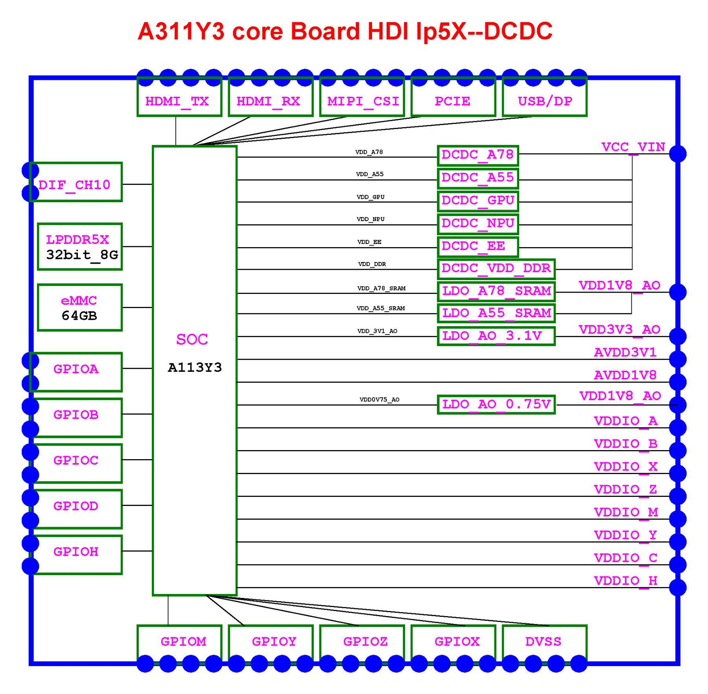
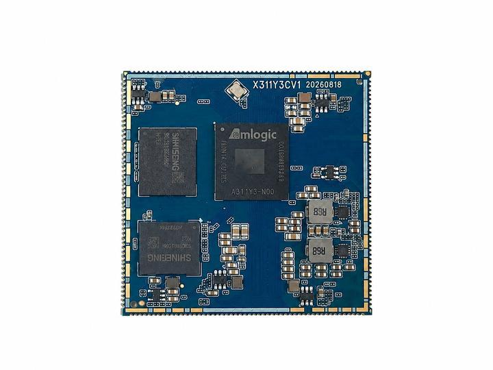
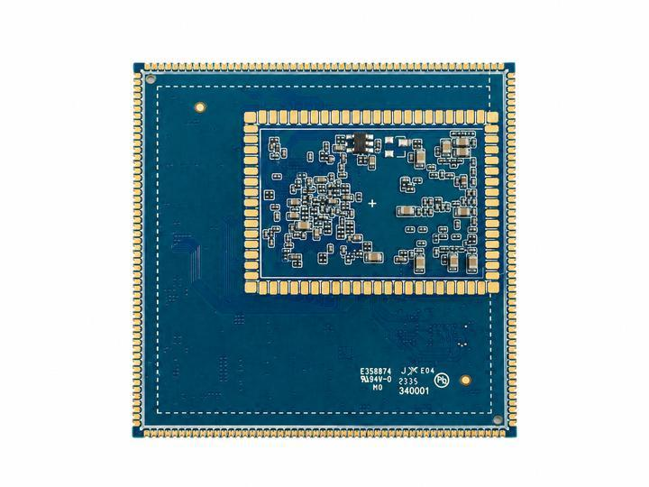
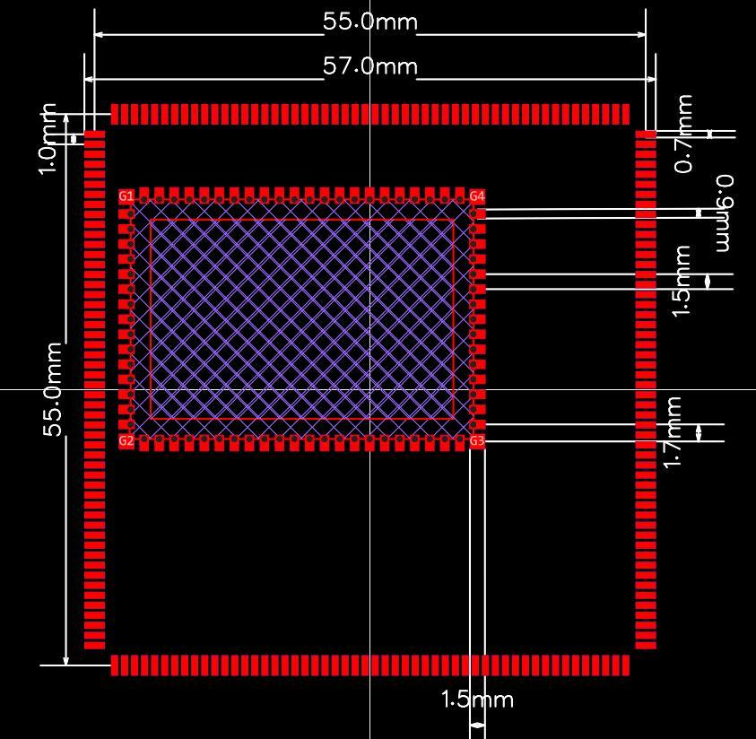

# 产品介绍

型号：**X311Y3CV1**。来源手册：**V1.1**，2026 年 10 月。

## 1.1 产品简介

X311Y3核心板（型号X311Y3CV1）是深圳市九鼎创展科技有限公司基于晶晨A311Y3处理器设计的高集成度核心板。核心板尺寸为 55mm×55mm×3.0mm，采用 286PINLGA焊盘阵列封装，板载 LPDDR5X 内存、eMMC 5.1存储、DCDC 电源，通过底部焊盘引出显示、摄像头、USB、PCIe、以太网、SDIO、音频、调试与GPIO等资源。

A311Y3采用2×Cortex-A78+6×Cortex-A55的八核异构架构，最高主频分别为2.4GHz与2.0GHz，集成 8 TOPS NPU 和 Mali-G625 MC1 GPU，支持最高 4K@120fps 视频能力，可运行Android16与Linux6.12。核心板面向边缘计算、工业控制、商业显示、智能零售、机器视觉与智能终端等场景。

## 1.2 核心特性

- 八核异构计算：2×Cortex-A78@2.4GHz+6×Cortex-A55@2.0GHz，兼顾性能与能效。

- 8TOPSNPU：支持INT4/INT8/FP16多精度推理，可用于视觉检测、边缘AI与智能交互。

- Mali-G625MC1 GPU：支持 OpenGLES3.2、Vulkan 1.4、OpenCL3.0，满足图形界面与轻量3D应用。

- LPDDR5X内存：32-bit位宽，标配8GB，可选16GB；内存直接板载，不对外引出。

- eMMC5.1存储：标配64GB，可选128GB/256GB；支持eMMC启动。

- 286PIN LGA：55mm ×55mm ×3.0mm，底部焊盘阵列，适合回流焊接；焊盘尺寸与间距以结构图/PCB为准。

- 显示接口：1 路 HDMI 2.1a TX、1 路 HDMI 2.1a RX（支持 eARC）、1 路 4-lane MIPIDSI/eDP/LVDS复用输出。

- 摄像头接口：2路4-laneMIPICSI，可连接高清摄像头或双目/多目视觉模组。

- 高速接口：USB3.0OTGType-C（支持DPAltMode）、USB3.0Host、PCIe3.0x2、PCIe2.0x1、RGMII千兆以太网。

- 低速与扩展：6 路 UART、9 路 I2C、6 路 SPI、14 路 PWM、5 通道 10-bit ADC，以及GPIOA/B/C/D/H/M/X/Y/Z等多组GPIO。

- 电源与工艺：12V输入，板内离散 DCDC 方案；PCB 10层、Tg170、沉金、过孔塞孔，工作温度-10~70°C。核心板只消耗电源，不向底板输出电源。

- 软件平台：Android 16与 Linux 6.12，提供显示、触摸、存储、USB、PCIe、以太网、Wi-Fi/BT、音频、摄像头等驱动支持。

## 1.3 系统框图

图 1-1 为 X311Y3CV1 核心板的系统框图。核心板以 A311Y3 SoC 为中心，左侧为LPDDR5X、eMMC 与 GPIO 资源，右侧为各路 DCDC/LDO 电源，顶部与底部为 HDMI、MIPICSI、PCIe、USB/DP等高速接口。该图用于理解核心板的资源划分，具体连接以原理图为准。

**图1-1 X311Y3CV1核心板系统框图**

## 1.4 结构形式

核心板采用 286PIN LGA 焊盘阵列封装，底部焊盘与底板焊盘回流焊接。模块尺寸 55mm×55mm×3.0mm（含器件），PCB板厚 1.6mm；PCB层数 10层，表面处理为化学沉金。焊盘尺寸、间距与禁布区以结构图及PCB文件为准。

**图1-2 X311Y3CV1结构示意（顶层）**

**图1-3 X311Y3CV1结构示意（底层）**

**图1-4 核心板结构参数**

## 1.5 接口资源

表 1-2汇总了核心板可提供的接口资源。表中“可用”表示SoC具备对应控制器并已引出；实际能否同时使用，取决于引脚复用、底板电路与软件配置。

**表1-2 核心板接口资源**

| 接口类别 | 资源与说明 |
| --- | --- |
| HDMI输出 | 1路HDMI2.1aTX，支持视频、音频、DDC/CEC/HPD，支持eARC。 |
| HDMI输入 | 1路HDMI2.1aRX，支持4K输入与eARC，可用于采集、监看与视频会议。 |
| MIPIDSI/eDP/LVDS | 2路4-laneDIF复用输出，可配置为MIPIDSI、eDP或LVDS。 |
| MIPICSI | 2路4-laneMIPICSI（CSI_A/B、CSI_C/D），支持高清摄像头与多摄组合。 |
| USB | 1路USB3.0OTGType-C（支持DPAltMode）、1路USB3.0Host、1路USB2.0Host、1路USB2.0OTG。 |
| PCIe | 1路PCIe3.0x2、1路PCIe2.0x1；PCIe2.0x1与USB3.0Host复用，需二选一。 |
| 以太网 | 1路RGMII千兆以太网接口 |
| Wi-Fi/Bluetooth | 1路SDIO4-bit、UART/PCM、32K时钟与控制信号，底板搭配Wi-Fi/BT模组。 |
| 音频 | I2S/PCM/PDM、SPDIF、HDMIeARC、耳机检测与麦克风输入，底板搭配AudioCodec。 |
| 存储 | 板载eMMC5.1；底板可经SDIO扩展TF/SD卡。 |
| 调试 | 1路3.3V调试UART（UART0），1路UART_F；支持Type-COTG烧录。 |
| 扩展 | 6路UART、9路I2C、6路SPI、14路PWM、5通道10-bitADC、多组GPIO（复用）。 |

## 1.6 配置选项

核心板默认配置为8GBLPDDR5X+64GBeMMC5.1。可根据项目需要选择更大内存或存储容量；订货前请与九鼎创展确认物料状态、批量与交期。

**表1-3 核心板配置选项**

| 配置项 | 标准配置 | 可选配置 | 说明 |
| --- | --- | --- | --- |
| 内存 | 8GBLPDDR5X | 16GBLPDDR5X | 32-bit位宽，板载，不对外引出 |
| 存储 | 64GBeMMC5.1 | 128GB/256GB | eMMC启动，支持BootPartition |
| 电源 | 12V输入，离散DCDC | — | 底板需提供足额12V/2A以上电源 |
| 操作系统 | Android16/Linux6.12 | 按项目定制 | 以发布固件为准 |
| 工作温度 | -10~70°C | — | 存储与运输按包装标识 |

## 1.7 应用场景

X311Y3核心板适合需要较强CPU/NPU算力、丰富显示与摄像头接口，同时对尺寸和功耗有约束的嵌入式设备。典型应用包括：

- 工业控制与人机界面：多串口、双网口扩展、HDMI/LVDS显示、触控与GPIO控制。

- 商业显示与数字标牌：HDMI输出、MIPI/eDP屏、双屏异显、音频与网络广告投放。

- 机器视觉与边缘AI：2路4-laneMIPICSI、8TOPSNPU，用于缺陷检测、识别与分拣。

- 智能零售与自助终端：Type-C/DP、USB外设、二维码扫描、打印与支付模块。

- 视频会议与医疗显示：HDMIRX采集、HDMITX输出、音频eARC与摄像头输入。

- 车载与轨道交通显示：宽温设计、HDMI/eDP长距离显示、CAN/串口扩展。

## 1.8 引脚定义

核心板286PIN焊盘按功能分为电源、显示、摄像头、USB/PCIe、以太网、SDIO、音频、调试与GPIO。各接口的引脚编号、引脚名称（含复用）与接口电源域见第3章对应表格；完整引脚编号与网络名对照见附录D。

说明：若本手册与最新原理图、引脚定义表或产品规格书存在差异，以最新版受控资料为准。量产导入前建议进行电源、时序、显示与高速接口的专项评审。

[SoC 引脚与网络定义](./x311y3-pin-definition.md) · [接口资源](./x311y3-interface-resources.md)
