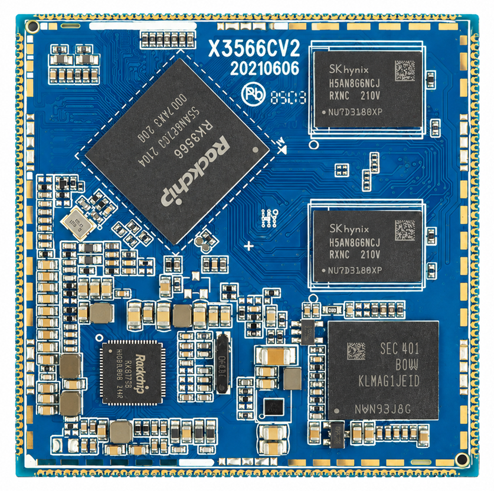
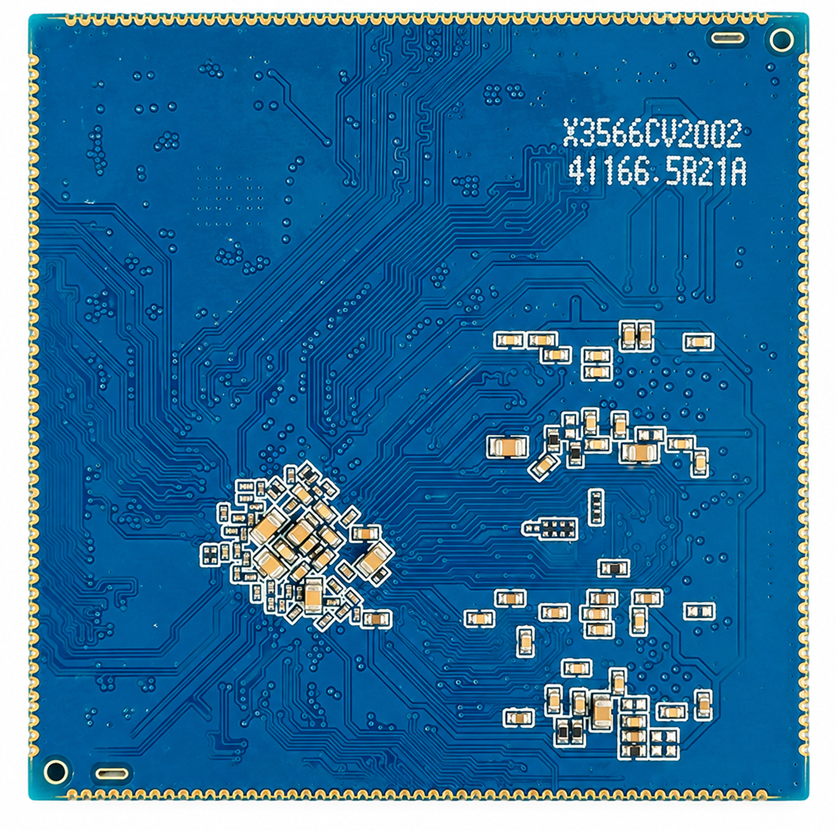
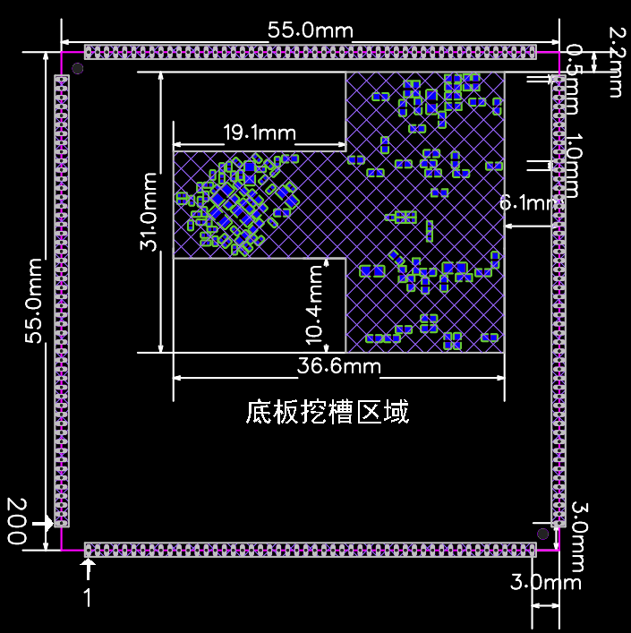
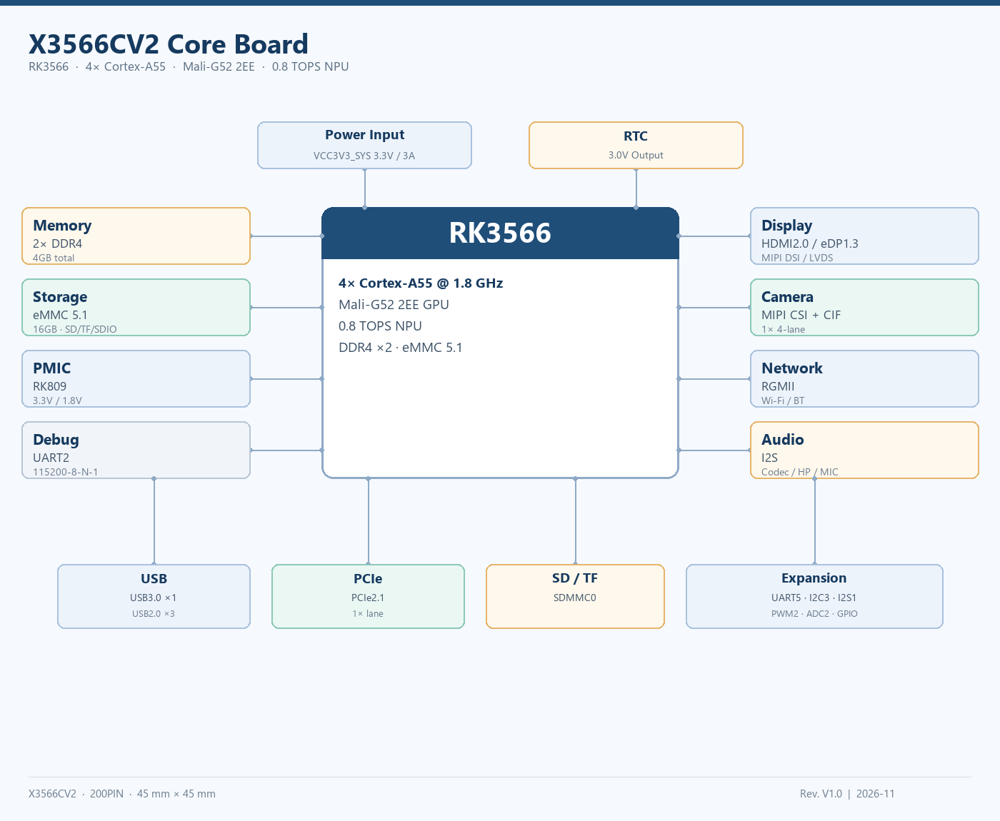

# 产品介绍

## 产品简介

X3566CV2核心板是基于瑞芯微RK3566 CPU研发的一款核心板，由深圳市九鼎创展科技有限公司自主研发、生产并销售。

RK3566系列芯片集成4核Arm Cortex-A55 CPU、Arm Mali-G52 2EE GPU和0.8 TOPS NPU，支持HDMI2.0、eDP1.3、MIPI DSI、LVDS、MIPI CSI、USB3.0/2.0、PCIe2.1、千兆以太网等接口，适用于平板、商显、工业控制与边缘计算产品。

## 核心板特性

X3566CV2核心板具有以下特性：

- 最佳尺寸，保证引出全部GPIO口的同时，尺寸仅55mm*55mm；

- 系统供电使用 PMU，在保证工作稳定可靠的同时，成本足够低廉；

- 支持多种品牌，多种容量的emmc；

- 4GB DDR4（2×2GB），eMMC标配16GB；

- 预留 WiFi/BT 控制与 SDIO 接口；

- 支持电源休眠唤醒；

- 支持HDMI2.0、eDP、MIPI DSI、LVDS、MIPI CSI、千兆以太网等高速接口；

- 采用200PIN邮票孔封装；

## 特性参数

| 系统配置 |  |
| --- | --- |
| CPU | RK3566 (Cortex-A55) |
| 主频 | 1.8GHz |
| RAM | 4GB DDR4（2×2GB） |
| ROM | 16GB eMMC（标配），可选4GB/8GB |
| 电源IC | 板载 PMIC（RK809/RK817） |
| 接口参数 |  |
| USB 接口 | 1路USB3.0 + 1路USB2.0 OTG + 2路USB2.0 Host |
| LCD 接口 | 1路HDMI2.0/1路eDP/1路MIPI DSI/1路LVDS |
| Camera 接口 | 1路MIPI CSI + 1路CIF |
| SPI 接口 | 未单独引出 |
| I2C接口 | 3路I2C接口 |
| UART接口 | 5路UART接口 |
| SDIO接口 | 2路SDIO接口（SDMMC0/SDMMC1） |
| I2S接口 | 1路I2S接口 |
| 以太网接口 | 1路千兆以太网接口 |
| PWM接口 | 2路PWM |
| PCIe接口 | 1路PCIe2.1 |
| ADC接口 | 2路ADC |
| 电气特性 |  |
| 输入电压/电流 | 4V/3A |
| 输出电压/电流 | 5V/3A（VCC5V_MIDU/VBUS）、3.3V/1.8V |
| 工作温度 | 0~70度 |
| 储存温度 | -10~50度 |

## 核心板外观

## 核心板结构图

## 核心板结构参数

| 结构参数 |  |
| --- | --- |
| 外观 | 邮票孔封装 |
| 核心板PCB尺寸 | 55mm*55mm*1.2mm |
| 引脚间距 | 1.0mm |
| 引脚数量 | 200PIN |
| 板层 | 8层 |
| 翘曲度 | 小于0.5% |

## 系统框图

X3566CV2 核心板以瑞芯微 RK3566 为核心，板载 2 颗 DDR4、eMMC 与 PMIC，对外经 200PIN 邮票孔引出 HDMI/eDP/MIPI DSI/LVDS、摄像头、USB、PCIe、以太网、音频、SD 卡、低速接口与电源。

## 接口资源

| 接口类别 | 资源与说明 |
| --- | --- |
| 显示 | 1路HDMI2.0、1路eDP1.3、1路MIPI DSI、1路LVDS |
| 摄像头 | 1路MIPI CSI、1路CIF |
| USB | 1路USB3.0、1路USB2.0 OTG、2路USB2.0 Host |
| 以太网 | 1路RGMII千兆以太网 |
| PCIe | 1路PCIe2.1 |
| 存储 | 1路SDMMC0（TF）、1路SDMMC1（SDIO） |
| 音频 | 耳机、扬声器、2路MIC |
| 低速 | 5路UART、3路I2C、1路I2S、2路PWM、2路ADC、GPIO |
| 电源 | 4V/3A输入，5V/3.3V/1.8V输出 |

## 应用场景

- 平板、学习机、商业显示与自助终端；

- 工业控制、人机界面与数据采集；

- 智能家居、门禁与楼宇对讲；

- 车载后排显示、广告机与数字标牌；

- 需要多屏、多摄像头与千兆网络的嵌入式设备。
