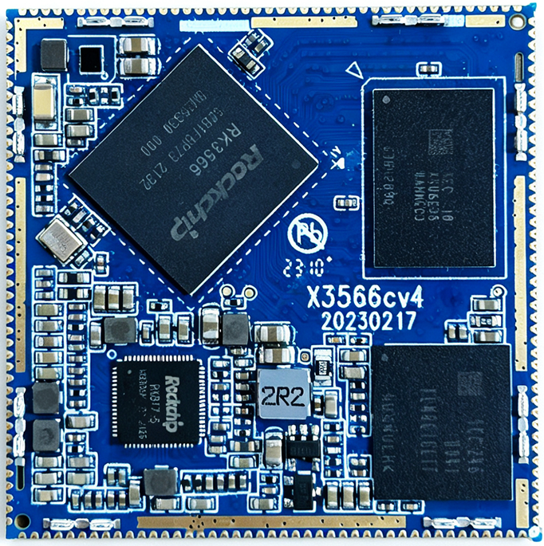
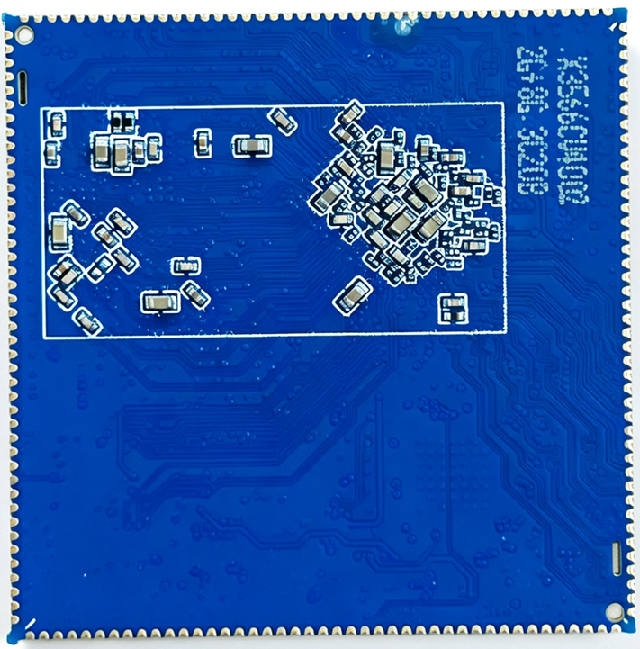

# 产品介绍

x3566cv4 是基于瑞芯微 RK3566 的核心板，采用 8 层沉金 PCB 和 172 个邮票孔焊盘，支持 Android 和 Linux。核心板通过载板引出显示、摄像头、以太网及其他外设接口。

x3566cv4 面向载板集成和嵌入式终端开发，可用于工业控制、显示终端、POS 机、自助点餐机、广告机、车载设备和教学实验平台。核心板集成处理器、内存、存储和电源管理电路，载板负责连接外部设备。

硬件支持软件开关机、休眠和唤醒。配套评估底板用于验证显示、摄像头、网络和音频等功能，实际外设搭配及可用功能取决于载板接线和系统驱动。

## 主要规格

| 项目 | 规格 |
| --- | --- |
| 处理器 | RK3566，四核 Cortex-A55，1.8 GHz |
| 内存与存储 | LPDDR4、DDR4 或 eMCP 方案，容量见下方型号表 |
| 电源管理 | RK817，支持 VBUS 或电池供电 |
| 显示与触摸 | MIPI DSI、LVDS、eDP、HDMI，支持电容触摸 |
| 摄像头 | MIPI CSI 及并口摄像头信号 |
| 网络 | 支持一路千兆以太网，载板实现物理接口 |
| USB | USB 2.0 Host、USB 3.0 Host、USB OTG |
| 音频 | 耳机、扬声器和两路麦克风输入 |
| 扩展信号 | SDMMC、UART、I2C、SPI、PWM、ADC 和 GPIO，复用关系见引脚表 |

## 功能与接口资源

| 接口 | 资源与用途 |
| --- | --- |
| 显示 | 支持 MIPI DSI、LVDS、eDP 和 HDMI，DSI 与 LVDS 共用部分引脚，由固件选择 |
| 触摸 | 支持电容触摸屏，通过载板连接对应控制接口 |
| 摄像头 | 支持 MIPI CSI 及 BT.601、BT.656、BT.1120、RAW 等并口输入，部分并口信号与以太网复用 |
| 音频 | 提供耳机和扬声器输出、麦克风输入，支持录音与播放 |
| 以太网 | 支持一路千兆以太网，接口连接和外围电路由载板实现 |
| 存储扩展 | 引出两路 SDIO 通道，可用于存储卡或 SDIO 外设；板载 eMMC 使用内部连接 |
| USB | 一路 USB 2.0 Host、一路 USB 3.0 Host 和一路 USB OTG |
| UART | 支持多组串口及流控复用功能，UART2 默认为调试串口 |
| I2C / SPI / PWM | 用于外设控制、数据通信和背光等功能，按引脚表选择复用组合 |
| ADC | 引脚表列出 ADC0、ADC1、ADC2，分别位于第 7、6、5 脚 |

同一焊盘的多个功能通过复用设置选择。设计接口时，应结合[引脚定义](./x3566cv4-pin-definition.md)核对可用信号、冲突关系和载板电平。

## 电气与结构参数

| 项目 | 参数 |
| --- | --- |
| 适配器输入 | VBUS，5 V / 2 A |
| 电池输入 | 3.5–4.2 V，典型值 3.7 V |
| 工作温度 | −10 至 70 °C |
| 储存温度 | −10 至 40 °C |
| PCB 外形 | 45 × 45 mm，模块厚度 3 mm |
| PCB 工艺 | 8 层板，沉金工艺 |
| 焊盘 | 172 个邮票孔焊盘，间距 1.0 mm，焊盘尺寸 1.3 × 0.6 mm |
| 翘曲度 | 不超过 0.5% |

电源引脚、引脚定位与回流焊参考曲线见[硬件设计与焊接](./x3566cv4-hardware-design.md)。

## 型号与容量

| 型号 | 内存类型 | 内存容量 | eMMC 容量 |
| --- | --- | --- | --- |
| x3566cv4001 | LPDDR4 | 2 GB | 16 GB |
| x3566cv4002 | LPDDR4 | 2 GB | 8 GB |
| x3566cv4101 | DDR4 | 2 GB | 16 GB |
| x3566cv4102 | DDR4 | 2 GB | 8 GB |
| x3566cv4103 | DDR4 | 4 GB | 16 GB |
| `x3566cv42**` | eMCP | 默认 2 GB | 默认 32 GB |

选型时按完整型号核对内存和 eMMC 容量。`x3566cv40**` 采用单片 LPDDR4，`x3566cv41**` 采用双片 DDR4，`x3566cv42**` 采用 eMCP。三种系列的引脚和程序兼容。`42` 后的两位数字用于区分容量配置。

## 型号变更与版本差异

### x3566cv4 系列

| 型号系列 | 内存方案 | 容量区分 | 版本关系 |
| --- | --- | --- | --- |
| `x3566cv40**` | 单片 LPDDR4 | 已列型号为 2 GB 内存，8 GB 或 16 GB eMMC | `x3566cv4001`、`x3566cv4002` 由原 `i3566cv1` 更名，统一型号命名 |
| `x3566cv41**` | 双片 DDR4 | 已列型号包含 2 GB / 4 GB 内存，8 GB / 16 GB eMMC | 采用 DDR4 方案，具体容量按完整型号区分 |
| `x3566cv42**` | eMCP | 默认 2 GB 内存、32 GB 存储，其他配置按完整型号区分 | 内存与存储采用 eMCP 方案 |

这三个系列均为 172 针、45 × 45 mm 封装。手册注明三者引脚和程序兼容，主要区别为内存方案与存储容量。`42` 后的两位数字用于区分容量配置，具体对应关系按完整型号确认。

### x3566cv2 与 x3566cv3 历史版本

| 型号 | 封装 | 内存方案 | 内存 / eMMC |
| --- | --- | --- | --- |
| x3566cv2001 | 200 针，55 × 55 mm | DDR4 | 2 GB / 16 GB |
| x3566cv2002 | 200 针，55 × 55 mm | DDR4 | 4 GB / 16 GB |
| x3566cv3001 | 200 针，55 × 55 mm | LPDDR4 | 2 GB / 16 GB |
| x3566cv3002 | 200 针，55 × 55 mm | LPDDR4 | 4 GB / 16 GB |

手册注明，x3566cv2 采用双片 DDR4，x3566cv3 采用单片 LPDDR4，两者引脚和程序兼容。x3566cv3 的版本表还列明其与 x3568cv2 的引脚和程序兼容关系，用于 RK3566 平台的成本优化选型。x3566cv4 采用 172 针、45 × 45 mm 封装，载板选型时需按对应系列的尺寸和引脚定义核对。

## 核心板外观

## 文档入口

- [引脚定义](./x3566cv4-pin-definition.md)
- [硬件设计与焊接](./x3566cv4-hardware-design.md)
