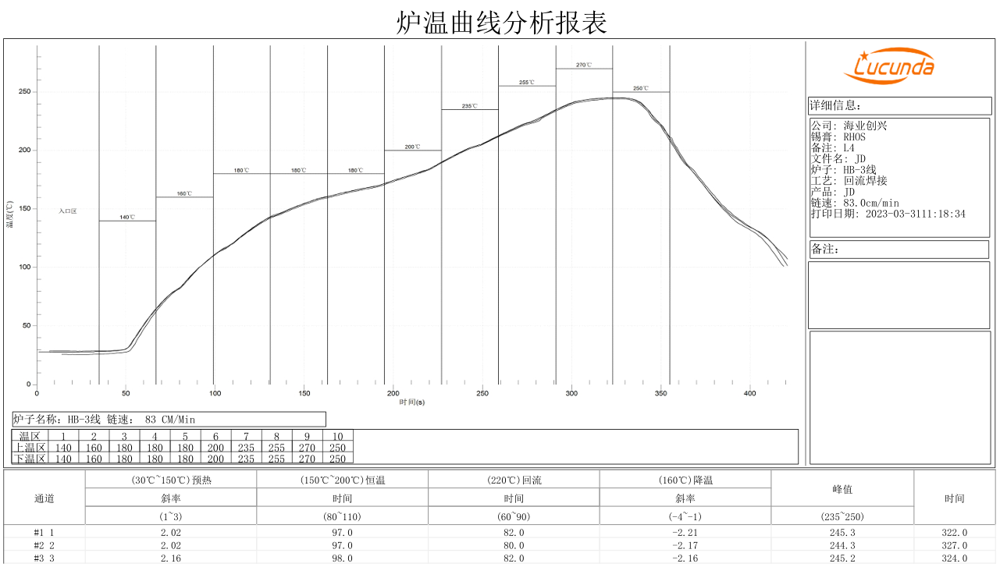

# 硬件设计与焊接

## 供电与控制

核心板使用 RK817 电源管理芯片。适配器供电使用第 146、147 脚的 `VBUS`，手册标注为 5 V / 2 A。电池输入范围为 3.5–4.2 V，典型值为 3.7 V。电池端子、检测信号及接地位置请对照[引脚定义](./x3566cv4-pin-definition.md)。

第 156 脚 `PMIC_PWRON` 低电平有效，第 157 脚 `PMIC_RESET_KEY` 用于复位。

## 接口分配

| 接口 | 引脚 | 说明 |
| --- | --- | --- |
| MIPI CSI | 70–81 | 摄像头差分信号 |
| MIPI DSI / LVDS | 83–92 | 共用一组差分引脚，由固件选择接口模式 |
| HDMI | 93–104 | 包含 DDC、CEC、热插拔检测和差分信号 |
| eDP | 120–129 | AUX 与数据差分对 |
| USB 2.0 Host | 49–50 | USB 2.0 主机差分对 |
| USB 3.0 Host | 110–115 | 含 USB 2.0 与 SuperSpeed 差分对 |
| USB OTG | 116–119 | VBUS 检测、ID 与 USB 差分对 |
| UART2 | 105–106 | 默认调试串口，分别为 RX 和 TX |

部分并口摄像头信号与 GMAC 复用。SDMMC0 的部分数据线也可复用为 UART。分配载板接口时应核对同一引脚上的功能是否冲突。

## 装配参数

| 项目 | 参数 |
| --- | --- |
| 外形尺寸 | 45 × 45 × 3 mm |
| 邮票孔焊盘数量 | 172 |
| 引脚间距 | 1.0 mm |
| 焊盘尺寸 | 1.3 × 0.6 mm |
| 翘曲度 | ≤ 0.5% |

载板封装方向请对照[引脚定位图](./x3566cv4-pin-definition.md)确认。原手册给出的工作温度为 −10 至 70 °C，储存温度为 −10 至 40 °C。

## 回流焊参考曲线

核心板与载板一起过炉前，应按实际回流炉、锡膏和装配条件标定温度曲线。下图为原手册提供的炉温测试记录。

