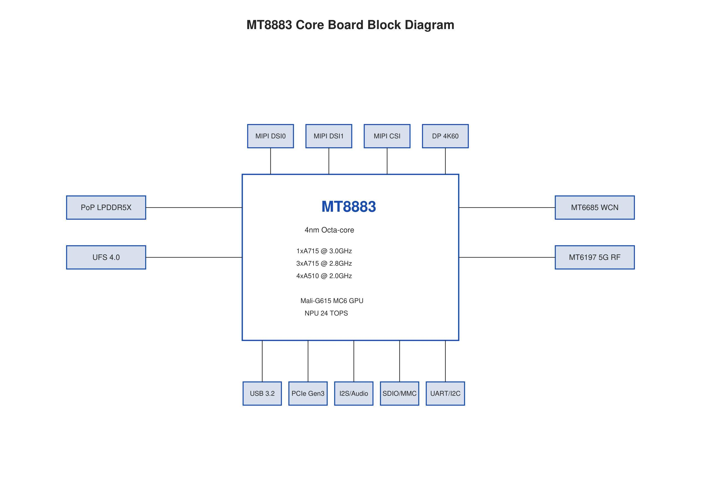
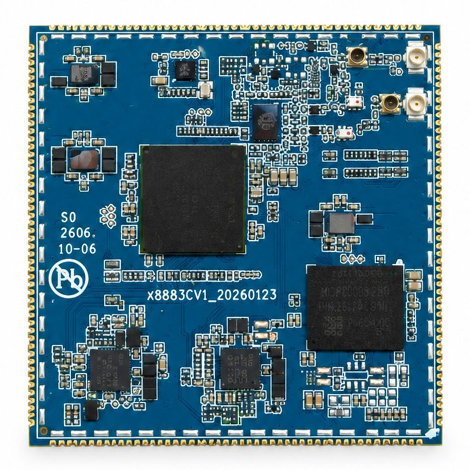
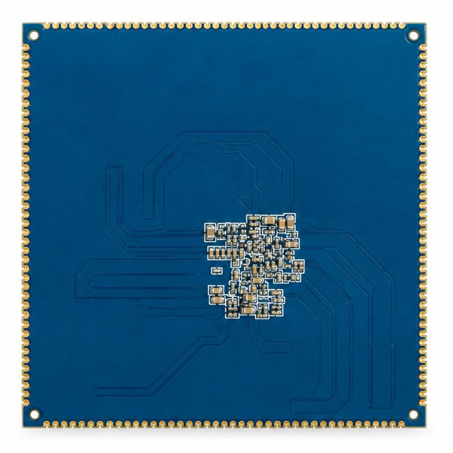
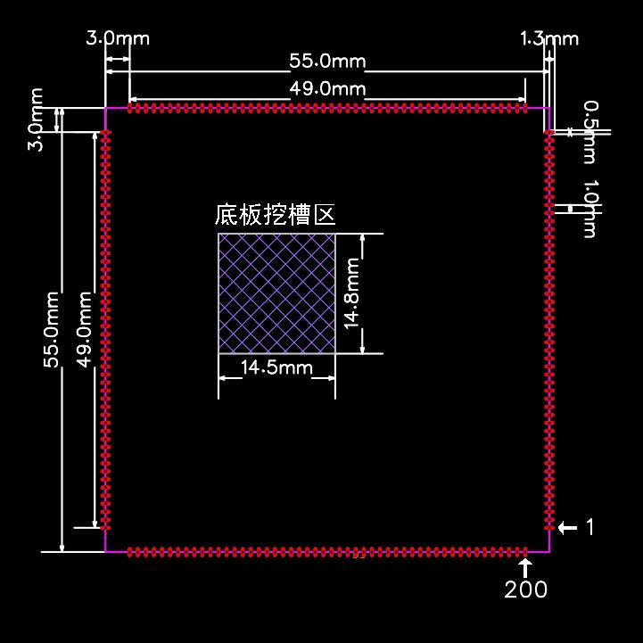

# 产品介绍

X8883 核心板型号为 **X8883CV1**，本系列文档依据《X8883核心板开发手册》V1.0（2026 年 10 月）整理。原稿封面及部分章节使用 MT8883/MT8883CV1 名称，本文产品型号统一使用 X8883CV1，处理器名称沿用原稿 MT8883。

## 处理器与板载资源

核心板基于联发科 MT8883，采用 4 nm 工艺，集成 PoP LPDDR5/LPDDR5X、UFS、MT6363/MT6368 PMIC、3 颗 MT6319 多相 Buck、MT6375 充电管理及 MT6685 无线连接。适用于边缘 AI、机器人、工业物联网、智能显示与移动终端。

| 项目 | 手册规格 |
| --- | --- |
| CPU | 4× Cortex-A715（1×3.0 GHz + 3×2.8 GHz）+ 4× Cortex-A510 @2.0 GHz |
| GPU | Mali-G615 MC6 @900 MHz；Vulkan / OpenCL |
| NPU | 第 7 代 APU，24 TOPS；INT4 / INT8 / FP16 |
| 内存 | PoP LPDDR5/5X，4×16 bit @8533 Mbps；8 GB，可选 12/16/24 GB |
| 显示 | 双路 MIPI DSI，最高 3200×2000 @144 Hz；DP 4K60 |
| 摄像头 | 多路 MIPI CSI-2，最高 200 MP ISP |
| 高速扩展 | USB 3.2 Gen1 DRD / DP Alt Mode；PCIe Gen3 ×1 |
| 无线能力 | 5G Rel.16 Sub-6 GHz、4G Cat.18、双 SIM；Wi-Fi 6E、BT 5.3、GNSS L1+L5 |

以上为手册描述的平台能力。200 PIN 实际引出信号见接口资源与引脚定义；无线、蜂窝和外设能否使用还取决于具体物料、底板及固件。原稿低速接口总量与实际引出数量不同，设计时应按逐脚定义分配。

## 存储与工作条件

原稿正文及订货章节列出 8 GB 内存 + 128 GB UFS 3.0，配置表另列 UFS 4.0 64 GB、可选 128/256 GB；温度条目分别出现 -20 至 75°C 与 0 至 60°C。内存、UFS 代际/容量和工作温度需按具体批次规格确认，本文不将其中一种写为统一标准配置。

## 系统框图

## 核心板外观与结构

采用 200 PIN 邮票孔引出。结构图标注外形 55 mm × 55 mm、有效引脚区 49 mm、间距 1.0 mm、底板挖空区约 14.5 mm × 14.8 mm。生产封装、焊盘及禁布区应以受控 PCB/结构文件为准。

## 文档导航

- [硬件架构](./x8883-hardware-architecture.md)

- [接口资源](./x8883-interface-resources.md)

- [PCB 设计](./x8883-pcb-design.md)

- [引脚定义](./x8883-pin-definition.md)
