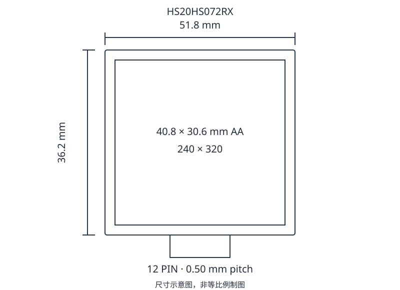
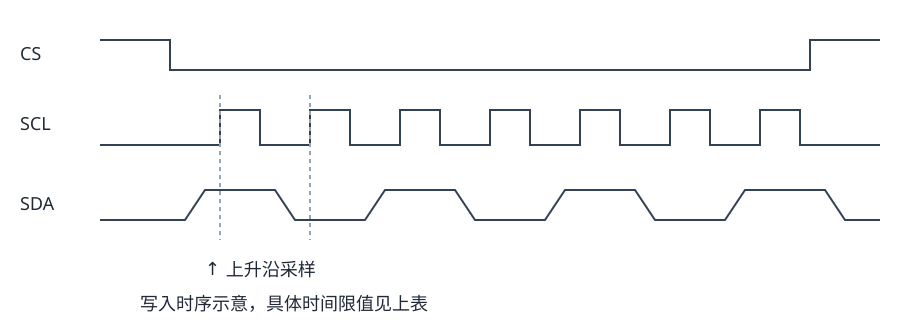

# 2寸 240 × 320 显示模组

HS20HS072RX 是透射式 a-Si TFT 彩色液晶模组，集成显示面板、驱动芯片、FPC 和侧入式 LED 背光，采用 4 线 SPI 接口。

## 产品参数

| 项目 | 参数 |
| --- | --- |
| 分辨率 | 240 (RGB) × 320 |
| 显示模式 | a-Si TFT，透射式 |
| 外形尺寸 | 51.80 × 36.20 mm |
| 显示区域 | 40.80 × 30.60 mm |
| 像素排列 | RGB 条纹 |
| 像素间距 | 0.151 × 0.153（单位待确认） |
| 显示颜色 | 262K |
| 视角方向 | ALL |
| 驱动芯片 | ST7789T3 |
| 接口 | SPI 4W |
| 背光 | 4 颗白色 LED 并联 |
| 重量 | TBD |

尺寸信息需确认：产品描述写为 2.4 inch，而结构图标注 2.0 inch。像素间距表的数值与单位也不完全匹配；选型与装配以实物尺寸核对。

## 极限参数

极限参数不代表正常工作条件。超过限值或施加反向电压可能造成永久损坏。低温下响应会变慢，长时间高温可能损伤偏光片。

| 项目 | 符号 | 最小值 | 典型值 | 最大值 | 单位 |
| --- | --- | --- | --- | --- | --- |
| 接口电源 | IOVCC | −0.3 | — | 4.6 | V |
| 模拟电源 | VCI | −0.3 | — | 4.6 | V |
| TFT 栅极导通电压 | VGH | −0.3 | — | 30 | V |
| TFT 栅极关断电压 | VGL | −0.3 | — | 30 | V |
| 背光正向电流 | IF | — | — | 80 | mA |
| 工作温度 | TOPR | −20 | — | 70 | °C |
| 储存温度 | TSTG | −30 | — | 80 | °C |
| 湿度 | RH | — | — | 90 (≤60 °C) | %RH |

## 电气特性

测试温度为 25 ± 2 °C。TBD 表示尚未确定的参数。

| 项目 | 符号 | 最小值 | 典型值 | 最大值 | 单位 |
| --- | --- | --- | --- | --- | --- |
| 接口电源 | IOVCC | 1.65 | 1.8 | 3.3 | V |
| 模拟电源 | VCI | 2.4 | 2.75 | 3.3 | V |
| 正常工作电流 | IDD | — | TBD | — | mA |
| 休眠电流 | IDD-SLEEP | — | TBD | — | µA |
| 输入低电平 | VIL | GND | — | 0.3 × IOVCC | V |
| 输入高电平 | VIH | 0.7 × IOVCC | — | IOVCC | V |
| 输出低电平（IOL = 1 mA） | VOL | GND | — | 0.2 × IOVCC | V |
| 输出高电平（IOH = −1 mA） | VOH | 0.8 × IOVCC | — | IOVCC | V |

## 背光特性

| 项目 | 符号 | 最小值 | 典型值 | 最大值 | 单位 |
| --- | --- | --- | --- | --- | --- |
| 正向电压（IL = 80 mA） | Vf | 2.8 | 3.0 | 3.2 | V |
| 正向电流 | IL | — | 80 | — | mA |
| 亮度 | Lv | TBD | TBD | — | cd/m² |
| LED 寿命（IL = 80 mA） | — | 20000 | 25000 | — | h |

背光采用 4 颗 LED 并联。

寿命定义为在 IL = 80 mA 下，亮度降至初始值 50% 的时间。超过 80 mA 工作会缩短寿命。

## 结构尺寸

| 项目 | 参数 |
| --- | --- |
| LCM 外形 | 51.8 × 36.2 mm |
| 显示区域 | 40.8 × 30.6 mm |
| LCD 尺寸 | 46.6 × 33.6 mm |
| 主模组厚度 | 2.05 ± 0.05 mm |
| FPC 厚度 | 0.3 mm |
| FPC 接口 | 12PIN，0.50 mm 间距 |
| 一般公差 | ±0.2 mm |



## 引脚定义

| 引脚 | 信号 | 功能 |
| --- | --- | --- |
| 1 | GND | 电源地 |
| 2 | CS | 片选输入 |
| 3 | RS | 命令/参数选择 |
| 4 | SCL | 串行接口时钟 |
| 5 | SDA | 数据输入，在 SCL 上升沿采样 |
| 6 | RST | 复位输入 |
| 7 | NC | 不连接 |
| 8 | I/O-VCC | 接口逻辑电源，2.8 V |
| 9 | VCC | 逻辑电源，2.8 V |
| 10 | A | 背光阳极 |
| 11 | K | 背光阴极 |
| 12 | GND | 电源地 |

## 光学特性

| 项目 | 符号 | 数值 |
| --- | --- | --- |
| 中心对比度 | C/R | 最小 280，典型 300 |
| 亮度均匀性 | UW | ≥80 % |
| 响应时间 | Tr + Tf | 30 ms |
| 上视角 | θT | 45° |
| 下视角 | θB | 20° |
| 左视角 | θL | 45° |
| 右视角 | θR | 20° |

| 色度坐标 | 最小值 | 典型值 | 最大值 |
| --- | --- | --- | --- |
| 白 x | 0.288 | 0.308 | 0.328 |
| 白 y | 0.305 | 0.325 | 0.345 |
| 红 x | 0.592 | 0.612 | 0.632 |
| 红 y | 0.309 | 0.329 | 0.349 |
| 绿 x | 0.279 | 0.299 | 0.319 |
| 绿 y | 0.547 | 0.567 | 0.587 |
| 蓝 x | 0.124 | 0.144 | 0.164 |
| 蓝 y | 0.090 | 0.110 | 0.130 |

白场中心亮度尚未给定；表内 ±15% 标记不能作为绝对亮度值。视角以 CR ≥10 定义。

- 对比度 CR = 全白画面中心亮度 / 全黑画面中心亮度。
- 响应时间为白转黑与黑转白的时间之和。
- 测量应在暗室、稳定温度和无风条件下进行。

- 背光点亮并稳定 30 min 后，在屏幕中心测量。
- 亮度均匀性 = 九点最小白场亮度 / 九点最大白场亮度 ×100%。九点位于 3×3 等分区域的中心。

## SPI 时序

4 线串行接口，SDA 在 SCL 上升沿采样。以下时间单位均为 ns。

| 信号 | 符号 | 参数 | 最小值 | 最大值 |
| --- | --- | --- | --- | --- |
| CSX | TCSS (write) | 片选建立时间（写） | 15 | — |
| CSX | TCSH (write) | 片选保持时间（写） | 15 | — |
| CSX | TCSS (read) | 片选建立时间（读） | 60 | — |
| CSX | TCSH (read) | 片选保持时间（读） | 65 | — |
| CSX | TCHW | 片选高电平脉宽 | 40 | — |
| SCL | TSCYCW | 写时钟周期 | 66 | — |
| SCL | TSHW | 写时钟高电平 | 15 | — |
| SCL | TSLW | 写时钟低电平 | 15 | — |
| SCL | TSCYCR | 读时钟周期 | 150 | — |
| SCL | TSHR | 读时钟高电平 | 60 | — |
| SCL | TSLR | 读时钟低电平 | 60 | — |
| D/CX | TDCS | 命令/数据建立时间 | 10 | — |
| D/CX | TDCH | 命令/数据保持时间 | 10 | — |
| SDA | TSDS | 数据建立时间 | 10 | — |
| SDA | TSDH | 数据保持时间 | 10 | — |
| DOUT | TACC | 读访问时间 | 10 | 50 |
| DOUT | TOH | 输出关闭时间 | 15 | 50 |



## 可靠性测试

| 测试项目 | 条件 |
| --- | --- |
| 高温存储 | 80 °C / 240 h |
| 低温存储 | −30 °C / 240 h |
| 高温工作 | 70 °C / 240 h |
| 低温工作 | −20 °C / 240 h |
| 温度循环 | −10 °C → 25 °C → 50 °C，每段 30 min，共 10 次 |
| 高温高湿存储 | 60 °C / 90%RH / 120 h |
| 振动 | 10 → 55 → 10 Hz，振幅 1.5 mm，X/Y/Z 各 2 h |
| 包装跌落 | 1 m 高度，1 角、3 棱、6 面 |
| 静电 | ±8 kV 空气放电，330 Ω / 150 pF，3 或 5 次 |

每组 5–10 个样品，每个样品仅进行一项试验。试验后室温存放 2–4 h，再检查气泡、漏液、不显示、缺段、玻璃裂纹、表面损伤和电气特性。高温高湿试验使用电阻大于 10 MΩ 的纯水；ESD 后复位可恢复正常的样品可判定为良品。

## 外观与显示检验

下表点状、像素、线状及偏光片缺陷的数量限值用于 A 区，B 区对此类外观缺陷忽略；液晶盒内部气泡在 A、B 区均不允许。

以下长度单位为 mm。点状缺陷等效直径按长短轴平均值计算，W 为宽度，L 为长度。

| 检查项 | 要求 |
| --- | --- |
| 点状异物/黑白点/气泡 | Φ ≤ 0.10 mm 忽略；0.10 &lt; Φ ≤ 0.20 mm 允许 2；Φ &gt; 0.20 mm 不允许；B/C 类总数 ≤3。 |
| 像素点缺陷 | 0.15 &lt; Φ ≤ 0.20 mm，亮点、暗点、相邻两像素缺陷及总数均 N ≤2。 |
| 线状缺陷 | W ≤0.03 mm 且 L ≤3.0 mm 忽略；0.03 &lt; W ≤0.05 mm 且 L ≤3.0 mm 允许 2；W &gt;0.05 mm 不允许。 |
| 对比度变化 | Φ ≤0.10 mm 忽略；0.10 &lt; Φ ≤0.30 mm 允许 2；Φ &gt;0.30 mm 不允许；总数 ≤2。 |
| 液晶盒内部气泡 | 任意尺寸均不允许。 |
| 偏光片气泡/凹凸 | Φ ≤0.30 mm 忽略；0.30 &lt; Φ ≤0.50 mm 允许 2；Φ &gt;0.50 mm 不允许；总数 ≤2。 |
| 多余玻璃 | 台阶残余玻璃 b ≤0.3 mm；周边残余不得影响外形尺寸和装配。 |
| MURA | 红绿蓝画面不允许可见 MURA；黑屏应不明显，按 6% ND 和限度样品判断。黑/灰屏 D ≤0.10 mm 忽略；0.10 &lt; D ≤0.30 mm，N ≤2；D &gt;0.30 mm 不合格。 |
| 玻璃端子侧崩裂 | a ≤t 且 b ≤1.0 mm 时 c 不限；a ≤t、1 ≤b ≤2 mm 时 c ≤3 mm；涉及对位标记时 b ≤0.5 mm，且不得覆盖线路及标记。 |
| 周边与角部崩裂 | 非接触侧不得越过封胶内边界；接触侧不得越过封胶外边界。角部 a ≤t、b ≤3.0 mm、c ≤3.0 mm，不得影响线路。 |
| FPC 与焊接 | 不允许虚焊、短路、断路、毛刺和锡珠；元件偏移小于引脚宽度 1/2；导线缺口小于线宽 1/2，毛刺小于间隙 1/2；连接器接触部位不得有焊锡和严重凹陷。 |

## 使用与储存

- 固定模组时避免扭曲、弯折、强冲击或局部挤压。
- 勿直接触摸导电端子和裸露电路，操作人员及工具应接地；使用手套或指套，缓慢剥离保护膜。
- 避免长期显示同一静止画面，以减少残影。
- 避免低于储存温度范围的环境，以防液晶凝固、气泡和显示异常。
- 使用密封、防静电包装，避免偏光片表面与其他物体接触。
- 避光储存，避免阳光及强紫外线。

储存环境建议 0–35 °C、相对湿度低于 60%。水滴和油污应立即清除；轻污用柔软干布，重污可用异丙醇或乙醇湿润软布清洁，勿用水、丙酮、甲苯等不适合的溶剂。液晶泄漏物须远离眼和口，接触皮肤或衣物后用肥皂彻底清洗。

## 焊接要求

| 产品类型 | 温度 | 时间 |
| --- | --- | --- |
| 非 RoHS | 290–350 °C | 3–5 s |
| RoHS | 340–370 °C | 3–5 s |

使用接地、无漏电的烙铁；焊后清除残余助焊剂，无卤型助焊剂按其工艺要求处理。

## 初始化代码

以下保留初始化命令、数据和调用顺序。delay() 的实现须与实际平台匹配；此代码使用 ST7789V 名称，而参数表列为 ST7789T3，移植时须核对控制器版本。

```c
void ST7789V_INITIAL(void)
{
RES =1;
delay(100);
RES =0;
delay(200);
RES =1;
delay(500);
LCD_WriteCommand(0x11);
delay(120);
LCD_WriteCommand(0x36);
LCD_WriteData(0x00); // 竖屏显示
LCD_WriteCommand(0x3a);
LCD_WriteData(0x05);
LCD_WriteCommand(0xb2);
LCD_WriteData(0x0c);
LCD_WriteData(0x0c);
LCD_WriteData(0x00);
LCD_WriteData(0x33);
LCD_WriteData(0x33);
LCD_WriteCommand(0xb7);
LCD_WriteData(0x35);
LCD_WriteCommand(0xbb);
LCD_WriteData(0x20);
LCD_WriteCommand(0xc0);
LCD_WriteData(0x2c);
LCD_WriteCommand(0xc2);
LCD_WriteData(0x01);
LCD_WriteCommand(0xc3);
LCD_WriteData(0x0b);
LCD_WriteCommand(0xc4);
LCD_WriteData(0x20);
LCD_WriteCommand(0xc6);
LCD_WriteData(0x0f);
LCD_WriteCommand(0xd0);
LCD_WriteData(0xa4);
LCD_WriteData(0xa1);
LCD_WriteCommand(0xe0);
LCD_WriteData(0xd0);
LCD_WriteData(0x03);
LCD_WriteData(0x09);
LCD_WriteData(0x0e);
LCD_WriteData(0x11);
LCD_WriteData(0x3d);
LCD_WriteData(0x47);
LCD_WriteData(0x55);
LCD_WriteData(0x53);
LCD_WriteData(0x1a);
LCD_WriteData(0x16);
LCD_WriteData(0x14);
LCD_WriteData(0x1f);
LCD_WriteData(0x22);
LCD_WriteCommand(0xe1);
LCD_WriteData(0xd0);
LCD_WriteData(0x02);
LCD_WriteData(0x08);
LCD_WriteData(0x0d);
LCD_WriteData(0x12);
LCD_WriteData(0x2c);
LCD_WriteData(0x43);
LCD_WriteData(0x55);
LCD_WriteData(0x53);
LCD_WriteData(0x1e);
LCD_WriteData(0x1b);
LCD_WriteData(0x19);
LCD_WriteData(0x20);
LCD_WriteData(0x22);
LCD_WriteCommand(0x29);
}
```
