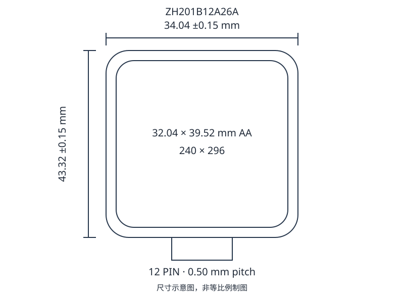

# 2寸 240 × 296 显示模组

ZH201B12A26A 是透射式 TFT 液晶显示模组，采用 JD9853 驱动芯片、4 线 SPI 接口和四颗并联 LED 背光。

## 产品参数

| 项目 | 参数 |
| --- | --- |
| 显示尺寸 | 2.01 inch |
| 分辨率 | 240 (RGB) × 296 |
| 显示模式 | TFT，透射式 |
| 视角方向 | 全视角 |
| 外形尺寸 | 34.04 × 43.32 × 1.86 mm |
| 显示区域 | 32.04 × 39.52 mm |
| 驱动芯片 | JD9853 |
| 显示颜色 | 65K |
| 接口 | 4-wire SPI |
| 输入电压 | 2.8 / 3.3 V |

## 极限参数

极限参数不代表正常工作条件。超过限值或施加反向电压可能造成永久损坏。低温下响应会变慢，长时间高温可能损伤偏光片。

| 项目 | 符号 | 最小值 | 典型值 | 最大值 | 单位 |
| --- | --- | --- | --- | --- | --- |
| 逻辑电源电压 | Vdd | −0.3 | — | 3.3 | V |
| 输入电压 | Vin | −0.3 | — | Vdd + 0.3 | V |
| 工作温度 | Top | −20 | — | 70 | °C |
| 储存温度 | Tst | −30 | — | 80 | °C |
| 湿度 | RH | — | — | 90 (≤60 °C) | %RH |

## 电气特性

测试温度为 25 ± 2 °C。TBD 表示尚未确定的参数。

| 项目 | 符号 | 最小值 | 典型值 | 最大值 | 单位 |
| --- | --- | --- | --- | --- | --- |
| 逻辑电源 | Vdd − Vss | 2.6 | 2.8 | 3.3 | V |
| 输入电流 | Idd | — | TBD | TBD | mA |
| 输入高电平 | VIH | 0.8 × IOVCC | — | IOVCC | V |
| 输入低电平 | VIL | — | — | 0.2 × IOVCC | V |
| 输出高电平 | VOH | 0.8 × IOVCC | — | IOVCC | V |
| 输出低电平 | VOL | — | — | 0.2 × IOVCC | V |

## 背光特性

| 项目 | 符号 | 最小值 | 典型值 | 最大值 | 单位 |
| --- | --- | --- | --- | --- | --- |
| 正向电压 | Vf | 2.8 | 3.2 | 3.3 | V |
| 亮度（IF = 80 mA） | Lv | 300 | — | — | cd/m² |
| 均匀性（20 mA/LED） | Avg | 80 | — | — | % |

背光采用 4 颗 LED 并联。

## 结构尺寸

| 项目 | 参数 |
| --- | --- |
| LCM 外形 | 34.04 ± 0.15 × 43.32 ± 0.15 mm |
| LCD 尺寸 | 33.84 ± 0.10 × 43.12 ± 0.10 mm |
| CF 尺寸 | 33.44 × 41.52 mm |
| 偏光片尺寸 | 33.04 × 41.12 mm |
| 显示区域 | 32.04 × 39.52 mm |
| 厚度 | 1.86 mm |
| FPC 接口 | 12PIN，0.50 mm 间距 |

## 引脚定义

| 引脚 | 信号 | 功能 |
| --- | --- | --- |
| 1 | GND | 模拟电路地 |
| 2 | K | LED 背光阴极 |
| 3 | A | LED 背光阳极 |
| 4 | VCC | 接口逻辑电源 |
| 5 | GND | 模拟电路地 |
| 6 | GND | 模拟电路地 |
| 7 | RS | 寄存器选择 |
| 8 | CS | 片选 |
| 9 | SCL | 串行接口时钟 |
| 10 | SDA | SPI 数据输入/输出 |
| 11 | RESET | 复位，初始化时使用 |
| 12 | GND | 模拟电路地 |

背光引脚需确认：接口定义表写为 2 = K、3 = A；结构图写为 2 = LEDA、3 = LEDK。两处极性相反，接线前须确认实物。

## 光学特性

| 项目 | 符号 | 数值 |
| --- | --- | --- |
| 透过率 | T | 4.5 % |
| 对比度 | CR | 800 |
| 响应时间 | Ton + Toff | 30（单位待确认） |
| 红色色度 | x / y | x 待确认 / 0.322 |
| 绿色色度 | x / y | 0.290 / 0.588 |
| 蓝色色度 | x / y | 0.134 / 0.124 |
| 白色色度 | x / y | 0.298 / 0.328 |

- 对比度 CR = 全白画面中心亮度 / 全黑画面中心亮度。
- 响应时间为白转黑与黑转白的时间之和。
- 测量应在暗室、稳定温度和无风条件下进行。

## 可靠性测试

| 测试项目 | 条件 |
| --- | --- |
| 高温存储 | 80 °C / 48 h |
| 低温存储 | −30 °C / 240 h；−40 °C / 8 h |
| 高温工作 | 70 °C / 48 h |
| 低温工作 | −20 °C / 48 h |
| 高温高湿工作 | 60 °C / 95%RH / 48 h |
| 冷热冲击 | −40 °C（30 min）↔ 80 °C（30 min），48 次 |

试验后在室温下放置 4 h，再检查外观、显示功能和连接。不得有明显外观/质量缺陷或功能异常；连接应牢固；对比度不得低于初始值的 30%。

## 外观与显示检验

以下长度单位为 mm。点状缺陷等效直径按长短轴平均值计算，W 为宽度，L 为长度。

| 检查项 | 要求 |
| --- | --- |
| 背光 | 不允许无背光；亮度、均匀性、功耗和色度须满足参数。 |
| 铁壳 | 不允许明显损坏、变形和锡渣。 |
| FPC | 不允许金手指明显划伤、污点、异物、氧化、电镀不良及焊盘脱落或断裂；补强板破损/气泡面积不得超过 1/5。 |
| 线状缺陷/划伤 | W ≤ 0.05 mm 可接受；0.05 &lt; W ≤ 0.10 mm 且 L ≤ 5 mm，允许 1 处。 |
| 点状缺陷 | D ≤ 0.10 mm 可接受；0.10 &lt; D ≤ 0.20 mm 允许 2 处；0.20 &lt; D ≤ 0.25 mm 允许 1 处；D &gt; 0.25 mm 不允许。 |
| TP 鱼眼/凹点/气泡 | D ≤ 0.20 mm 可接受；0.20 &lt; D ≤ 0.30 mm 允许 6 处；0.30 &lt; D ≤ 0.50 mm 允许 2 处；D &gt; 0.50 mm 不允许。 |
| 缺陷统计 | D = (长边 X + 短边 Y)/2；点缺陷间距 &gt; 5 mm；点线缺陷允许总数 5。 |
| 牛顿环 | 均匀环面积 &gt; TP 面积 1/4 不允许；小于 1/4 且不影响字体可接受。不均匀环无荧光灯时 &gt;7 mm 不允许；荧光灯下造成文字或直线变形均不允许。 |
| 裂纹 | 任何有延伸趋势的裂纹均不接受。 |
| 显示偏斜 | S &lt; 0.3 mm 可接受；0.3 ≤ S &lt; 0.5 mm 为 Minor；S ≥ 0.5 mm 为 Major。 |
| 显示功能 | 不允许缺行、缺列、串扰、乱码、错误视角、水波纹、抖动和视区内漏液/气泡。 |
| 偏光片/反射片 | 不得贴反、漏贴、贴错或缺少保护膜；划伤、异物按点线缺陷判定。 |
| COG 区 | IC 不得破损或划伤；封口胶不得进入视区；涂布胶不得高于上偏光片并须覆盖端子 ITO。 |

玻璃崩裂补充：X 为崩裂长度、Y 为宽度、Z 为厚度，a 为玻璃边长，t 为玻璃厚度。表面/中间崩裂 Z ≤t/2、X ≤a；角部崩裂 Z ≤t/2、X ≤a/8；不得进入封胶内缘，适用位置须保留 1/2 封胶宽度。端子区正面 X ≤a/5、Y ≤0.5 mm、Z ≤t；背面 Z ≤t/2。多处崩裂的 X 按总长计算，不得进入视区；单个电极崩裂宽度不超过电极宽度 1/4。

## 使用与储存

- 固定模组时避免扭曲、弯折、强冲击或局部挤压。
- 勿直接触摸导电端子和裸露电路，操作人员及工具应接地；使用手套或指套，缓慢剥离保护膜。
- 避免长期显示同一静止画面，以减少残影。
- 避免低于储存温度范围的环境，以防液晶凝固、气泡和显示异常。
- 使用密封、防静电包装，避免偏光片表面与其他物体接触。
- 避光储存，避免阳光及强紫外线。

长期储存建议 0–35 °C、40–60%RH。水分与污染物应及时清除。
