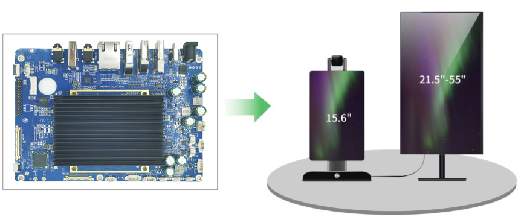
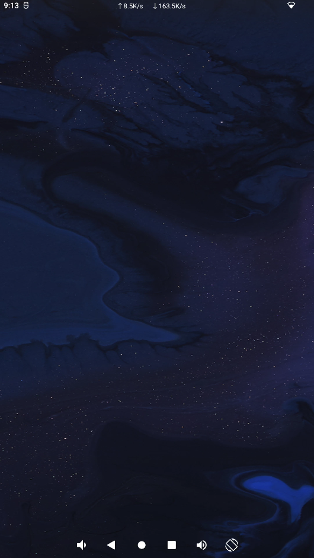
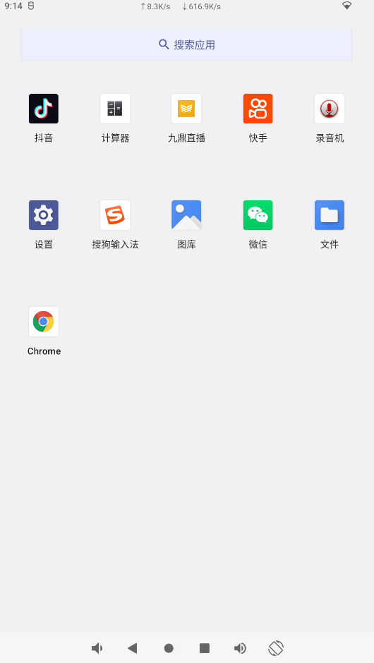
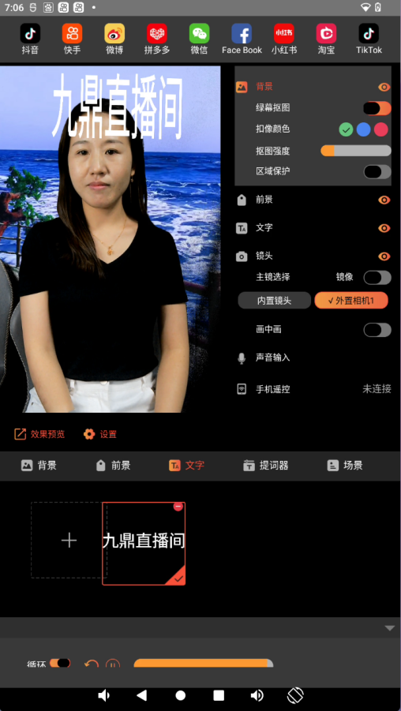
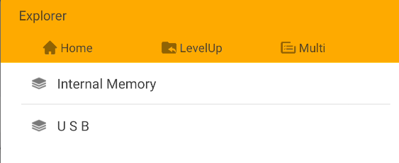
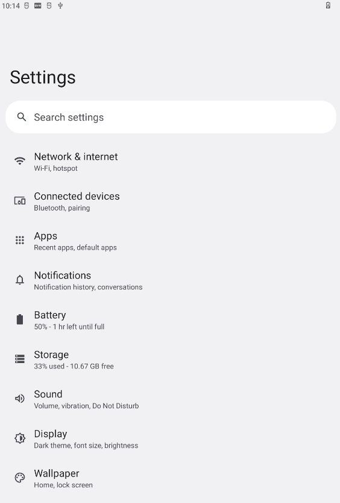
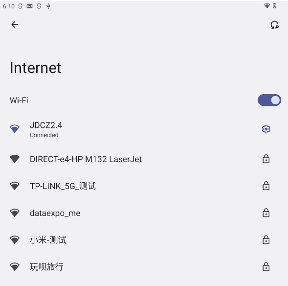

# live3588 直播主板

本页面介绍 LIVE3588 主板的定位、平台和主要能力。具体硬件配置以对应版本及实际交付板卡为准。

主板基于 RockChip RK3588，采用八核 64 位 CPU（4×Cortex-A76 + 4×Cortex-A55），支持 Android 12.0。

## 主要文档

- [硬件资源](./live3588-hardware-resources.md)
- [硬件接口定义](./live3588-interface-details.md)
- [Android 使用指南](./android/live3588-android-guide.md)

## 产品图片

