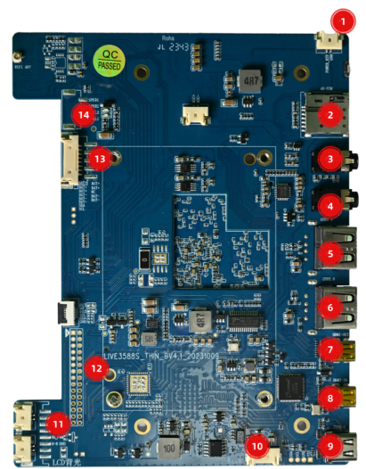
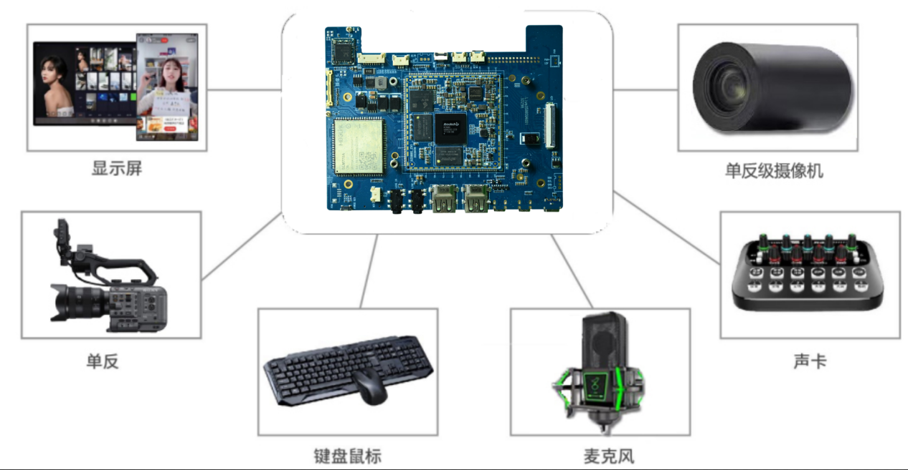
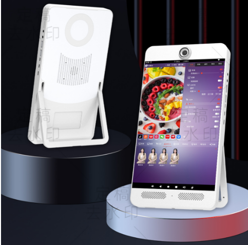
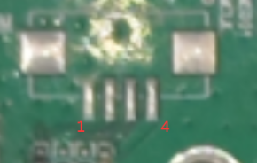
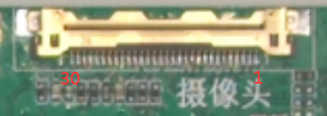
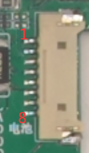
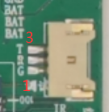
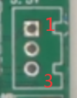

# live3588sv4 直播机主板

本页面介绍 LIVE3588SV4 主板的定位、平台和主要能力。具体硬件配置以对应版本及实际交付板卡为准。

本手册对应 V4 版本资料。LIVE3588V4 与 LIVE3588SV4 使用不同 SoC 版本及板型，参数和连接器定义不可混用。

## 主要文档

- [硬件资源](./live3588sv4-hardware-resources.md)
- [硬件接口定义](./live3588sv4-interface-details.md)
- [Android 使用指南](./android/live3588sv4-android-guide.md)

## 产品图片

