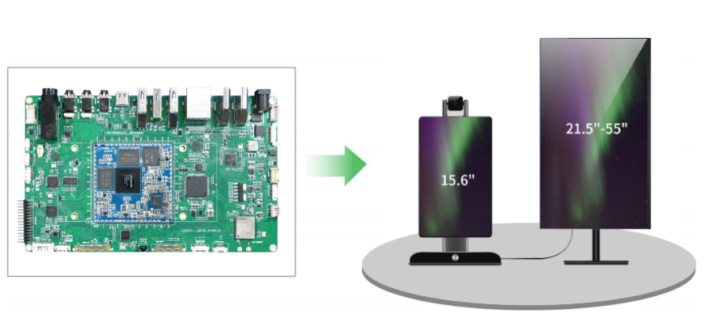
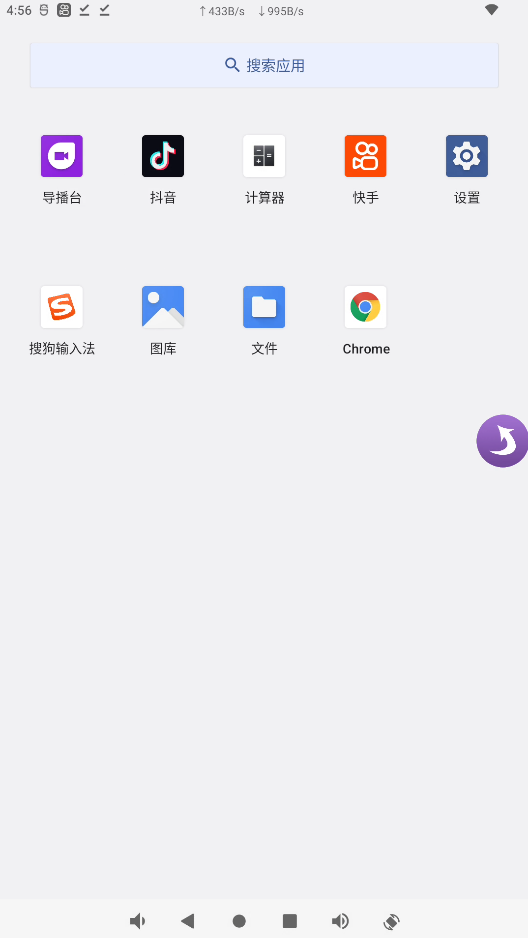
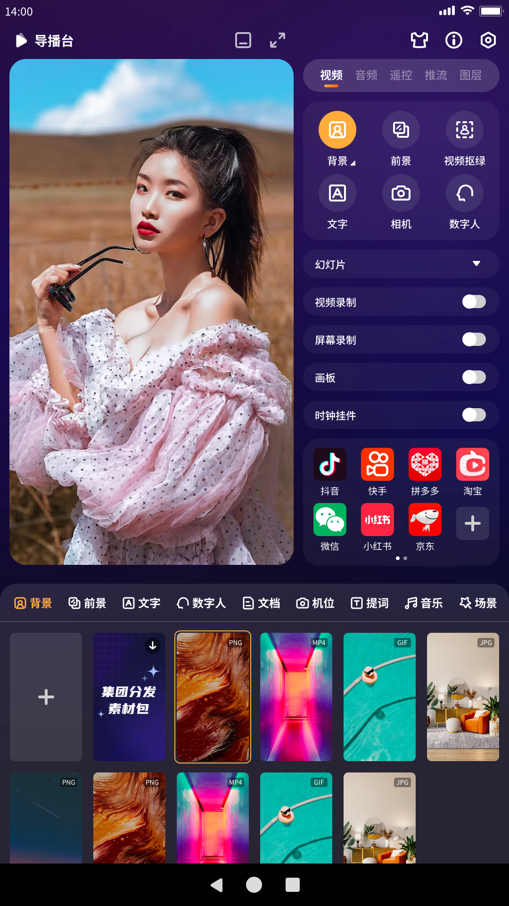
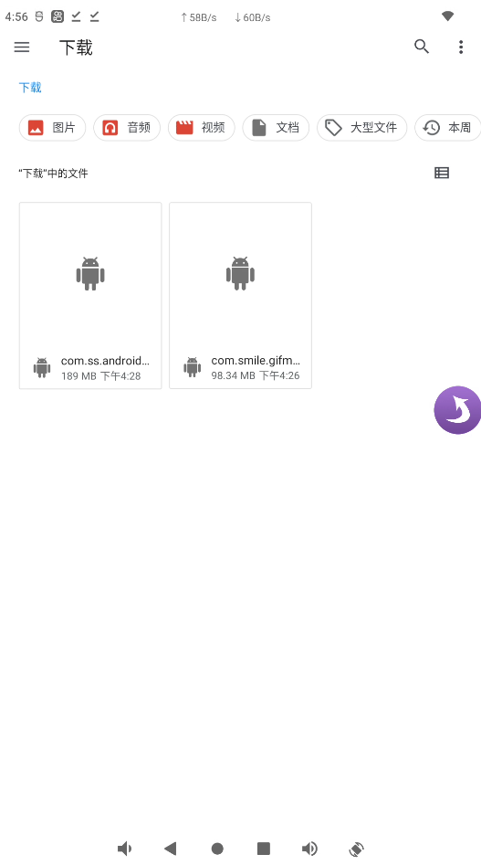
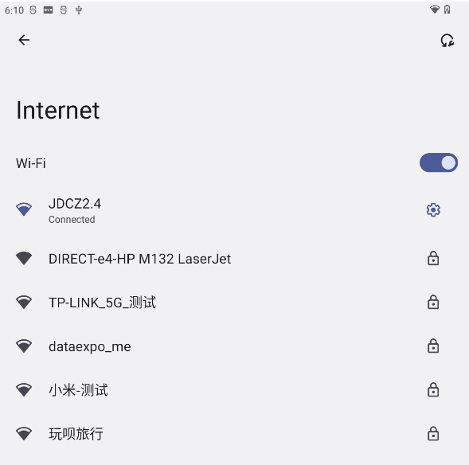
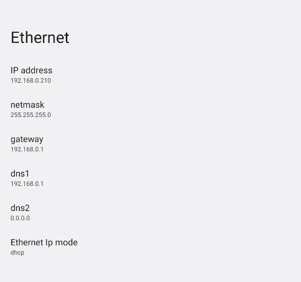
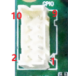
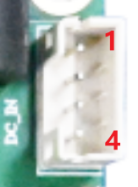

# live3588sv53 直播主板

本页面介绍 LIVE3588SV53 主板的定位、平台和主要能力。具体硬件配置以对应版本及实际交付板卡为准。

该版本为 Live3588 主板 V5.3 迭代版本，面向直播应用，集成视频采集与音频处理相关能力。手册指出其可用于摄像头画面、主播声音及 HDMI 输入内容的组合直播场景。

## 主要文档

- [硬件资源](./live3588sv53-hardware-resources.md)
- [硬件接口定义](./live3588sv53-interface-details.md)
- [Android 使用指南](./android/live3588sv53-android-guide.md)

## 产品图片

