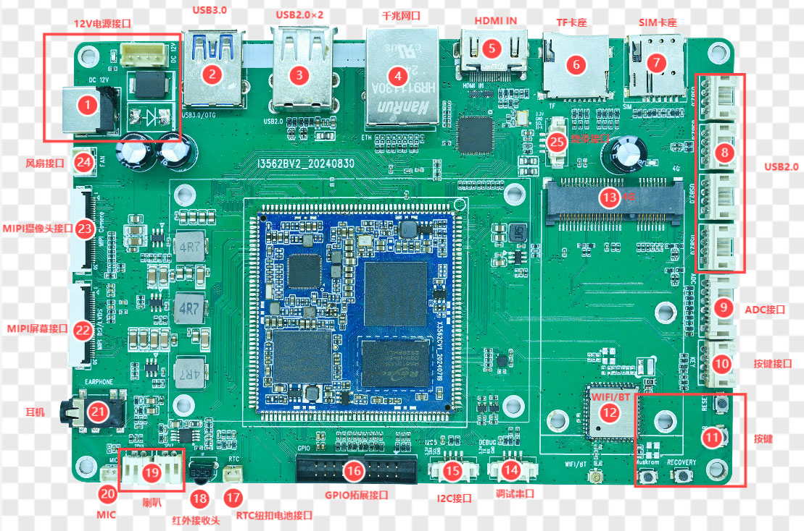

# 硬件资源与规格

## 1. 系统配置

| 资源 | 规格 |
|---|---|
| SoC | Rockchip RK3562 |
| CPU | Quad-core ARM Cortex-A53，最高 2.0 GHz |
| NPU | 集成 NPU，面向轻量级 AI 应用 |
| RAM | 2 GB / 4 GB / 8 GB |
| eMMC | 4 GB / 8 GB / 16 GB / 32 GB / 64 GB |
| PMIC | RK809-5A，支持动态调频 |

RAM 和 eMMC 容量为可选配置，不代表每块板均同时具备所有容量。

## 2. 机械与环境参数

| 项目 | 参数 |
|---|---|
| PCB 尺寸 | 150 mm × 99 mm × 1.6 mm |
| 工作温度 | 0～70 ℃ |
| 存储温度 | -10～50 ℃ |
| 推荐输入电源 | 12 V / 3 A |

## 3. 接口资源汇总

| 接口类别 | 数量 / 规格 | 备注 |
|---|---|---|
| 显示 | 1 路 MIPI-DSI / LVDS 复用 | 只能二选一 |
| 触摸 | I2C 电容触摸 | 与显示模组配套 |
| 摄像头 | 1 路 MIPI-CSI | 30PIN |
| HDMI | 1 路 HDMI 2.0 IN | LT6911C 转 MIPI |
| Ethernet | 1 路千兆以太网 | RGMII，RTL8211F |
| USB 2.0 | 6 路 HOST | 含 HUB 扩展的 4 路 4PIN |
| USB 3.0 | 1 路 OTG | Host / Device 切换，可用于烧录 |
| SD | 1 路 SDIO / TF 卡 | 支持 TF 卡启动或存储 |
| eMMC | 板载 | 管脚不单独引出 |
| PCIe | 1 路扩展接口 | 可接 4G 模块 |
| UART | UART0 | TTL 调试串口 |
| I2C | I2C5 扩展 | 4PIN |
| GPIO | 2×10PIN | 20PIN 简牛座 |
| ADC | 5 路信号 | 6PIN 接口，含 GND |
| Audio | IIS / PCM / PDM / SPDIF | 双声道喇叭、耳机、MIC |
| 其他 | RTC、IR、风扇 | 风扇供电 12 V |

## 4. 主板接口位置

接口编号与硬件手册第 9～10 页的标注对应。正面主要接口包括：

1. 12 V 电源输入
2. USB 3.0
3. 双层 USB 2.0
4. 千兆以太网
5. HDMI IN
6. TF 卡座
7. SIM 卡座
8. 4 路 USB 2.0 4PIN
9. ADC 扩展
10. 按键扩展
11. BOOT / RESET / POWER / RECOVERY 等按键
12. Wi-Fi / BT 模块
13. 4G 模块接口
14. UART0 调试串口
15. I2C5 扩展
16. GPIO 扩展
17. RTC 纽扣电池接口
18. 红外接收头
19. 双声道扬声器
20. MIC
21. 耳机接口
22. MIPI-DSI / LVDS
23. MIPI-CSI
24. 12 V 风扇
25. LT6911C 烧录接口

## 5. 供电注意事项

- 主板 DC 输入为 12 V，硬件手册建议使用 12 V / 3 A 适配器。
- 4PIN 电源座定义：Pin 1、2 为 12 V；Pin 3、4 为 GND。
- 风扇接口为 2PIN：Pin 1 GND，Pin 2 12 V。
- 外接显示屏、USB 设备、4G 模块及扬声器时，应核算整板负载和电源余量。

## 6. 标配与选配

手册列出的标配包括开发板、12 V / 3 A 电源适配器、USB A 数据线、USB 转串口转接板及资料。选配包括扬声器、8 GB TF 卡和 7 英寸 1024×600 MIPI 电容触摸屏模组。
