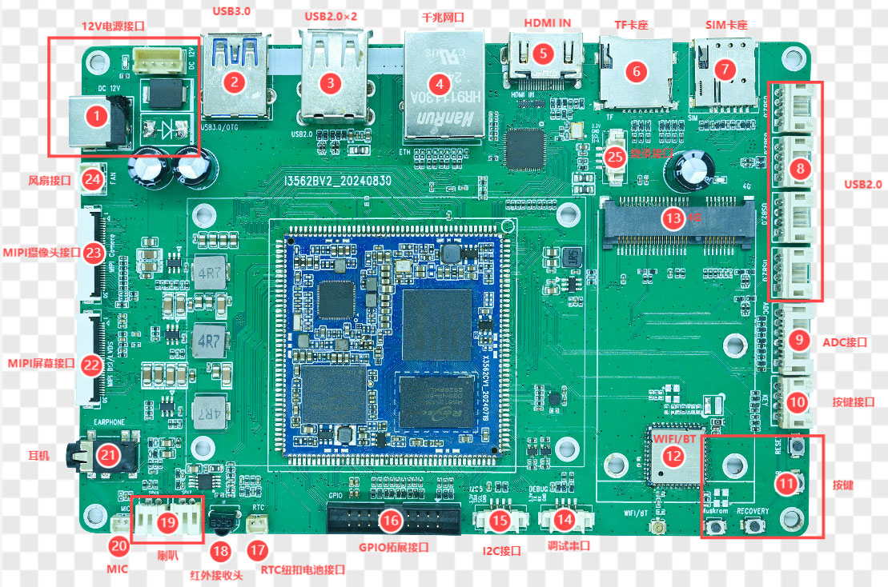

# 接口定义与引脚说明

本页整理《I3562 开发板硬件手册》中的连接器定义。连接前请再次核对 PCB 丝印、连接器方向和实际线序，禁止仅凭线缆颜色判断引脚。

## 1. 电源输入

### DC 输入

- 输入电压：12 V DC
- 建议适配器：12 V / 3 A

### 4PIN 电源座

| Pin | 信号 |
|---:|---|
| 1 | 12 V |
| 2 | 12 V |
| 3 | GND |
| 4 | GND |

## 2. UART0 调试串口

| Pin | 信号 |
|---:|---|
| 1 | GND |
| 2 | UART0_RX_DEBUG |
| 3 | UART0_TX_DEBUG |
| 4 | 3.3 V |

UART0 默认作为调试串口，接口为 TTL 电平。串口波特率请以当前 SDK 的 U-Boot / Kernel 配置为准；不同用户手册示例中的波特率存在差异，不应将示例值直接当作所有版本的固定值。

## 3. USB 2.0 4PIN 扩展口

| Pin | 信号 |
|---:|---|
| 1 | 5 V |
| 2 | DM |
| 3 | DP |
| 4 | GND |

板上有双层 USB 2.0 Type-A 接口，以及 4 路由 HUB 扩展的 4PIN USB 2.0 接口。

## 4. MIPI-DSI / LVDS 复用接口（30PIN）

| Pin | 信号 | Pin | 信号 |
|---:|---|---:|---|
| 1 | VCC_5V0 | 16 | GND |
| 2 | VCC_5V0 | 17 | D3N |
| 3 | VCC_5V0 | 18 | D3P |
| 4 | VCC3V3_S3 | 19 | GND |
| 5 | VCC3V3_S3 | 20 | D2N |
| 6 | I2C2_SCL_TP | 21 | D2P |
| 7 | I2C2_SDA_TP | 22 | GND |
| 8 | TP_INT_L | 23 | CLK N |
| 9 | TP_RST_L | 24 | CLK P |
| 10 | VCC3V3_S3 | 25 | GND |
| 11 | VCC3V3_S3 | 26 | D1N |
| 12 | LCD_BL_PWM | 27 | D1P |
| 13 | LCD_RST | 28 | GND |
| 14 | NC | 29 | D0N |
| 15 | LCD_PWREN_H | 30 | D0P |

差分信号名称在原手册中标注为 `MIPI_DSI_TX_* / LVDS_TX_*` 复用信号。该接口只能配置为 MIPI 或 LVDS 其中一种，不能同时工作。

## 5. MIPI-CSI 接口（30PIN）

| Pin | 信号 | Pin | 信号 |
|---:|---|---:|---|
| 1 | GND | 16 | GND |
| 2 | MIPI_CSI_RX0_CLK0P | 17 | NC |
| 3 | MIPI_CSI_RX0_CLK0N | 18 | NC |
| 4 | GND | 19 | MIPI_AF |
| 5 | MIPI_CSI_RX0_D0P | 20 | I2C4_SCL_M0 |
| 6 | MIPI_CSI_RX0_D0N | 21 | I2C4_SDA_M0 |
| 7 | GND | 22 | CAM_CLK0_OUT |
| 8 | MIPI_CSI_RX0_D1P | 23 | CAM_CLK1_OUT |
| 9 | MIPI_CSI_RX0_D1N | 24 | CAM_PDN1_L |
| 10 | GND | 25 | CAM_PDN0_L |
| 11 | MIPI_CSI_RX0_D2P | 26 | CAM_RST1_L |
| 12 | MIPI_CSI_RX0_D2N | 27 | CAM_RST0_L |
| 13 | GND | 28 | VCC1V8_CAM3 |
| 14 | MIPI_CSI_RX0_D3P | 29 | VCC2V8_CAM3 |
| 15 | MIPI_CSI_RX0_D3N | 30 | MIPI_1.2V_CAM3 |

## 6. 按键接口

| Pin | 信号 |
|---:|---|
| 1 | BOOT_KEY |
| 2 | RESET_KEY |
| 3 | PWRON_KEY |
| 4 | GND |

板上按键功能在硬件手册中描述为 BOOT、复位、开关机和烧录相关按键。实际按键名称及操作时序应以 PCB 丝印和当前 U-Boot 烧录流程为准。

## 7. 风扇接口

| Pin | 信号 |
|---:|---|
| 1 | GND |
| 2 | 12 V |

## 8. 红外接收接口

| Pin | 信号 |
|---:|---|
| 1 | PWM0_CH0_M0_IR |
| 2 | GND |
| 3 | 3.3 V |

## 9. ADC 扩展接口（6PIN）

| Pin | 信号 |
|---:|---|
| 1 | SARADC0_IN1 |
| 2 | SARADC0_IN3 |
| 3 | SARADC0_IN5 |
| 4 | SARADC0_IN6 |
| 5 | SARADC0_IN7 |
| 6 | GND |

## 10. I2C5 扩展接口（4PIN）

| Pin | 信号 |
|---:|---|
| 1 | 3.3 V |
| 2 | I2C5_SDA |
| 3 | I2C5_SCL |
| 4 | GND |

## 11. GPIO 扩展接口（2×10PIN）

| Pin | 信号 | Pin | 信号 |
|---:|---|---:|---|
| 1 | GND | 2 | GPIO3_B1 |
| 3 | GND | 4 | GPIO4_B0 |
| 5 | GPIO0_C0 | 6 | GPIO3_A2 |
| 7 | GPIO0_C4 | 8 | GPIO3_A3 |
| 9 | GPIO2_A1 | 10 | GPIO3_A4 |
| 11 | GPIO3_A6 | 12 | GPIO3_A5 |
| 13 | GPIO3_A7 | 14 | GND |
| 15 | GPIO3_B0 | 16 | VCC_5V0 |
| 17 | GND | 18 | VCC_3V3 |
| 19 | GND | 20 | GND |

## 12. 其他接口说明

- **PCIe + SIM：** SIM 卡座需配合 PCIe 4G 模块使用。
- **HDMI IN：** 标准 Type-A HDMI 输入，采用 LT6911C 将 HDMI 信号转换为 MIPI 信号。
- **LT6911C 烧录接口：** Pin 1 3.3 V、Pin 2 GND、Pin 3 CSCL、Pin 4 CSDA。
- **音频：** 板载耳机、MIC 和双声道扬声器接口。
- **RTC：** 纽扣电池用于断电后维持 RTC 计时。
- **Wi-Fi / BT：** 硬件手册标注模块型号 BL-M8821CSI；采购和量产前需核对实际 BOM。
