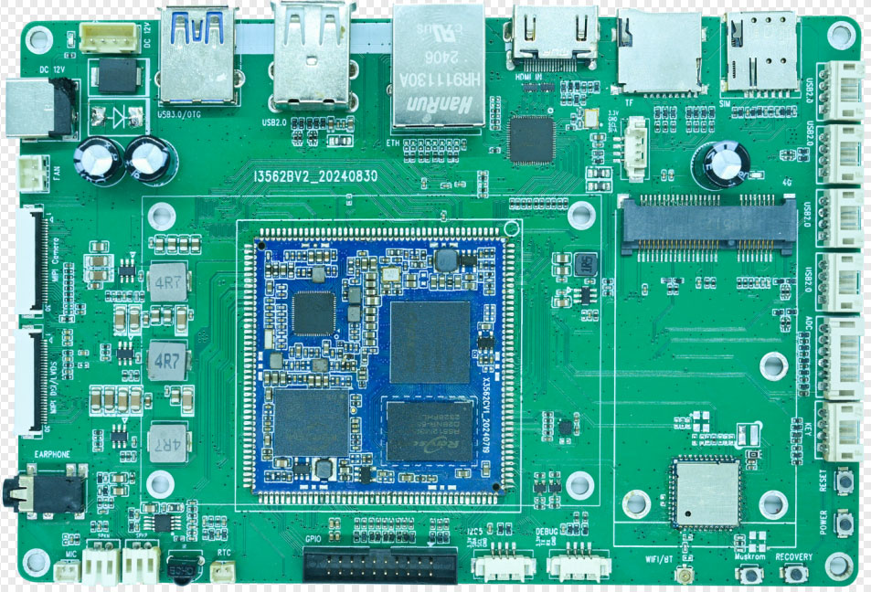

# i3562bv2 主板简介

## 产品概述

I3562BV2 是基于 Rockchip RK3562 的开发板，由深圳市九鼎创展科技有限公司研发。主控采用四核 64 位 ARM Cortex-A53，最高主频 2.0 GHz，集成 NPU，适用于嵌入式 Linux、Android 及轻量级边缘 AI 应用。

> 图片来源：I3562 开发板硬件手册（Rev.02，2024-11-09）。照片中 PCB 丝印可见 `I3562BV2_20240830`。

## 主要硬件规格

| 项目 | 规格 |
|---|---|
| SoC | Rockchip RK3562 |
| CPU | 四核 ARM Cortex-A53 |
| CPU 主频 | 最高 2.0 GHz |
| RAM | 2 GB / 4 GB / 8 GB（依配置） |
| eMMC | 4 GB / 8 GB / 16 GB / 32 GB / 64 GB（依配置） |
| PMIC | RK809-5A |
| 供电 | DC 12 V，建议 12 V / 3 A |
| PCB 尺寸 | 150 mm × 99 mm × 1.6 mm |
| 工作温度 | 0～70 ℃ |
| 存储温度 | -10～50 ℃ |

## 主要接口

- 1 路 MIPI-DSI / LVDS 复用显示接口（两者不能同时使用）
- 1 路 MIPI-CSI 摄像头输入
- 1 路 HDMI 2.0 输入（LT6911C 转换为 MIPI 信号）
- 1 路千兆以太网（RGMII，RTL8211F）
- 1 路 USB 3.0 OTG
- 6 路 USB 2.0 HOST（其中 4 路通过 HUB 扩展为 4PIN 接口）
- TF 卡、SIM 卡及 PCIe 扩展
- Wi-Fi / Bluetooth 模块（手册标注 BL-M8821CSI）
- UART0 调试串口、I2C5、ADC、GPIO 扩展
- 双声道扬声器、耳机、MIC、红外接收及 12 V 风扇接口

## 文档导航

- [硬件资源与规格](./hardware-resources.md)
- [接口定义与引脚说明](./interfaces.md)
- [Linux 编译与烧录](./linux/build-and-flash.md)
- [Linux 驱动与调试](./linux/drivers-debug.md)
- [Android 编译与烧录](./android/build-and-flash.md)
- [Android 使用与调试](./android/usage-debug.md)

## 资料版本

当前文档依据以下资料整理：

- 《I3562 开发板硬件手册》，Rev.02，2024-11-09
- 《RK3562 Linux 平台用户手册》，Rev.01，2024-11-08
- 《RK3562 Android 平台用户手册》（随当前资料包提供）

SDK 分支、实际 BOM、无线模块料号和串口波特率应以项目实际版本为准。
