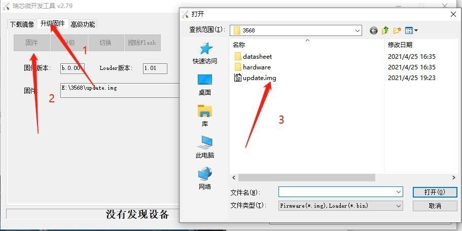
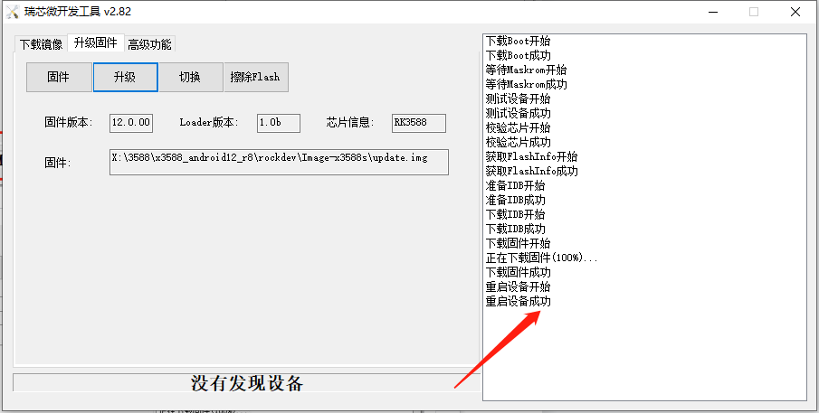

# Android 固件烧录

## 单板 USB 烧录

1. 备份数据，从 `rockdev/Image-rk3568_r/` 选择对应板型的 Android `update.img`。
2. 在 Windows 安装配套 DriverAssitant v5.1.1，打开 SDK 中的 AndroidTool v2.79。
3. 在“升级固件”页选择镜像，将 OTG 开关拨到 Device。
4. 按住 VOL+/RECOVERY 并连接 Micro USB 数据线和 12 V 电源。等待工具识别设备，再点击“升级”。
5. 等待写入完成后启动系统，检查显示、触摸、网络和外设。

## 批量烧录

解压 SDK 的 `RKTools/windows/FactoryTool_v1.66.zip`，打开 FactoryTool，选择匹配的固件、勾选“升级”并点击“启动”。按单板操作让各板进入下载模式，工具将按端口显示升级状态。确认每台结果后再拔线或接入下一台。

Android TF 卡升级流程尚未验证，当前使用 USB 升级。工具未识别时，优先核对 OTG 位置、供电、USB 数据线和驱动版本。
