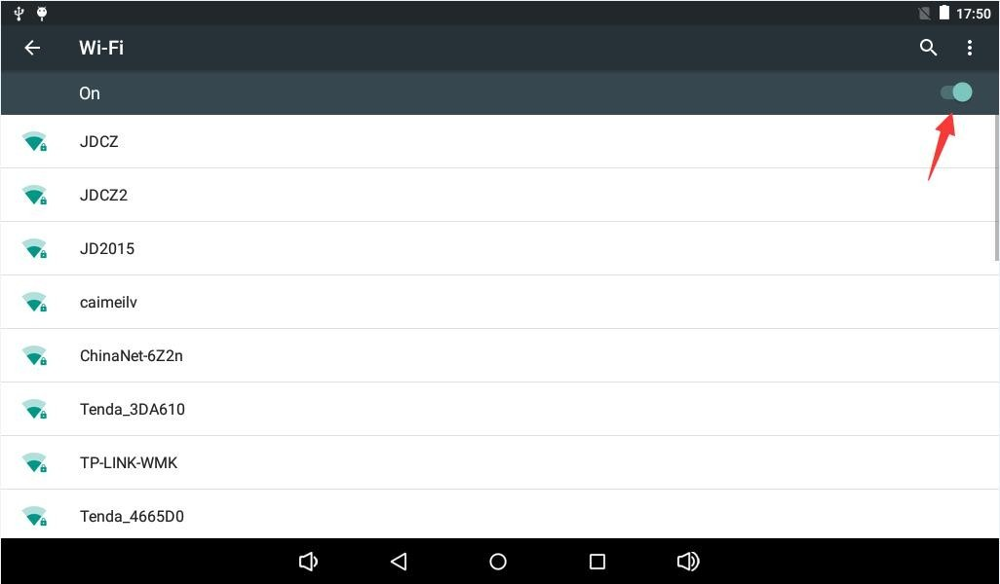
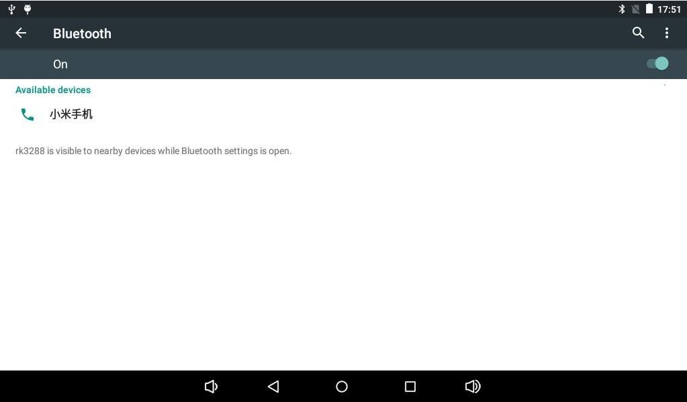
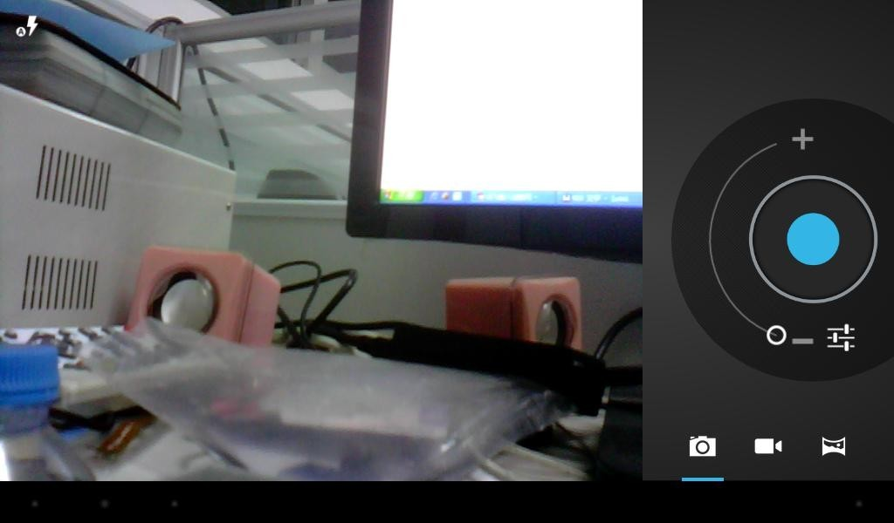

# Android 使用指南

## 串口与 ADB

连接 UART2，选择对应串口，设置 115200、8 数据位、无校验、1 停止位，关闭流控。若固件使用其他波特率，以板端实际配置为准。ADB 需在开发者选项打开 USB 调试，将 OTG 切到 Device 并确认主机授权。

```bash
adb devices
adb shell
```

连接多个设备时，使用 `adb -s <序列号> shell` 指定目标。

## 网络与蓝牙

在设置中进入 Network & Internet，打开 Wi-Fi 并连接热点，或连接以太网并检查网口灯和 IP。进入 Connected devices 的蓝牙设置搜索设备，两端确认配对。配对后可通过分享菜单传输文件，或通过蓝牙音箱播放媒体。





## 显示、音视频与存储

HDMI 可同步输出音视频，分辨率按固件与显示器支持选择。摄像头连接后打开相机检查预览，再切换拍照或录像。媒体应用可播放 TF 卡或 U 盘中的文件。连接 USB 鼠标、键盘或 U 盘时使用 Host 口。TF 与 USB 存储识别后可在 `/storage/` 下按 UUID 查看。



## 电源、旋转与遥控

长按 POWER 调出关机界面，短按进入休眠或唤醒。配有重力传感器时，支持旋转的应用可随姿态切换方向。外接匹配的红外接收头后，可使用对应遥控器操作支持的功能。
