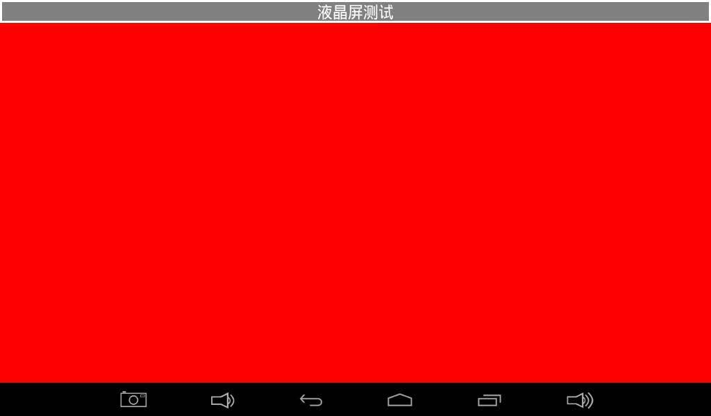
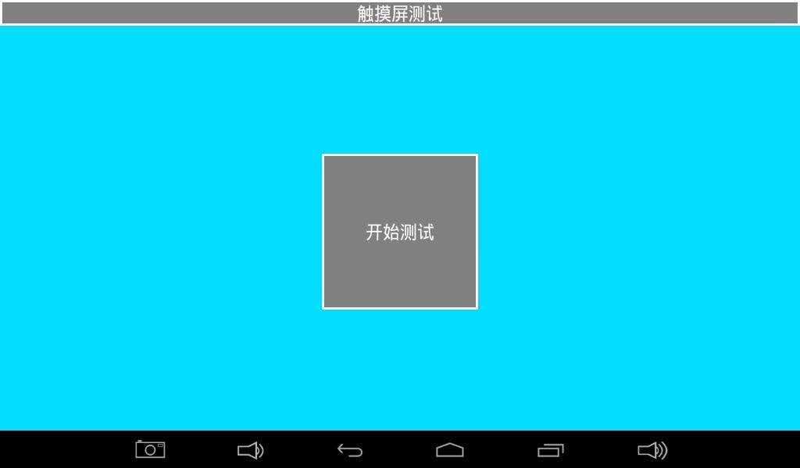
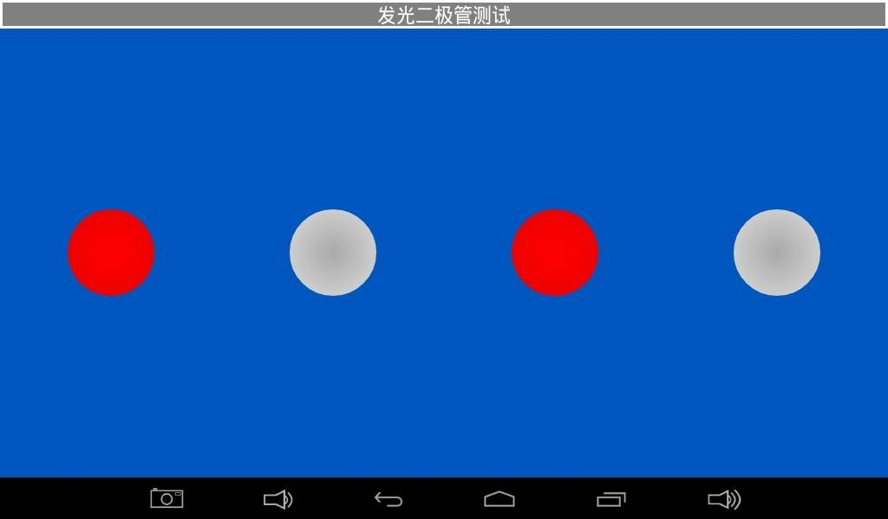
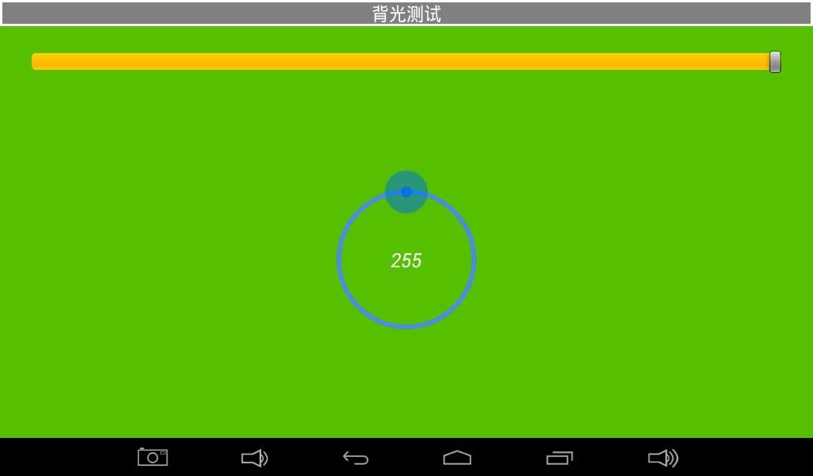
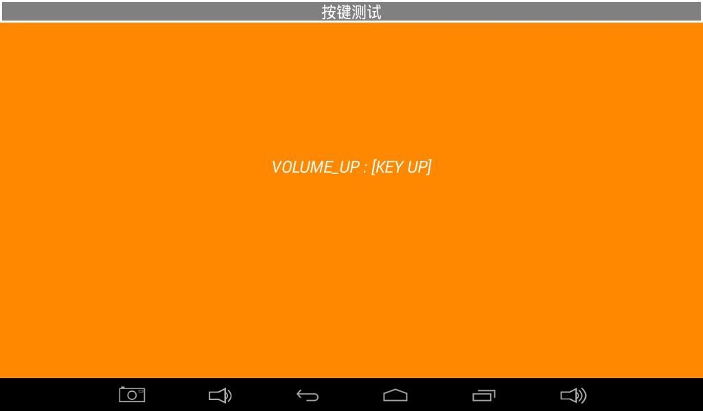
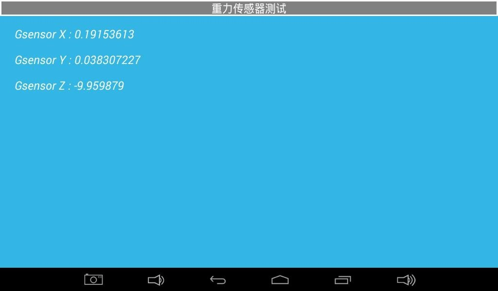
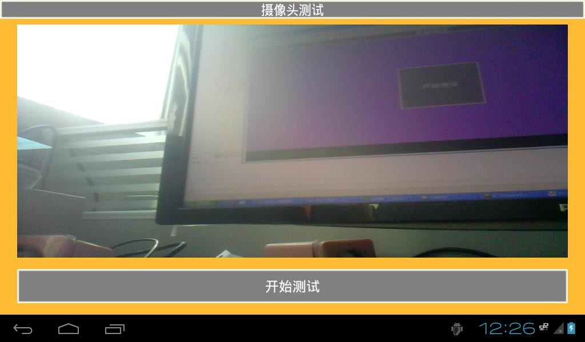
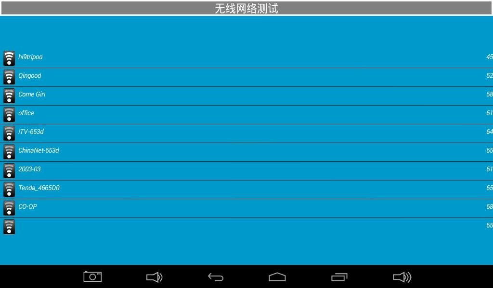
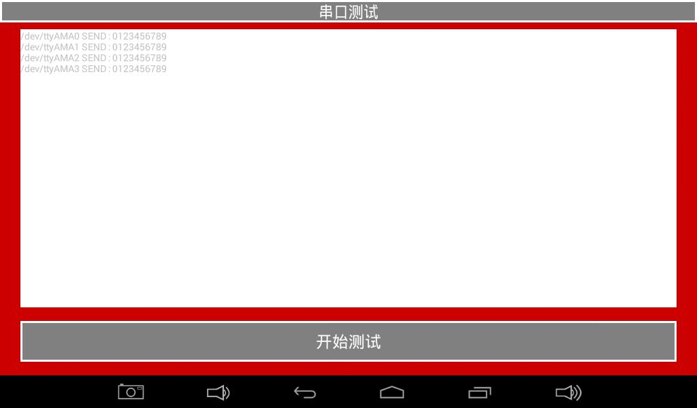
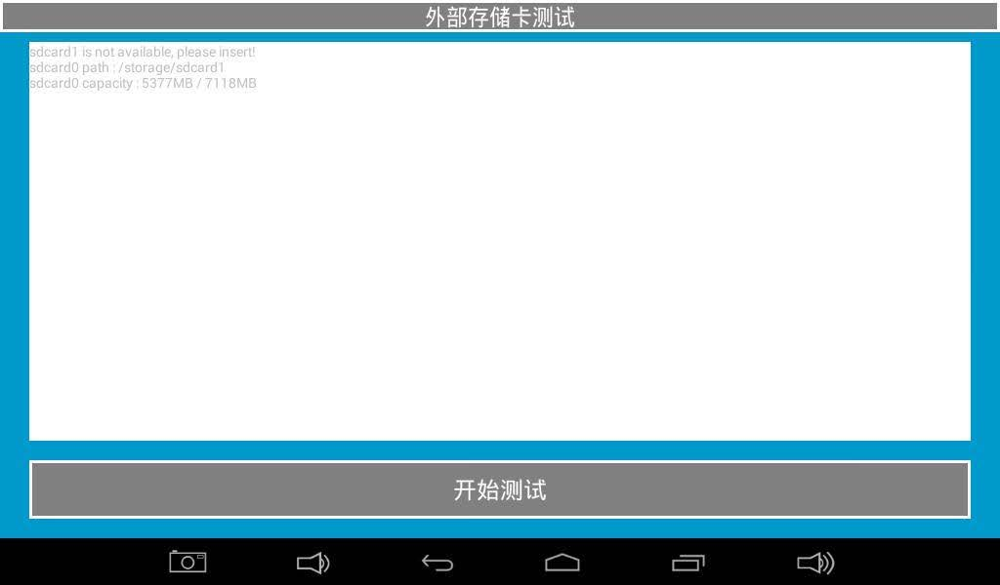

# Android 功能测试

打开“安卓测试”应用，左右滑动切换项目。根据实际板卡配置与固件选择测试，通用应用中的可选器件项目仅在对应硬件已装配时执行。

## 液晶屏

点击纯色区域切换颜色，观察坏点、丢色或闪烁。

## 触摸

点击开始测试，画对角线和边缘线检查连续性。

## LED 与蜂鸣器

切换 LED 图标查看亮灭。按住蜂鸣器测试键检查发声，松开应停止。

## 背光

拖动圆形控件，检查亮度变化。

## 按键与电池

检查按下和抬起事件。配有电池时核对电量与供电状态。

## ADC 与重力传感器

核对已接出的 ADC 通道。转动板卡观察 X/Y/Z 数据。

## 音频与摄像头

播放测试音并检查输出。连接匹配摄像头后启动测试，确认预览。

## 无线与有线网络

检查热点列表，联网后确认网络访问。

## 串口

确认所测端口电平及线序，将该口 TXD 与 RXD 回环，检查是否收到 0123456789，测试后移除回环。

## TF 与 U 盘

插入介质后检查识别、挂载、容量和文件读写。

