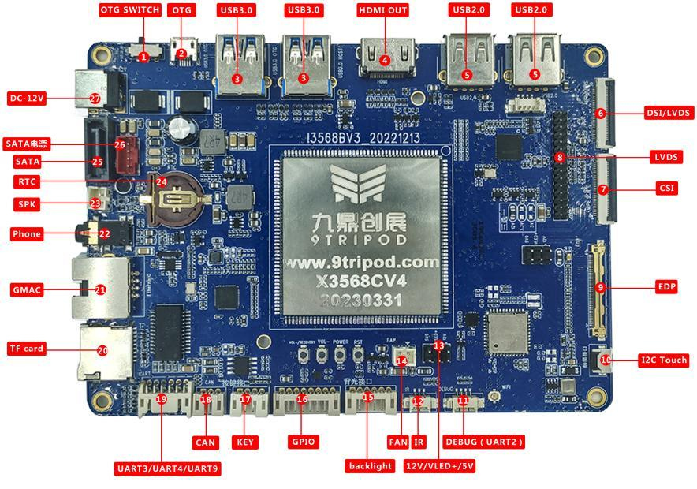

# 硬件资源

| 图号 | 名称 | 用途 |
| --- | --- | --- |
| 1 | USB 切换开关 | 左侧 Device，右侧 Host |
| 2 | Micro USB OTG | 下载与 ADB，共用一组 USB 2.0 信号 |
| 3 | USB 3.0 | 两路 Host，靠近 OTG 的端口受切换开关影响 |
| 4 | HDMI | 音视频输出 |
| 5 | USB 2.0 | 两个 Type-A 与一个 4-pin、1.25 mm 座 |
| 6 | DSI/LVDS | 显示 FPC，由固件配置模式 |
| 7 | MIPI CSI | 30-pin 摄像头座 |
| 8 | LVDS | GM8775C 转接输出 |
| 9 | eDP | eDP 显示座 |
| 10 | 触摸 | I2C 电容触摸 |
| 11 | 调试串口 | UART2 |
| 12 | 红外 | 外接红外接收头 |
| 13 | 背光跳线 | 12 V / VLED+ / 5 V 选择 |
| 14 | 风扇 | 12 V 风扇电源 |
| 15 | 背光接口 | 屏幕背光接口 |
| 16 | 扩展接口 | 1.8 V / 3.3 V / 5 V / ADC / IO / I2C |
| 17 | 外接按键 | VOL− / VOL+ / POWER / RST |
| 18 | CAN | CAN 总线 |
| 19 | 扩展串口 | UART9 / UART3 / UART4，TTL |
| 20 | TF | 存储卡座 |
| 21 | GMAC0 | 千兆以太网 |
| 22 | 耳机 | 音频输出 |
| 23 | 喇叭 | 外接扬声器 |
| 24 | RTC | 后备电池 |
| 25 | SATA 数据 | 黑色数据连接器 |
| 26 | SATA 电源 | 红色电源连接器 |
| 27 | DC 输入 | 12 V DC |
