# 硬件接口

## 供电与按键

接入 12 V DC 电源。若未自动开机，长按 POWER。RST 用于硬复位，VOL+ 兼作 RECOVERY 下载键。外接按键接到 KEY 座，先按板卡版本核对线序。

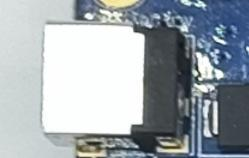

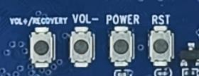

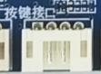

## USB Host 与 OTG

开关拨到 Device（左侧）时，Micro USB OTG 用于烧录与 ADB，邻近 USB 3.0 口的 USB 2.0 功能停用。拨到 Host（右侧）时，邻近 USB 3.0 口恢复 USB 2.0 兼容。另有两个 Type-A USB 2.0 口和一个 PH 座 USB 2.0 口。

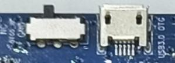

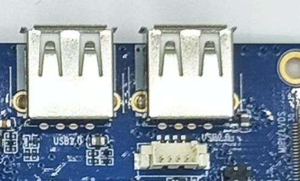

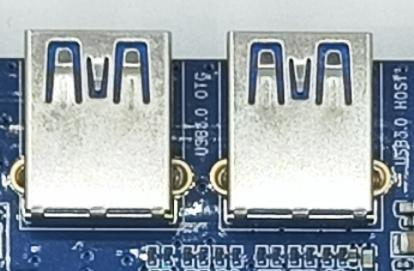

## 显示与背光

HDMI 输出音视频。DSI/LVDS FPC 的模式由固件配置，独立 LVDS 接口通过 GM8775C 转接，eDP 使用对应显示座。背光跳线分别控制 eDP 与背光接口的供电选择，接屏前按屏规格核对 5 V、12 V 和跳线位置。

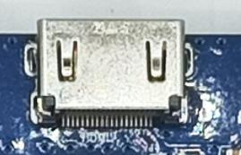

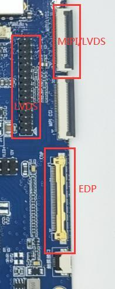

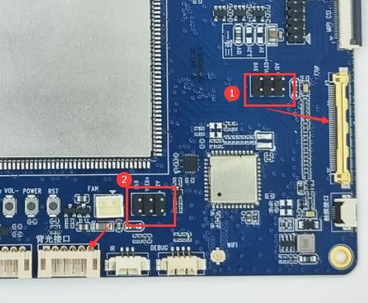

## 摄像头、音频与红外

摄像头使用 30-pin MIPI CSI 座，更换模组需核对线序、供电及驱动。主板提供耳机输出、外接喇叭和板载录音输入。IR 座可连接匹配的红外接收头。

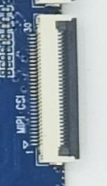

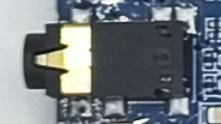

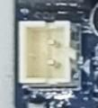

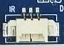

## 网络、存储与 RTC

RJ45 提供千兆以太网，Wi-Fi/蓝牙使用板载双频 SDIO 模组。TF 卡可用于存储。SATA 黑色座传输数据，红色座供电。RTC 后备电池在主电源关闭时维持计时。

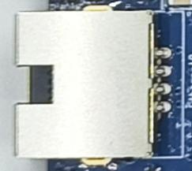

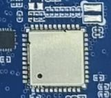

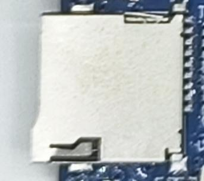

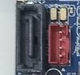

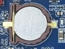

## 调试与扩展

UART2 默认为调试串口，其他 TTL 串口为 UART3/4/9。连接时 TX/RX 交叉、共地，核对电平后再接线。主板另有 CAN 和 1.8 V / 3.3 V / 5 V / ADC / IO / I2C 扩展座。接外设时按原理图确认每脚定义。

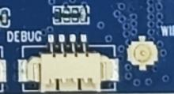

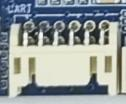

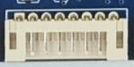
