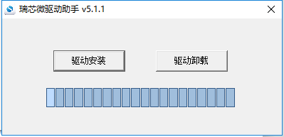
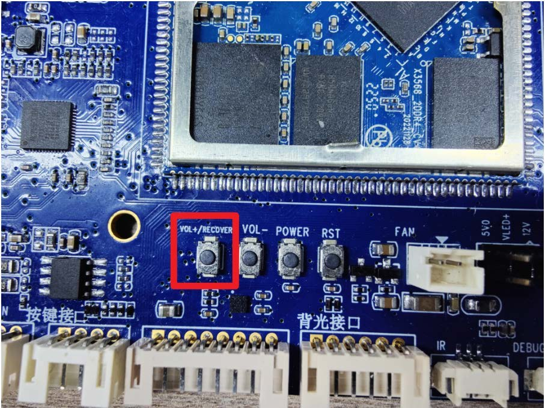

# Linux 固件烧录

## 通过 RKDevTool 升级

1. 备份需保留的数据，准备 I3568BV3 的 Linux `rockdev/update.img`。
2. 从 SDK 的 `tools/windows/` 安装配套驱动 DriverAssitant v5.1.1，打开 RKDevTool v2.86。
3. 拨动 OTG 开关到 Device，按住 VOL+/RECOVERY，连接 Micro USB 数据线和 12 V 电源。已上电时可按住 RECOVERY 再按 RST。
4. 工具识别 LOADER 后，在“升级固件”页选择 `update.img`，点击“升级”。等待写入完成并重启。





## 识别与恢复

如果只识别到 ADB 设备，可使用工具的“切换”，也可在支持该命令的板端串口执行以下命令进入 Loader。未识别时先检查驱动、USB 数据线、OTG 开关和电源。

```bash
reboot bootloader
```

系统无法进入 Loader 时可使用 Maskrom 恢复。硬件短接方式需要按实际核心板版本确认触点。工具中的“擦除 Flash”会清除存储数据，确认备份和恢复镜像后再使用。

## 启动调试快捷键

使用匹配串口参数，在启动时按住对应组合键。能否触发取决于固件与安全启动配置。

| 按键 | 功能 |
| --- | --- |
| Ctrl+C | 进入 U-Boot 命令行 |
| Ctrl+D | 进入 Loader |
| Ctrl+B | 进入 Maskrom |
| Ctrl+F | 进入 Fastboot |
| Ctrl+M | 打印 bidram/system 信息 |
| Ctrl+I | 启用 initcall_debug |
| Ctrl+P | 打印内核命令行 |
| Ctrl+S | 在 Starting kernel 后进入 U-Boot 命令行 |
