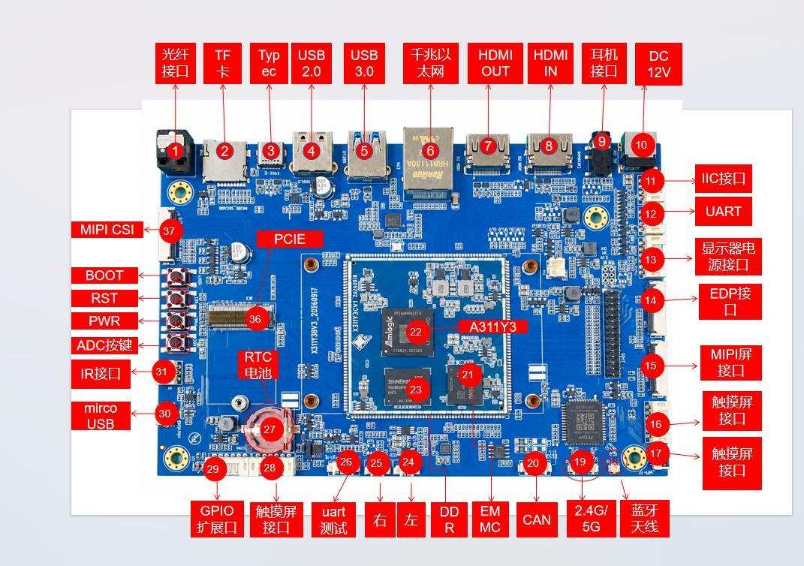

# 硬件资源

下表编号与接口图一致。图片保留原始中文标注，英文页面提供对应名称。

| 标号 | 名称 | 说明 |
| --- | --- | --- |
| 【1】 | 光纤接口 | SPDIF 光纤输出接口 |
| 【2】 | TF 卡座 | TF 卡(MicroSD)卡座 |
| 【3】 | Type-C | USBType-C 接口 |
| 【4】 | USB2.0 | USB2.0 HOST 接口 |
| 【5】 | USB3.0 | USB3.0 HOST 接口 |
| 【6】 | 千兆以太网 | 千兆以太网接口 |
| 【7】 | HDMIOUT | HDMI 输出接口 |
| 【8】 | HDMIIN | HDMI 输入接口 |
| 【9】 | 耳机座 | 耳机输出座 |
| 【10】 | DC12V | DC 12V2A 电源输入插座 |
| 【11】 | IIC 接口 | I2C 扩展接口 |
| 【12】 | UART接口 | UART串口扩展接口 |
| 【13】 | 显示器电源接口 | 显示器供电接口 |
| 【14】 | EDP 屏接口 | eDP 显示接口 |
| 【15】 | MIPI 屏接口 | MIPI-DSI 显示接口 |
| 【16】 | 触摸屏接口 | 触摸屏接口 |
| 【17】 | 触摸屏接口 | 触摸屏接口 |
| 【18】 | 蓝牙天线 | 蓝牙天线座 |
| 【19】 | 2.4G/5G天线 | WIFI 2.4G/5G双频天线座 |
| 【20】 | CAN接口 | CAN总线接口 |
| 【21】 | EMMC | eMMC 存储颗粒，标配64GB |
| 【22】 | A311Y3 | 主控CPU（核心板） |
| 【23】 | DDR | LPDDR4X/LPDDR5 标配8GB 内存颗粒 |
| 【24】 | 左喇叭 | 左声道扬声器接口 |
| 【25】 | 右喇叭 | 右声道扬声器接口 |
| 【26】 | UART测试 | UART测试接口 |
| 【27】 | RTC电池 | RTC 纽扣电池座 |
| 【28】 | 触摸屏接口 | 触摸屏接口 |
| 【29】 | GPIO 扩展接口 | GPIO 扩展接口 |
| 【30】 | micro USB | Micro USB接口 |
| 【31】 | IR 接口 | 红外接收接口 |
| 【32】 | ADC 按键 | ADC 按钮 |
| 【33】 | PWR 按键 | 电源按键（PWRKEY） |
| 【34】 | RST按键 | 复位按键（RESET） |
| 【35】 | BOOT 按键 | BOOT 按钮，在升级时用作Recovery 键 |
| 【36】 | PCIE接口 | PCIE2.0接口 |
| 【37】 | MIPI 摄像头 | MIPI CSI摄像头接口 |

## 软件驱动资源

硬件手册记录的支持情况如下，● 表示该平台资料列为支持；具体外设还需使用匹配的固件、设备树与驱动。

| 功能 | Android 16 / Linux 6.12 | Armbian / Linux 6.12 |
| --- | --- | --- |
| 7寸MIPI屏(1024*600) | ● | ● |
| 背光驱动 | ● | ● |
| 电容触摸屏 | ● | ● |
| EMMC驱动 | ● | ● |
| SD卡驱动 | ● | ● |
| 独立按键 | ● | ● |
| ADC驱动 | ● | ● |
| 开关机 | ● | ● |
| 休眠唤醒 | ● | ● |
| 一路USB HOST2.0驱动 | ● | ● |
| 一路USB HOST3.0驱动 | ● | ● |
| 一路OTG驱动 | ● | ● |
| PCIE总线驱动 | ● | ● |
| 光纤驱动 | ● | ● |
| RTC驱动 | ● | ● |
| 音频 | ● | ● |
| 录音 | ● | ● |
| 双频WIFI/BT4.0 | ● | ● |
| CSI摄相头驱动 | ● | ● |
| 串口 | ● | ● |
| HDMI2.1a | ● | ● |
| 一路千兆以太网 | ● | ● |
| USB鼠标键盘 | ● | ● |
| uboot | ● | ● |
