# 接口详解

## 电源与调试串口

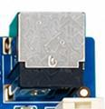

主板使用 12V 直流输入。调试串口为四针接口，接线与电平按板上丝印确认；外接调试小板应支持防倒灌。软件烧录手册使用 921600、8N1、无流控。

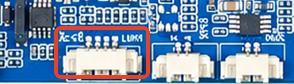

## HDMI 接口

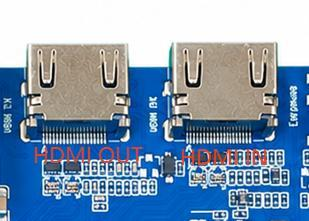

提供标准 HDMI A 型输入和输出。HDMI OUT 连接电视或显示器，支持 HDMI 2.1a；HDMI IN 用于输入信号或 HDMI 摄像头。

## 摄像头接口

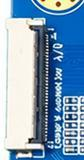

30PIN MIPI CSI 摄像头连接座。引脚名称及网络备注按原硬件手册保留。

| 引脚号 | 信号/功能 | 备注 |
| --- | --- | --- |
| 1 | GND_0 | GND |
| 2 | MIPI_D3N | CSI_A_CLKP |
| 3 | MIPI_D3P | CSI_A_CLKP |
| 4 | GND_1 | GND |
| 5 | MIPI_D2N | CSI_A_D0P |
| 6 | MIPI_D2P | CSI_A_D0N |
| 7 | GND_2 | GND |
| 8 | MIPI_CLKN | CSI_A_D1P |
| 9 | MIPI_CLKP | CSI_A_D1N |
| 10 | GND_3 | GND |
| 11 | MIPI_D1N | CSI_A_D2P |
| 12 | MIPI_D1P | CSI_A_D2N |
| 13 | GND_4 | GND |
| 14 | MIPI_D0N | CSI_A_D3P |
| 15 | MIPI_D0P | CSI_A_D3N |
| 16 | GND_5 | GND |
| 17 | CAM_MCLK | CSI_B_CLKP |
| 18 | GND_6 | CSI_B_CLKP |
| 19 | VCC_IO | VCC_IO |
| 20 | AF_CTL | CMA_I2C_G_SCL |
| 21 | PRE_TRIG | CMA_I2C_G_SDA |
| 22 | FLASH_TRIG | CMA_MCLK |
| 23 | MIPI_SCL | CMB_MCLK |
| 24 | MIPI_SDA | GPIOAO_10 |
| 25 | MIPI_PDN | CMA_PWRDN |
| 26 | MIPI_RST | CMA_RST_L |
| 27 | 27 | GPIOY_8 |
| 28 | 28 | VCC1V8_CAM1 |
| 29 | 29 | VCC2V8_CAM1 |
| 30 | 30 | MIPI_1_2V_CAM1 |

## 以太网接口

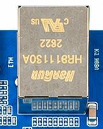

板载 RTL8211F，提供一路千兆有线以太网。

## 耳机与喇叭

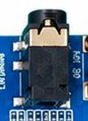

耳机座支持耳机音频输出及耳机麦克风；双声道喇叭连接定义如下。

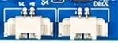

| 引脚号 | 信号/功能 |
| --- | --- |
| 1 | R+ |
| 2 | R- |
| 3 | L- |
| 4 | L+ |

## TF 卡

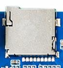

TF 卡可用于存放多媒体文件，也可配合匹配的镜像及启动配置进行升级。

## 独立按键

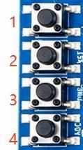

板上有 BOOT、RST、PWRKEY、ADC 四个按键。BOOT 在升级时用作 Recovery 键，ADC 键通过 ADC 采样读取。

|  | 开关 | 功能 |
| --- | --- | --- |
| 1 | BOOT | BOOT按钮（升级时用作Recovery键） |
| 2 | RST | 复位按钮 |
| 3 | PWRKEY | 电源键 |
| 4 | ADC | ADC按钮 |

## USB OTG 与 HOST

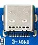

Type-C 为 USB3.0 OTG，支持 HOST/Device 双模式，Device 用于程序下载；另有 micro USB2.0 OTG，以及一路 HOST2.0、一路 HOST3.0。

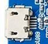

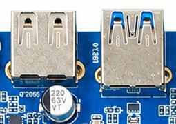

## eDP 屏接口

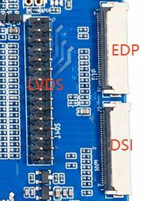

eDP 显示座 J13 的信号/功能与备注如下。

| 引脚号 | 信号/功能 | 备注 |
| --- | --- | --- |
| 1 | GND_0 | GND |
| 2 | LVDS_D0N | EDP_A_0N/DSI_A_D1N/VX1_A_1N |
| 3 | LVDS_D0P | EDP_A_0P/DSI_A_D1P/VX1_A_1P |
| 4 | GND_1 | GND |
| 5 | LVDS_D1N | EDP_A_1N/DSI_A_CKN/VX1_A_2N |
| 6 | LVDS_D1P | EDP_A_1P/DSI_A_CKP/VX1_A_2P |
| 7 | GND_2 | GND |
| 8 | LVDS_CLKN | EDP_A_AUXN/DSI_A_D0N/VX1_A_0N |
| 9 | LVDS_CLKP | EDP_A_AUXP/DSI_A_D0P/VX1_A_0P |
| 10 | GND_3 | GND |
| 11 | LVDS_D2N | EDP_A_2N/DSI_A_D2N/VX1_A_3N |
| 12 | LVDS_D2P | EDP_A_2P/DSI_A_D2P/VX1_A_3P |
| 13 | GND_4 | GND |
| 14 | LVDS_D3N | EDP_A_3N/DSI_A_D3N/VX1_A_4N |
| 15 | LVDS_D3P | EDP_A_3P/DSI_A_D3P/VX1_A_4P |
| 16 | GND_5 | GND |
| 17 | LCD_PWM1_IN | PANEL_A_BL_PWM_I |
| 18 | GND_6 | GND |
| 19 | VCC_IO | PANEL_VCC |
| 20 | LCD_RST | PANEL_A_RST |
| 21 | CABG_EN | eDP_HPD_VX1_HPD |
| 22 | LED_EN | PANEL_A_BL_EN |
| 23 | TP_SCL | TP_A_I2C_A_SCL |
| 24 | TP_SDA | TP_A_I2C_A_SDA |
| 25 | TP_INT | TP_A_INT |
| 26 | TP_RST | TP_A_RST |
| 27 | GND_7 | GND |
| 28 | VSYS_0 | VCC5V_EXT(12V可选) |
| 29 | VSYS_1 |  |
| 30 | VSYS_2 |  |

## MIPI 屏接口

30PIN MIPI 显示座引脚如下，面板供电选择需与屏幕规格匹配。

| 引脚号 | 信号/功能 |
| --- | --- |
| 1 | 供电5V/12V可选 |
| 2 | 供电5V/12V可选 |
| 3 | 供电5V/12V可选 |
| 4 | PANEL_VCC（3V3） |
| 5 | PANEL_VCC（3V3） |
| 6 | TP_B_I2C_SCL |
| 7 | TP_B_I2C_SDA |
| 8 | TP_B_INT |
| 9 | TP_B_RST |
| 10 | PANEL_VCC（3V3） |
| 11 | PANEL_VCC（3V3） |
| 12 | PANEL_B_BL_PWM_J |
| 13 | PANEL_B_RST |
| 14 | NC |
| 15 | PANEL_B_BL_EN |
| 16 | GND |
| 17 | DSI_B_D3N/LVDS_B_3N |
| 18 | DSI_B_D3P/LVDS_B_3P |
| 19 | GND |
| 20 | DSI_B_D2N/LVDS_B_CLKN |
| 21 | DSI_B_D2P/LVDS_B_CLKP |
| 22 | GND |
| 23 | DSI_B_CKN/LVDS_B_2N/VX1_A_7N |
| 24 | DSI_B_CKP/LVDS_B_2P/VX1_A_7P |
| 25 | GND |
| 26 | DSI_B_D1N/LVDS_B_1N/VX1_A_6N |
| 27 | DSI_B_D1P/LVDS_B_1P/VX1_A_6P |
| 28 | GND |
| 29 | DSI_B_D0N/LVDS_B_0N/VX1_A_5N |
| 30 | DSI_B_D0P/LVDS_B_0P/VX1_A_5P |

## 触摸屏 1

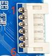

触摸屏 1 接口定义如下。

| 引脚号 | 信号/功能 |
| --- | --- |
| 1 | GND |
| 2 | SCL |
| 3 | SDA |
| 4 | INT |
| 5 | RST |
| 6 | GND |

## 触摸屏 2

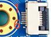

触摸屏 2 接口定义如下。

| 引脚号 | 信号/功能 |
| --- | --- |
| 1 | GND |
| 2 | SDA |
| 3 | SCL |
| 4 | 3V3 |
| 5 | INT |
| 6 | RST |

## RTC 后备电池

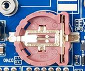

后备电池用于断电后保存系统时间。硬件手册记录外置 RTC 工作电流低于 0.6µA。

## 红外接头

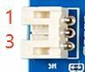

3PIN、2.0mm 间距接口，可外接红外接收模块。

| 引脚号 | 信号/功能 |
| --- | --- |
| 1 | IR |
| 2 | GND |
| 3 | VCC |

## 光纤音频

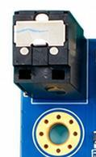

SPDIF 光纤接口可连接具有光纤输入的音频设备。

## Wi-Fi 与蓝牙

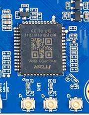

板载 SDIO Wi-Fi/BT 模块，支持 2.4GHz / 5GHz 双频。

## UART_F 串口

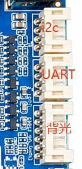

开发板提供一路 UART_F 串口。

| 引脚号 | 信号/功能 |
| --- | --- |
| 1(上) | GND |
| 2 | RX |
| 3 | TX |
| 4(下) | VCC |

## PCIe 接口

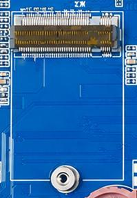

提供标准 PCIe 2.0 扩展座，可连接对应 PCIe 设备；选择该通道时需确认与 USB3.0 HOST 的复用配置。

## GPIO 扩展

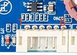

预留 GPIO 扩展座引脚如下。

| 引脚号 | 信号/功能 |
| --- | --- |
| 1 | 3V3 |
| 2 | GPIOA_3 |
| 3 | GPIOA_4 |
| 4 | GPIOA_5 |
| 5 | GPIOA_6 |
| 6 | GND |

## LVDS/DSI 排针

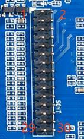

7CON2 为 2×15、30PIN 显示排针座。

| 引脚号 | 信号/功能 |
| --- | --- |
| 1 | PANEL_VCC |
| 2 | PANEL_VCC |
| 3 | PANEL_VCC |
| 4 | GND |
| 5 | GND |
| 6 | GND |
| 7 | EDP_A_AUXN/DSI_A_D0N/LVDS_A_0N/VX1_A_0N |
| 8 | EDP_A_AUXP/DSI_A_D0P/LVDS_A_0P/VX1_A_0P |
| 9 | EDP_A_0N/DSI_A_D1N/LVDS_A_1N/VX1_A_1N |
| 10 | EDP_A_0P/DSI_A_D1P/LVDS_A_1P/VX1_A_1P |
| 11 | EDP_A_1N/DSI_A_CKN/LVDS_A_2N/VX1_A_2N |
| 12 | EDP_A_1P/DSI_A_CKP/LVDS_A_2P/VX1_A_2P |
| 13 | GND |
| 14 | GND |
| 15 | EDP_A_2N/DSI_A_D2N/LVDS_A_CLKN/VX1_A_3N |
| 16 | EDP_A_2P/DSI_A_D2P/LVDS_A_CLKP/VX1_A_3P |
| 17 | EDP_A_3N/DSI_A_D3N/LVDS_A_3N/VX1_A_4N |
| 18 | EDP_A_3P/DSI_A_D3P/LVDS_A_3P/VX1_A_4P |
| 19 | DSI_B_D0N/LVDS_B_0N/VX1_A_5N |
| 20 | DSI_B_D0P/LVDS_B_0P/VX1_A_5P |
| 21 | DSI_B_D1N/LVDS_B_1N/VX1_A_6N |
| 22 | DSI_B_D1P/LVDS_B_1P/VX1_A_6P |
| 23 | DSI_B_CKN/LVDS_B_2N/VX1_A_7N |
| 24 | DSI_B_CKP/LVDS_B_2P/VX1_A_7P |
| 25 | GND |
| 26 | GND |
| 27 | DSI_B_D2N/LVDS_B_CLKN |
| 28 | DSI_B_D2P/LVDS_B_CLKP |
| 29 | DSI_B_D3N/LVDS_B_3N |
| 30 | DSI_B_D3P/LVDS_B_3P |
