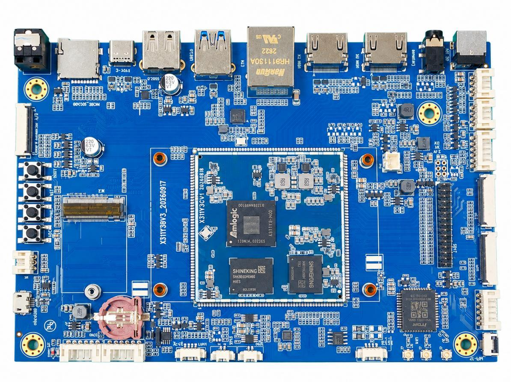

# 产品介绍

X311Y3 是基于晶晨 A311Y3 的八核 AI 开发板，面向工业控制、机器视觉、边缘计算和多媒体终端。采用 6nm 工艺，2 × Cortex-A78 @ 2.4GHz + 6 × Cortex-A55 @ 2.0GHz，集成 8 TOPS NPU 和 Mali-G625 MC1 GPU。

支持 Android 16 和 Linux 6.12.69，视频能力最高 4K@120fps；视觉输入支持 1300 万像素@30fps / 1600 万像素@20fps。标配 8GB 内存和 64GB eMMC 5.1，内存最高 16GB，存储支持 128GB/256GB 等配置。

## 功能特性

- 1 路 USB HOST2.0、1 路 USB HOST3.0；HOST3.0 与一路 PCIe 2.0 复用。
- Type-C USB3.0 OTG、micro USB2.0 OTG、调试串口和 UART_F。
- HDMI TX/RX、MIPI DSI/eDP/LVDS、触摸屏及背光控制。
- RTL8211F 千兆以太网、双频 Wi-Fi/蓝牙、MIPI CSI 摄像头。
- TF 卡、GPIO、I2C、PCIe 2.0、RTC、红外、SPDIF、耳机及双声道喇叭。
- BOOT、RST、PWRKEY、ADC 四个按键，主板使用 12V/2A 直流电源。

## 系统配置

| 项目 | 说明 |
| --- | --- |
| CPU | A311Y3 |
| GPU | ARMMali-G625MC1，支持OpenGLES3.2、Vulkan1.4、OpenCL3.0 |
| NPU | 8TOPS 深 度 学 习 加 速 器 ， 支 持INT4/INT8/FP16多精度推理 |
| 主频 | 2 × 2.4GHz + 6 × 2.0GHz |
| 内存 | LPDDR4X/LPDDR5，标配8GB，最高16GB |
| 存储器 | 64GB/128GB/256GB emmc 5.1 可选，标配64GB |
| 电源管理 | 分立DC-DC+LDO |

## 接口参数

| 项目 | 说明 |
| --- | --- |
| LCD接口 | 支持HDMI2.1a/MIPI-DSI/eDP/LVDS输出 |
| Touch接口 | 触摸屏接口 |
| 音频接口 | 支持耳机喇叭直接输出，支持录放音 |
| SD卡接口 | 1 路 TF 卡 接 口 （ SDIO 3.0 ， 支 持SD/SDHC/SDXC） |
| 以太网接口 | 支持1路千兆以太网（RTL8211F） |
| USBHOST2.0接口 | 1路HOST2.0 |
| USBHOST3.0接口 | 1 路HOST3.0（和其中一路 PCIE2.0 接口复用） |
| OTG接口 | 1路Type-CUSB3.0OTG接口 |
| UART接口 | 2路串口（1路调试串口、1路UART_F串口） |
| IIC接口 | 1路IIC输出 |
| Camera接口 | MIPI-CSI输入4-lane |

## 核心板电气参数

| 项目 | 说明 |
| --- | --- |
| 输入电压 | 12V/2A，3.3V/1A，1.8V/1A（给核心板供电） |
| RTC输入电压 | 3V/0.6uA |
| 工作温度 | -10~70度 |
| 储存温度 | -10~40度 |

## 文档导航

- [硬件资源](./x311y3-hardware-resources.md)

- [接口详解](./x311y3-interface-details.md)

- [配置清单](./x311y3-configuration-list.md)

- [USB 烧录与工具安装](./x311y3-usb-flashing.md)

- [Android 开发环境](./x311y3-android-environment.md)

- [Android 编译与 OTA](./x311y3-android-build.md)

- [Linux 开发环境](./x311y3-linux-environment.md)

- [Linux 编译与升级](./x311y3-linux-build.md)

- [Linux 系统使用](./x311y3-linux-user-guide.md)

- [Linux 多媒体与 AI 测试](./x311y3-linux-multimedia-ai.md)

- [常见问题与排查](./x311y3-troubleshooting.md)
