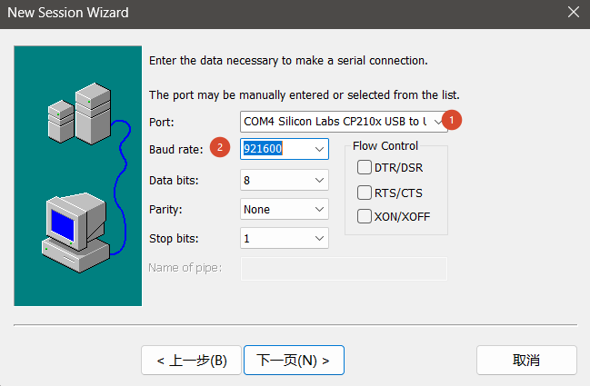
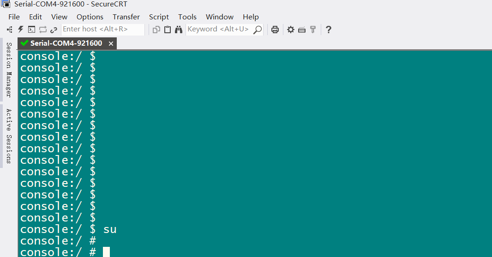
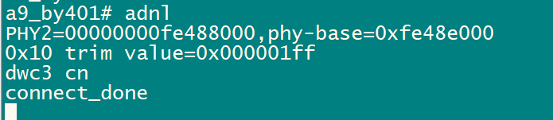
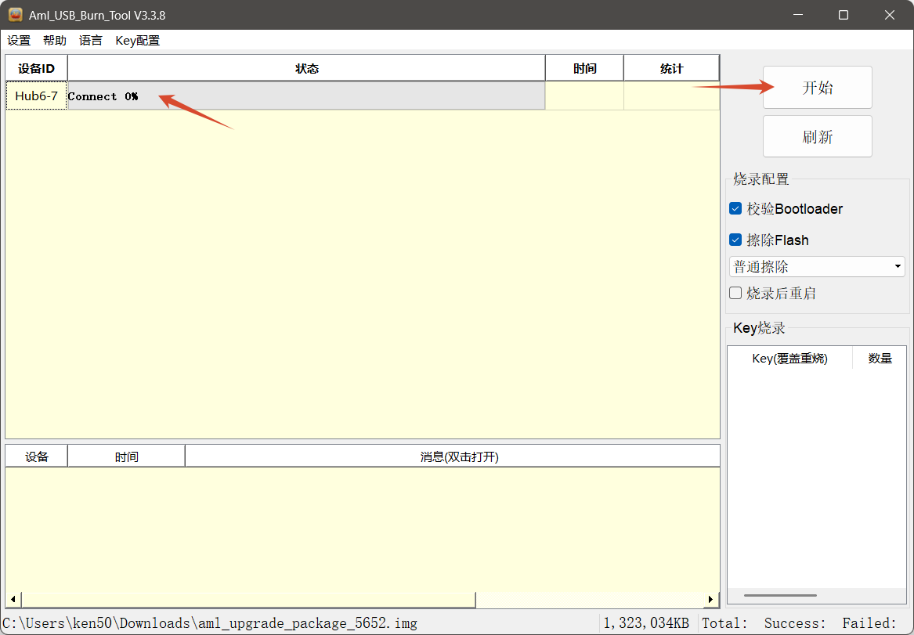
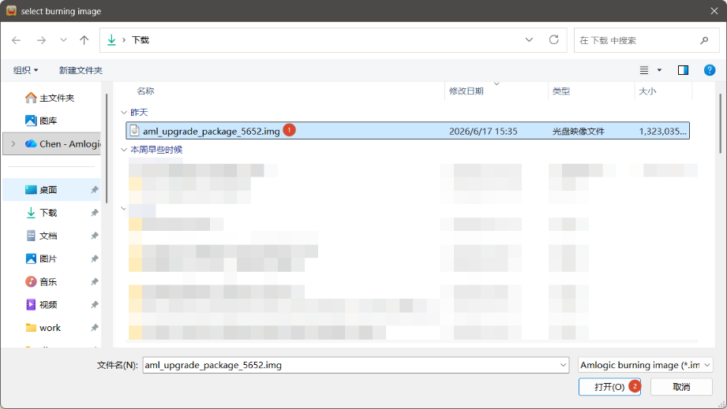
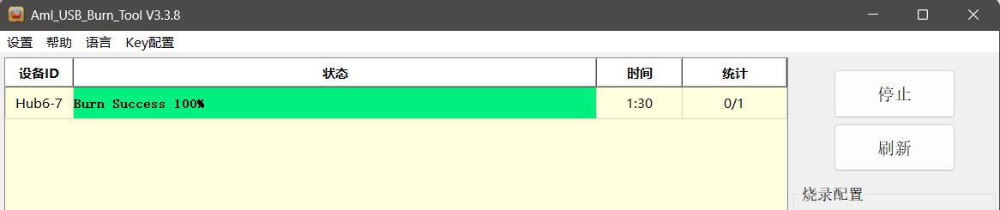

# USB 烧录与工具安装

X311Y3 使用 Amlogic USB Burn Tool V3。流程为 UART + Type-C → 921600 → 上电 → Enter → adnl → V3 工具。烧录前确认镜像与板卡、存储和软件版本匹配，并备份需要保留的数据。

## 串口配置

| 项目 | 说明 |
| --- | --- |
| UART | GND / TX / RX / VDD3V3 |
| Baud rate | 921600 |
| Data format | 8N1 |
| Flow control | 关闭 |

按 UART 丝印接线，TX/RX 交叉连接，VDD3V3 不作为外部供电使用。SecureCRT 选择实际 Port，关闭 DTR/DSR、RTS/CTS 和 XON/XOFF。





## 安装 V3 工具与驱动

1. Windows 10/11 64 位主机准备 X311Y3 镜像和 Type-C 数据线。
2. 运行项目提供的 `V3_setup_V3.*.*.exe`，选择语言和路径。
3. 按提示完成 DNL 驱动安装，启动 `Aml_Burn_Tool`。
4. 手册示例界面为 V3.3.8，实际版本使用项目提供的工具包。

正常识别时，设备管理器显示 `Universal Serial Bus devices → android_winusb`。黄色感叹号时，运行 V3 目录的 `dpscat.exe`，再按系统位数运行 `dpinst64.exe` 或 `dpinst32.exe`；也可手动更新驱动并指向 `C:\Amlogic\Aml_Burn_Tool\V3\Driver`。

若提示 `Load aml_usb_flow.dll failed`，先确认工具目录中存在 DLL；存在仍报错时，安装对应 VC2015 运行库 `vc_redist.x64.exe` 或 `vc_redist.x86.exe`。

## 进入 USB 烧录模式

1. 连接 UART 和 Type-C，Type-C 接 PC。
2. 设置 921600 / 8N1 / 无流控。
3. 上电后及时按 Enter，停在 U-Boot。
4. 执行 `adnl`，等待 `connect_done`。

```text
a9_by401# adnl
PHY2=00000000fe488000,phy-base=0xfe48e000
0x10 trim value=0x000001ff
dwc3 cn
connect_done
```



没有 `connect_done` 时，先检查 UART、电源、Type-C 数据线和 Windows USB 识别状态。

## 导入镜像并烧录

1. 启动工具，选择“设置 → 导入镜像”，打开对应 `.img`。
2. 确认设备出现后选择“开始”。
3. 等待成功状态，选择“停止”。
4. 重启开发板，用串口确认启动。







Linux 镜像也可使用配套 V3 工具。Linux 主机端另有 `adnl_burn_pkg` 方案，具体参数按当前 SDK/镜像配套说明；Linux U-Boot 入口不同时，按该版本说明进入模式。
