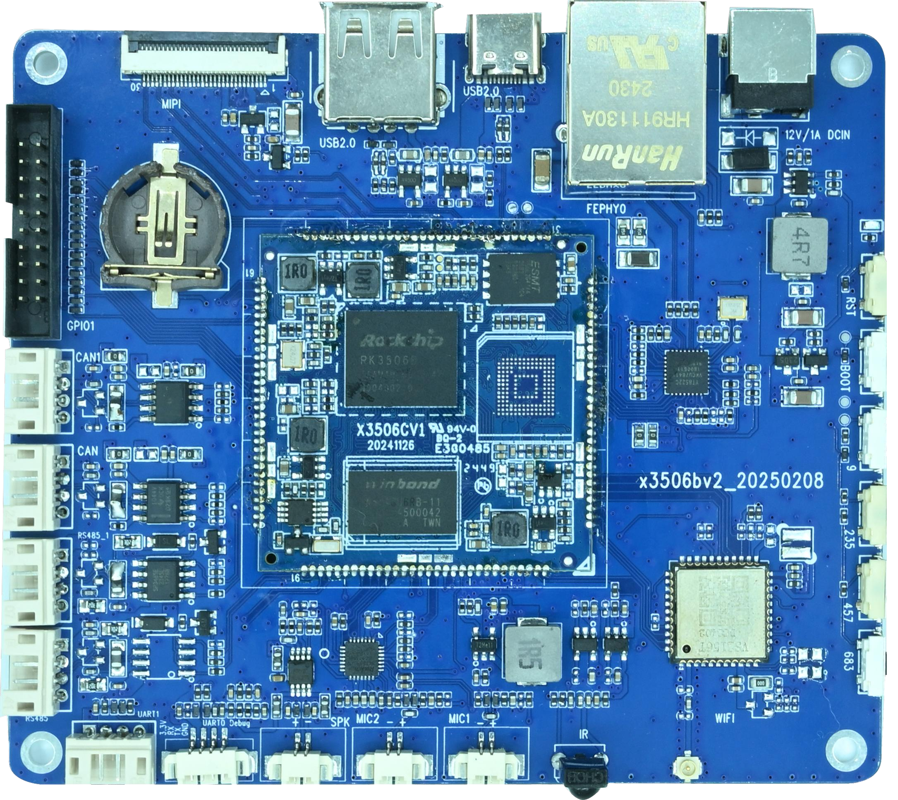

# Linux 固件烧录

## 准备 Windows 烧录工具

准备与板卡配置匹配的 `update.img`，以及一根支持数据传输的 USB Type-C 线。在 SDK 的 `RKTools/windows/Release_DriverAssitant` 下运行 `DriverInstall.exe` 安装瑞芯微 USB 驱动，再启动 SDK 配套的 `AndroidTool.exe`。手册所用的工具目录为 `RKTools/windows/AndroidTool/AndroidTool_Release_v2.81`。

## 进入 Maskrom 模式

1. 断开主板的 12 V 电源，使用 Type-C OTG 口连接主板与电脑。
2. 按住主板上的 `BOOT` 键，再接上 12 V 电源。
3. 烧录工具显示发现 MASKROM 设备后松开按键。

## 升级固件

1. 在工具中打开「升级固件」页签，点击「固件」并选择 `update.img`。
2. 确认设备已被识别，点击「升级」。烧录过程中保持电源和 USB 连接。
3. 等待工具报告升级成功，再观察主板启动。

升级可能覆盖板上数据，烧录前备份需要保留的内容。若工具无法识别设备，检查驱动、Type-C 线和 BOOT 上电顺序。
