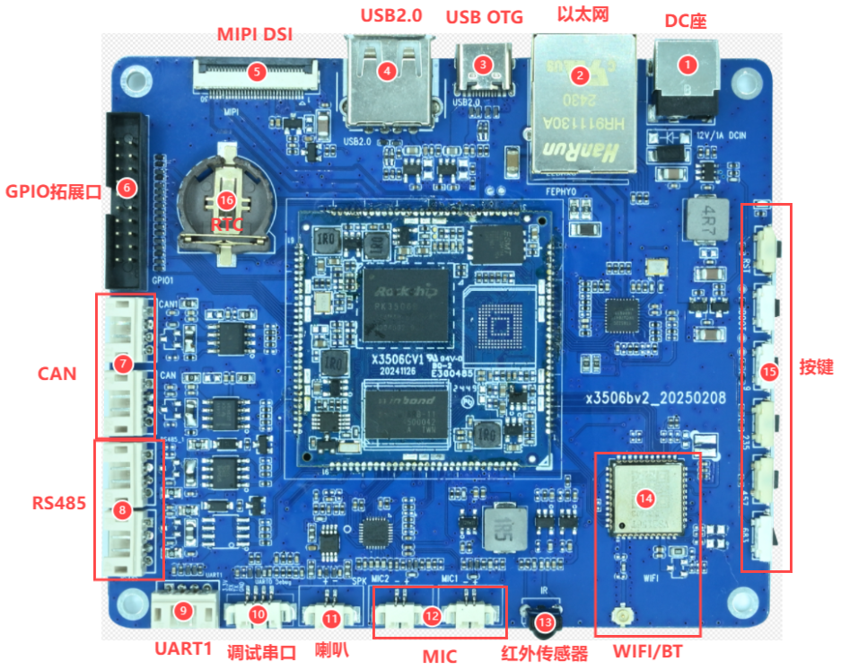

# 硬件资源

| 图号 | 接口 | 用途 |
| --- | --- | --- |
| 1 | DC 电源座 | 12 V 直流输入 |
| 2 | 以太网 | 10/100 Mbps RJ45 |
| 3 | USB OTG | Type-C，用于固件烧录和 ADB |
| 4 | USB Host | Type-A USB 2.0 |
| 5 | MIPI DSI | 30 针显示与触摸接口 |
| 6 | GPIO | 2×10 针排座，间距 2.0 mm |
| 7 | CAN | 两路，4 针，间距 2.0 mm |
| 8 | RS485 | 两路，4 针，间距 2.0 mm |
| 9 | UART1 | TTL，4 针，间距 2.0 mm |
| 10 | UART0 调试串口 | TTL，4 针，间距 1.25 mm |
| 11 | 喇叭 | 外接扬声器，2 针，间距 1.25 mm |
| 12 | MIC | 两路麦克风输入，各 2 针，间距 1.25 mm |
| 13 | 红外 | 红外接收头 |
| 14 | Wi-Fi / 蓝牙 | 板载 AW869A 模组 |
| 15 | 按键 | RST、BOOT 和四个 ADC 按键 |
| 16 | RTC | 后备电池座 |

接线时可对照[硬件接口定义](./x3506-interface-details.md)中的局部图和引脚表。
