# 硬件接口定义

章节中的编号与[硬件资源](./x3506-hardware-resources.md)的主板图一致。接线前断电，并按局部图核对接口方向。

## 1. 直流电源输入

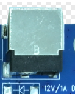

主板通过 DC 插座接入 12 V 电源，建议使用 12 V/3 A 适配器。

## 2. 以太网

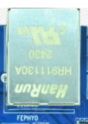

RJ45 网口使用 YT8522C PHY，支持 10/100 Mbps 有线以太网。

## 3. USB Type-C OTG

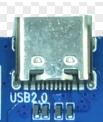

使用支持数据传输的 Type-C 线连接电脑，可用于固件烧录和 ADB 调试。

## 4. USB 2.0 Host

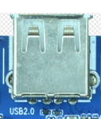

Type-A 接口可连接 U 盘、鼠标等 USB 外设。

## 5. MIPI DSI

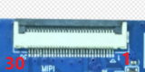

30 针接口提供一路双通道 MIPI DSI，并引出 I2C 触摸、背光 PWM 和复位信号。接屏前核对排线方向、供电和信号定义。

| 引脚 | 信号 |
| --- | --- |
| 1 | `VCC5V0_SYS` |
| 2 | `VCC5V0_SYS` |
| 3 | `VCC5V0_SYS` |
| 4 | `VCC3V3_LCD` |
| 5 | `VCC3V3_LCD` |
| 6 | `I2C1_SCL` |
| 7 | `I2C1_SDA` |
| 8 | `TP_INT_L` |
| 9 | `TP_RST_L` |
| 10 | `VCC3V3_LCD` |
| 11 | `VCC3V3_LCD` |
| 12 | `PWM0_CH2_LCD_BL` |
| 13 | `LCD_RESET` |
| 14 | `NC` |
| 15 | `NC` |
| 16 | `GND` |
| 17 | `NC` |
| 18 | `NC` |
| 19 | `GND` |
| 20 | `NC` |
| 21 | `NC` |
| 22 | `GND` |
| 23 | `MIPI_DPHY_DSI_TX_CLKN` |
| 24 | `MIPI_DPHY_DSI_TX_CLKP` |
| 25 | `GND` |
| 26 | `MIPI_DPHY_DSI_TX_D1N` |
| 27 | `MIPI_DPHY_DSI_TX_D1P` |
| 28 | `GND` |
| 29 | `MIPI_DPHY_DSI_TX_D0N` |
| 30 | `MIPI_DPHY_DSI_TX_D0P` |

## 6. GPIO 扩展

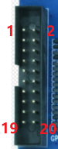

2×10 针、间距 2.0 mm 的排座引出 17 路 GPIO，另有 5 V、3.3 V 和 GND。

| 引脚 | 信号 |
| --- | --- |
| 1 | `5V` |
| 2 | `GND` |
| 3 | `3.3V` |
| 4 | `GPIO1_B1` |
| 5 | `GPIO1_C0` |
| 6 | `GPIO1_B0` |
| 7 | `GPIO1_C1` |
| 8 | `GPIO1_A7` |
| 9 | `GPIO1_C4` |
| 10 | `GPIO1_A6` |
| 11 | `GPIO1_C5` |
| 12 | `GPIO1_A5` |
| 13 | `GPIO1_C6` |
| 14 | `GPIO1_B7` |
| 15 | `GPIO1_C7` |
| 16 | `GPIO1_B6` |
| 17 | `GPIO1_D0` |
| 18 | `GPIO1_B5` |
| 19 | `GPIO1_D1` |
| 20 | `GPIO1_B4` |

## 7. CAN

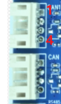

两路 CAN 使用相同的 4 针、间距 2.0 mm 接口。

| 引脚 | 信号 |
| --- | --- |
| 1 | `5V` |
| 2 | `CANL` |
| 3 | `CANH` |
| 4 | `GND` |

## 8. RS485

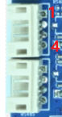

两路 RS485 均使用 4 针、间距 2.0 mm 接口。两组接口的 VCC 分别为 3.3 V 和 5 V，接线前核对所用接口的供电电压。

| 引脚 | 信号 |
| --- | --- |
| 1 | `VCC` |
| 2 | `RS485_A` |
| 3 | `RS485_B` |
| 4 | `GND` |

## 9–10. UART1 与 UART0 调试串口

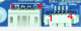

UART1 是间距 2.0 mm 的 4 针 TTL 串口，UART0 是间距 1.25 mm 的 4 针 TTL 调试串口。两者引脚顺序相同。

| 引脚 | 信号 |
| --- | --- |
| 1 | `VCC_3V3` |
| 2 | `UART_RX` |
| 3 | `UART_TX` |
| 4 | `GND` |

## 11. 扬声器

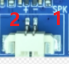

2 针、间距 1.25 mm 的接口支持一路 3 W、8 Ω 扬声器。将扬声器两端分别接到下表所示输出。

| 引脚 | 信号 |
| --- | --- |
| 1 | `SPKN_OUT` |
| 2 | `SPKP_OUT` |

## 12. 麦克风

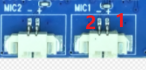

MIC1 和 MIC2 均为 2 针、间距 1.25 mm 的麦克风输入接口。

| 引脚 | 信号 |
| --- | --- |
| 1 | `MICP` |
| 2 | `MICN` |

## 13. 红外接收

板载红外接收头的位置见主板图中 13 号标注。

## 14. Wi-Fi 与蓝牙

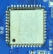

板载 AW869A 无线模组支持 Wi-Fi 6 和蓝牙 5.2。

## 15. 板载按键

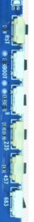

`RST` 用于复位，`BOOT` 用于进入烧录模式。其余四个为 ADC 按键，板上标记为 `9`、`235`、`457` 和 `683`。

## 16. RTC 电池座

RTC 后备电池座的位置见主板图中 16 号标注。
