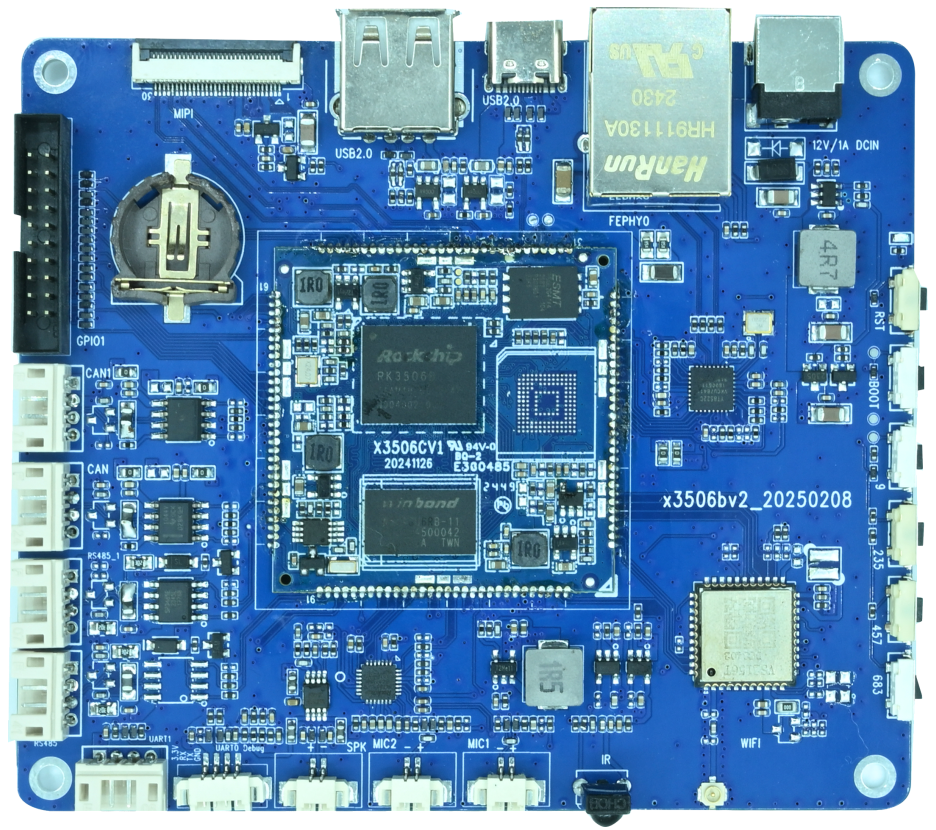

# 产品介绍

x3506bv2 是基于瑞芯微 RK3506 的 Linux 主板，提供 MIPI DSI 显示接口、以太网、Wi-Fi、蓝牙和工业通信接口。

| 项目 | 规格 |
| --- | --- |
| 处理器 | RK3506，Cortex-A7 + Cortex-M0，1.5 GHz |
| 内存 | 512 MB |
| 存储 | 256 MB 或 8 GB，容量以实际配置为准 |
| 电源 | 12 V DC 输入，建议使用 12 V/3 A 电源适配器 |
| 显示与触摸 | 1 路双通道 MIPI DSI，支持 I2C 电容触摸 |
| 网络 | 1 路 10/100 Mbps 以太网，板载 Wi-Fi 6 和蓝牙 5.2 |
| USB | 1 路 Type-C OTG，1 路 Type-A USB 2.0 Host |
| 音频 | 2 路麦克风输入，1 路扬声器输出 |
| 扩展 | 2 路 CAN、2 路 RS485、UART1、UART0 调试串口、GPIO、红外接收和 RTC |

## 文档入口

- [硬件资源](./x3506-hardware-resources.md)
- [硬件接口定义](./x3506-interface-details.md)
- [Linux 编译](./linux/x3506-linux-build.md)
- [Linux 固件烧录](./linux/x3506-linux-flash.md)
- [Linux 使用与调试](./linux/x3506-linux-debug.md)
