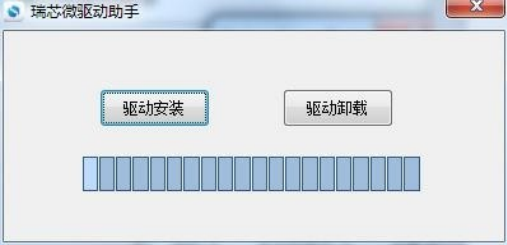

# Android 固件烧录

## 单板 USB 烧录

1. 备份数据，准备 X3576BV3 的 Android `update.img`。
2. 安装 SDK 配套的 Rockchip USB 驱动，打开 AndroidTool。
3. 在“升级固件”页选择镜像。按当前板卡的下载按键方式进入下载模式，并使用 Type-C 数据线和 12 V 电源。
4. 工具识别设备后点击“升级”。等待完成再重启，验证显示、触摸、网络和存储。

工具位于 `RKTools/windows/`。板载按键为 POWER、RESET、BOOT，下载组合键以实际板卡版本为准。未识别时检查 Type-C 数据线、供电、驱动和下载模式。

## 批量升级

解压 SDK 配套的 `FactoryTool_v1.66.zip`，打开 FactoryTool，选择本机型镜像并启动“升级”。让每块板进入下载模式并连接，逐端口检查成功或失败结果。

该板的 Android TF 卡升级尚未验证，使用 Type-C OTG 升级。
