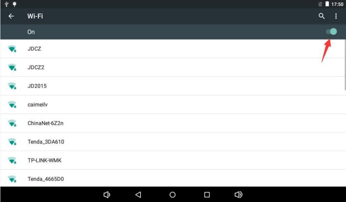
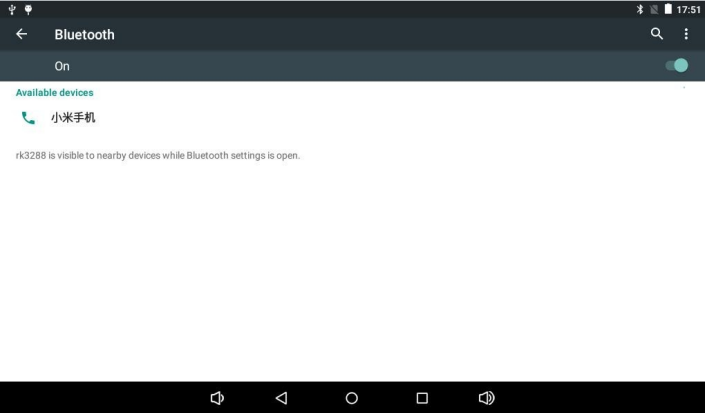

# Android 使用指南

## 串口与 ADB

UART0 Debug 建议先使用 1500000、8N1、无流控。实际波特率以固件为准。ADB 调试使用 Type-C OTG，在开发者选项中打开 USB 调试并授权主机。

```bash
adb devices
adb shell
```

有多个设备时，用 `adb -s <序列号> shell` 指定目标。

## 网络与蓝牙

从设置的 Network & Internet 连接 Wi-Fi，或接入网线检查链路与 IP。进入 Connected devices，搜索并确认配对。可用蓝牙分享文件，或通过已配对的蓝牙音箱播放媒体。





## 显示、媒体与存储

显示器接 HDMI OUT 或匹配的 MIPI DSI 屏。摄像头接对应 CSI 座，打开相机验证预览、拍照与录像。USB 键鼠与 U 盘接 Host 口。TF 卡和 U 盘识别后可在 `/storage/` 查看挂载目录，使用媒体应用播放文件。

## 电源与控制

短按 POWER 休眠或唤醒，长按打开关机界面。使用匹配的红外遥控器。屏幕旋转需要相应固件配置，自动旋转还取决于传感器与应用支持。
