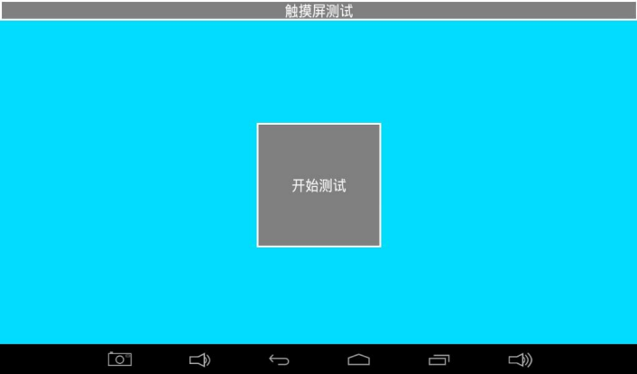
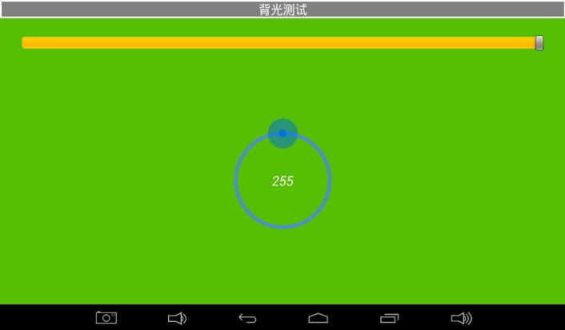
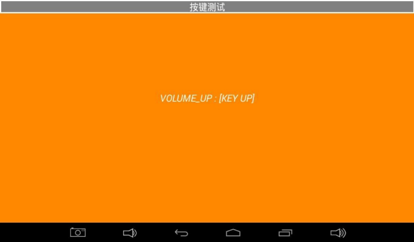
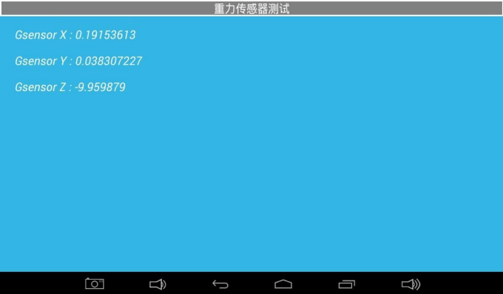
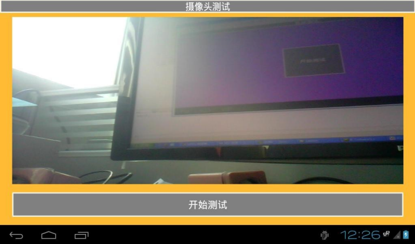
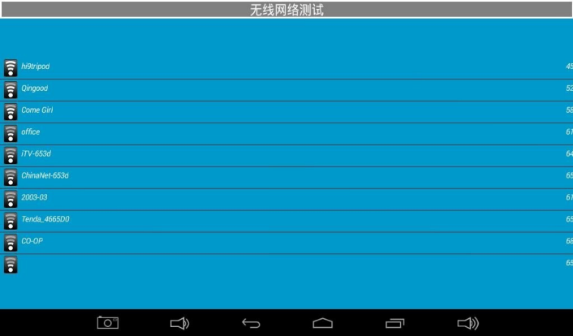
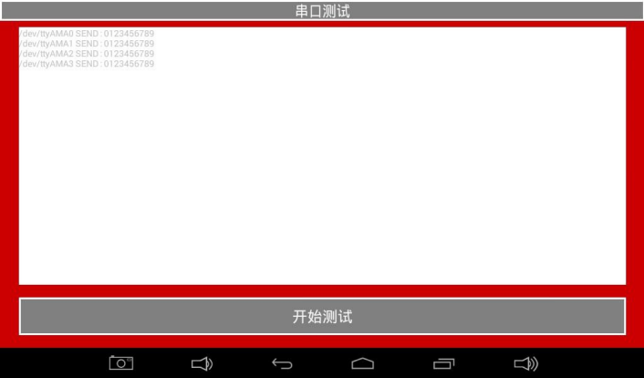
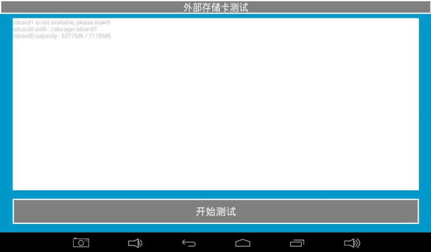

# Android 功能测试

打开“安卓测试”应用，左右滑动切换项目。根据板卡装配和固件支持选择测试。

## 显示与触摸

切换纯色检查坏点、丢色与闪烁。画对角线和边缘线检查触摸连续性。

## 背光

拖动控制环并观察亮度变化。

## 按键、LED 与蜂鸣器

核对按下和抬起事件。装有 LED 或蜂鸣器时，使用对应页面检查亮灭或发声。

## 电池、ADC 与传感器

检查已装配的电池状态、引出的 ADC 通道和重力传感器数据。

## 音频与摄像头

播放测试音，检查输出。连接匹配摄像头并检查预览。

## 网络

检查热点列表、以太网链路与联网状态。

## 串口

确认端口的电平与线序，将该端口 TXD 与 RXD 回环，检查是否收到 0123456789，测试后移除回环。

## TF 卡与 U 盘

插入介质后检查识别、挂载、容量和读写。

