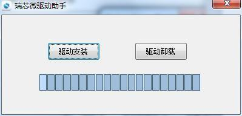

# Linux 固件烧录

## 通过 Type-C OTG 烧录

1. 备份数据，准备 X3576BV3 的 Linux `rockdev/update.img`。
2. 安装 SDK 配套 Rockchip USB 驱动，打开 `RKTools/windows/AndroidTool/` 中的烧录工具。
3. 用 Type-C 数据线连接 OTG。确认当前板卡的 RECOVERY 按键映射后，保持 RECOVERY 按下，触发 RESET 后释放，等待工具识别 Loader。
4. 在“升级固件”页选择 `update.img`，点击“升级”，等待写入完成后重启。



## 下载模式与故障排查

板上按键标为 POWER、RESET、BOOT。使用 RECOVERY 组合键前，按当前板卡和固件确认对应触发方式。系统可正常启动时，也可通过支持该命令的板端终端进入 Loader，或在工具检测到 ADB 设备后使用“切换”。

```bash
reboot bootloader
```

无法识别时先查 12 V 供电、Type-C 数据线与 USB 驱动。Loader 无法使用时，可按板卡对应方式进入 Maskrom 恢复。使用工具擦除 Flash 会清除存储数据，操作前确认备份及恢复镜像。
