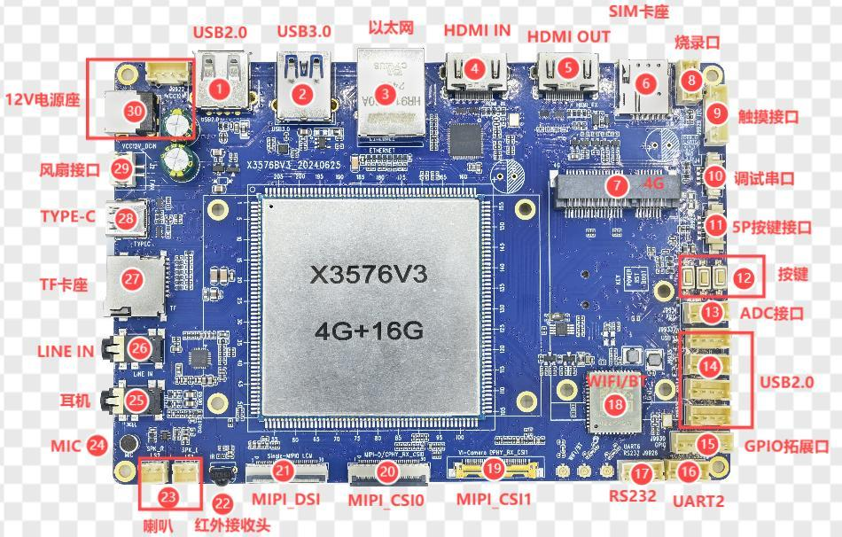

# 硬件资源

| 图号 | 接口 | 用途 |
| --- | --- | --- |
| 1 | USB 2.0 | Type-A Host |
| 2 | USB 3.0 | Type-A Host |
| 3 | 以太网 | 千兆 RGMII |
| 4 | HDMI IN | 通过 LT6911C 转换为 MIPI |
| 5 | HDMI OUT | RK3576 原生输出 |
| 6 | SIM | 配合 4G 模组 |
| 7 | 4G PCIe | 扩展模组 |
| 8 | 烧录口 | LT6911C 程序烧录 |
| 9 | 触摸 | 6-pin I2C 触摸座 |
| 10 | Debug | UART0 TTL 调试 |
| 11 | 外接按键 | 5-pin 座 |
| 12 | 板载按键 | POWER、RESET、BOOT |
| 13 | ADC | 4-pin 模拟信号扩展 |
| 14 | USB 2.0 | 四个 4-pin 座 |
| 15 | GPIO | 6-pin 扩展座 |
| 16 | TTL 串口 | 板上标 UART2，电路定义使用 UART3 信号 |
| 17 | RS232 | UART6 经 MAX3232 转换 |
| 18 | Wi-Fi/BT | VS2275P 模组 |
| 19 | MIPI CSI1 | 摄像头接口 |
| 20 | MIPI CSI0 | 摄像头接口 |
| 21 | MIPI DSI | 30-pin 显示接口 |
| 22 | 红外 | 红外接收 |
| 23 | 喇叭 | 双声道 |
| 24 | MIC | 板载录音输入 |
| 25 | 耳机 | 耳机及耳麦 |
| 26 | LINE IN | 音频输入 |
| 27 | TF 卡 | 外部存储 |
| 28 | Type-C | OTG 下载与 ADB |
| 29 | 风扇 | 12 V 风扇供电 |
| 30 | 电源 | 12 V DC 输入 |
