# 硬件接口

## 电源、按键与散热

使用 12 V / 3 A 适配器。板载 POWER、RESET、BOOT 用于开关机、复位和下载操作。12 V 风扇座按板载标记接线。外接按键、电源座及风扇线序见板载接口引脚页。

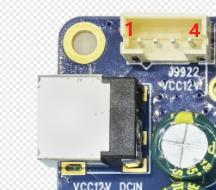

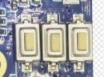

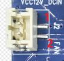

## 调试串口与扩展

UART0 为 TTL 调试串口。主板上标 UART2 的扩展座按接口定义连接 UART3，参考电源为 1.8 V。RS232 座经 MAX3232 转换，使用匹配的 RS232 设备。连接 TTL 串口前核对电平，TX/RX 交叉并共地。

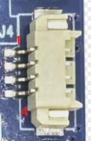

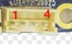

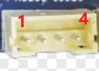

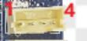

## USB 与 TF

Type-C OTG 用于固件下载和 ADB。USB 3.0 Type-A 用于外接高速设备，USB 2.0 由 Hub 扩展为一个 Type-A 与四个 4-pin 2.0 mm 座。TF 卡可用于外部存储，启动功能取决于固件。

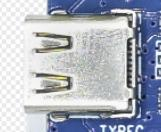

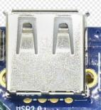

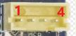

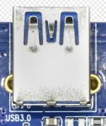

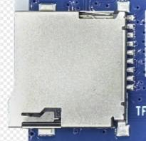

## 显示、摄像头与触摸

HDMI OUT 输出音视频，HDMI IN 通过 LT6911C 转为 MIPI 输入。显示使用 MIPI DSI，触摸使用 6-pin I2C 座，电源可选 3.3 V 或 1.8 V。两路 CSI 的线序和供电不同，接入模组前逐脚核对。

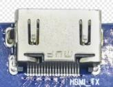

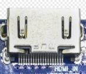

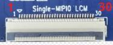

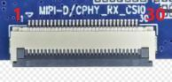

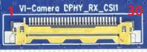

## 网络与 4G

RJ45 支持千兆以太网。板载 VS2275P 提供 Wi-Fi 6 和蓝牙。4G 模组接入 PCIe 扩展座后，配合 SIM 卡、天线和对应驱动使用。

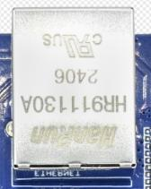

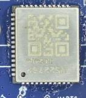

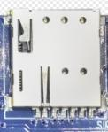

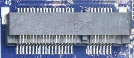

## 音频与红外

耳机座可连接耳机或功放输入，LINE IN 提供音频输入。板载麦克风可用于录音。左右声道各有一路 0.5 W 喇叭输出，红外接收头用于匹配的遥控器。

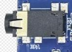

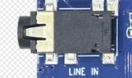

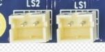

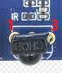
