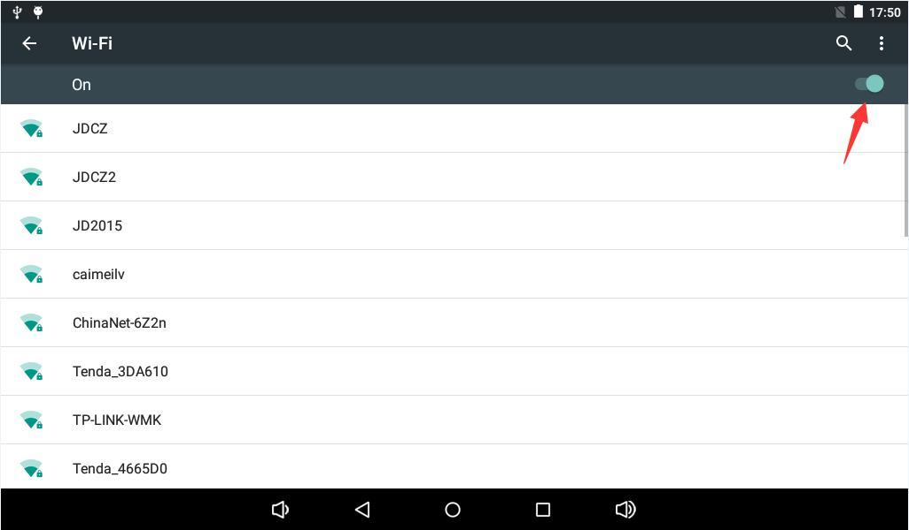
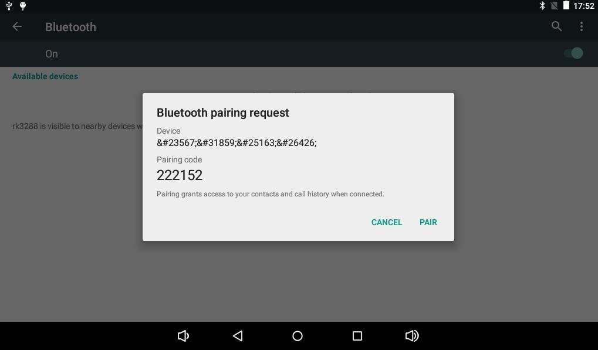
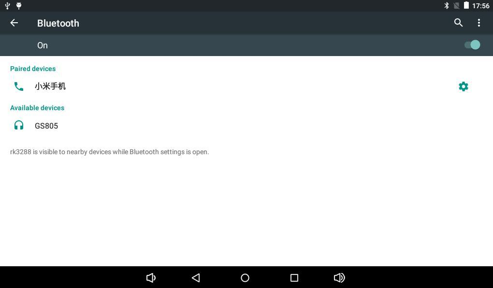

# Android 使用指南

## 串口与 ADB

通过 UART0 连接 USB 转串口工具，使用 115200-8-N-1、关闭流控，TX/RX 交叉并共地，电平按主板实际接口核对。Windows 串口工具选择设备管理器中的 COM 号。

Android 设置中启用 Developer options → USB debugging，连接 Micro USB OTG，在已配置 ADB 的主机执行：

```bash
adb devices
adb shell
```

输入 `exit` 退出板端终端；连接多个设备时先用 `adb devices` 查看序列号，再用 `adb -s <序列号> shell` 选择目标。

## 网络与蓝牙

Wi-Fi：进入 Settings → Network & Internet，打开 Wi-Fi，选择热点并输入密码。以太网：接入可用网线，检查网口灯和 IP。蓝牙：进入 Connected devices → Bluetooth，搜索设备并在两端确认配对；文件通过 Share → Bluetooth 发送，蓝牙音箱配对后可播放媒体。







## 存储与媒体

TF 卡和 U 盘正常识别后挂载到 `/storage/`，按 UUID 区分。USB 鼠标键盘连接到 Host 口使用。音乐应用可扫描音频文件，图库可打开视频与图片。

## 显示、开关机与休眠

通过 Mini HDMI 连接显示器，可输出画面及音频；分辨率按固件支持选择。支持旋转的应用可随重力传感器改变方向。接入 12 V 后按固件设置自动启动或长按 POWER 开机，长按 POWER 选择关机；短按 POWER 休眠，再次短按唤醒。
