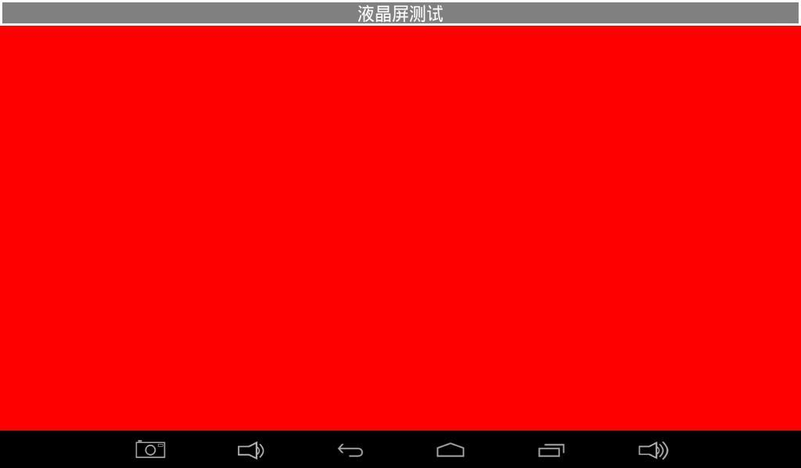
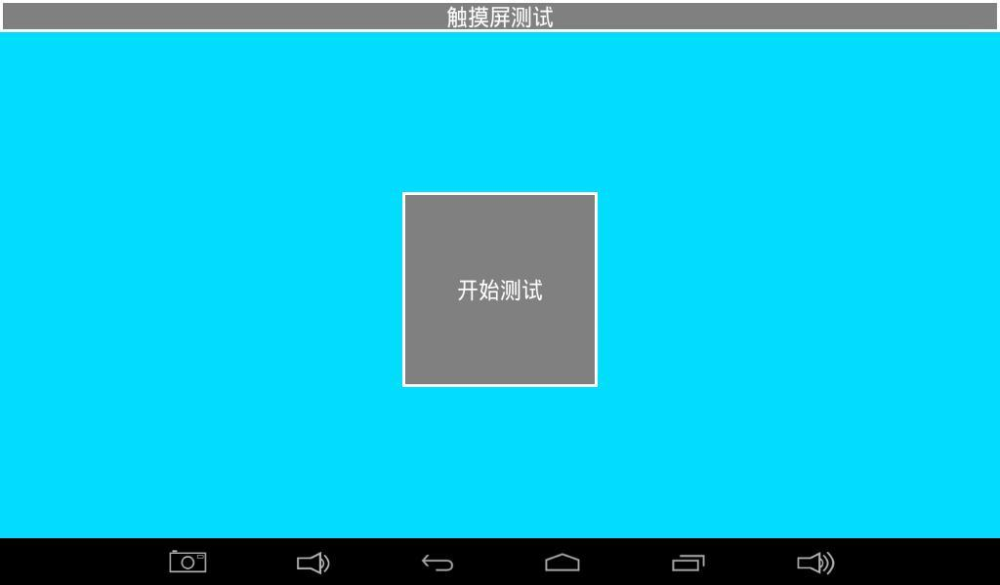
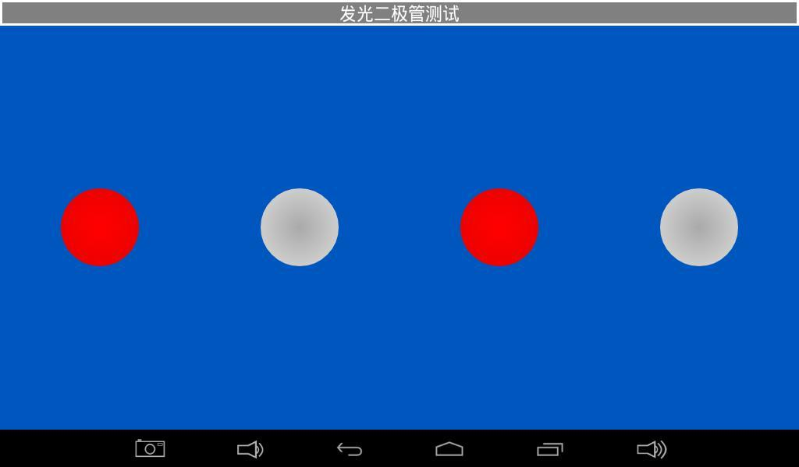
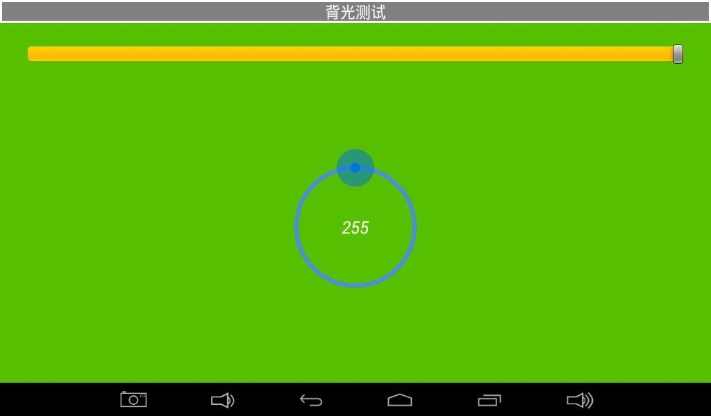
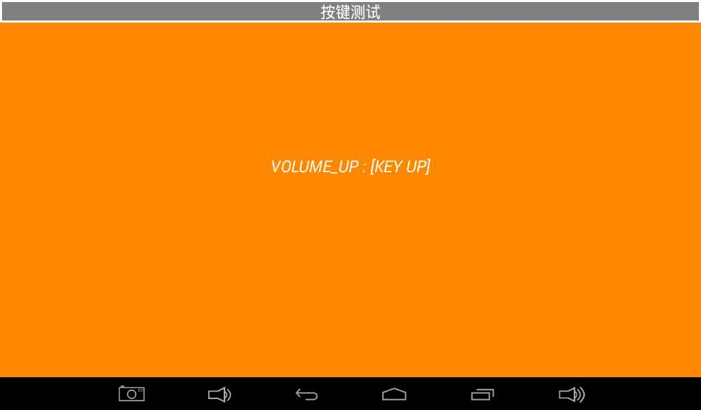
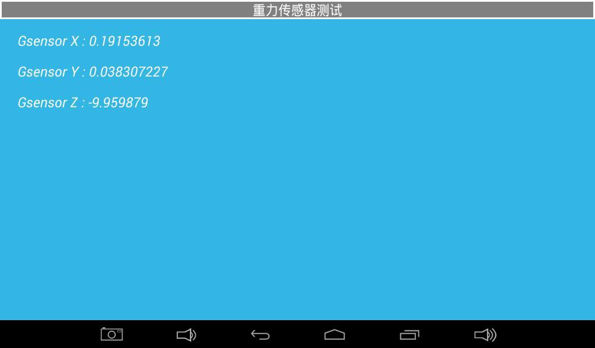
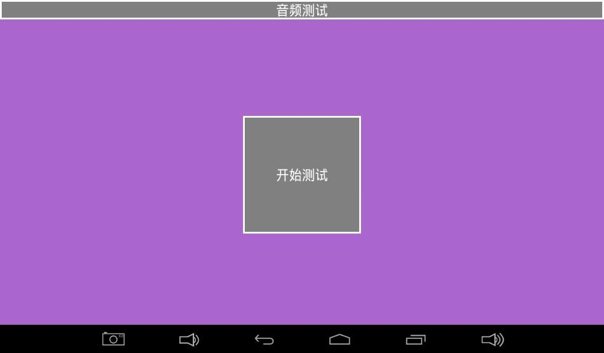
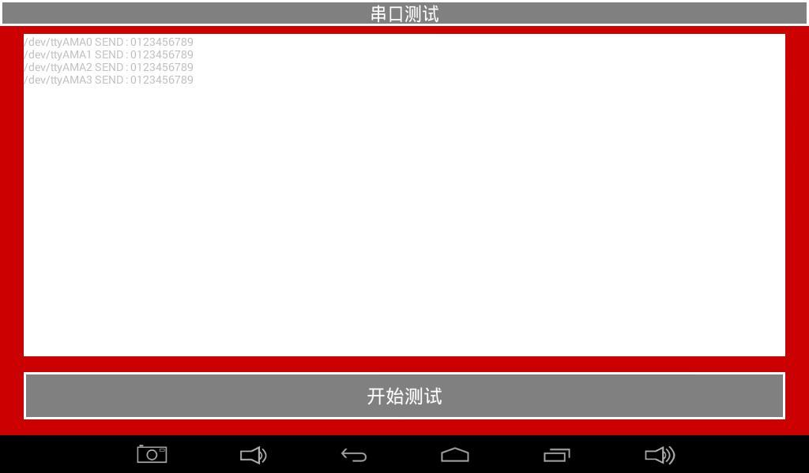
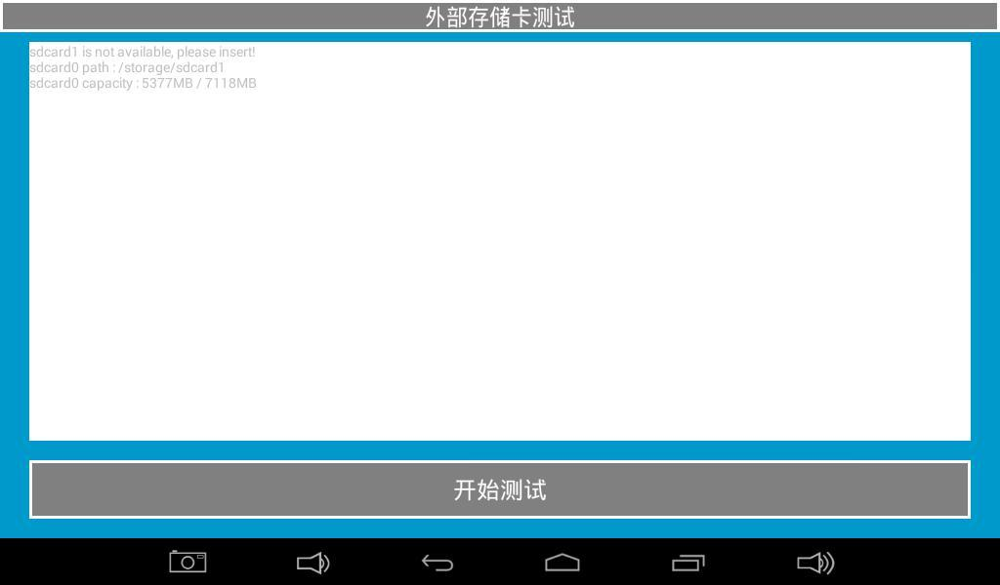

# Android 功能测试

打开“安卓测试”应用，左右滑动切换项目。仅测试当前主板实际装配且固件支持的硬件；未装配器件的通用测试页可跳过。

## 液晶屏

点击纯色区域切换颜色，检查丢色、坏点和闪烁。

## 触摸屏

点击开始测试，画对角线与边缘线，检查坐标及连续性。

## LED 与蜂鸣器

LED 页点击图标切换亮灭；蜂鸣器页按住开始测试发声、松开停止。

## 背光

拖动圆形控件，观察亮度是否连续变化。

## 按键与电池

按下/抬起按键检查事件；电池页查看电量、电压和供电状态。

## ADC 与重力传感器

按实际引出的 ADC 通道检查电压；旋转板卡观察 X/Y/Z 数值变化。

## 音频与网络

音频页点击开始测试监听声音；连接 Wi-Fi/以太网后检查热点列表与网页访问。

## 串口

确认端口电平后短接该口 TXD/RXD，开始测试，检查能否自发自收 0123456789。测试完成移除短接。

## TF 与 U 盘

插入介质后点击开始测试，检查容量、挂载和读写。

