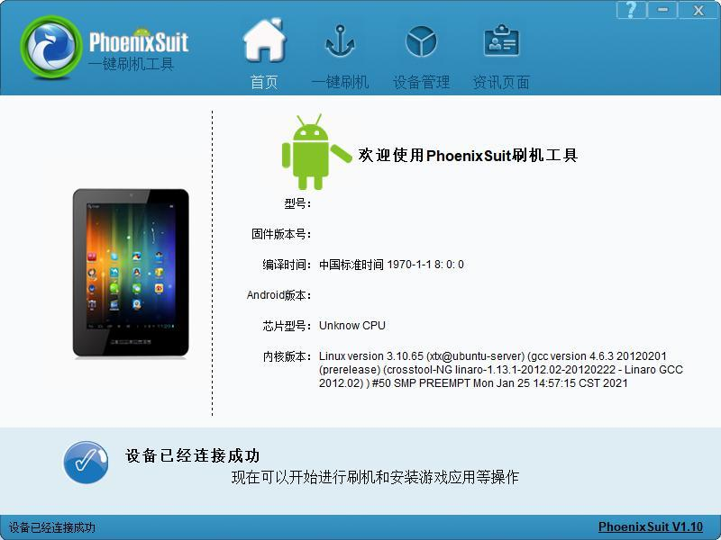
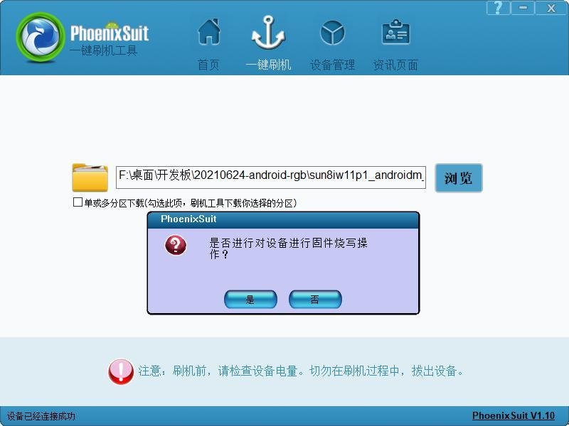
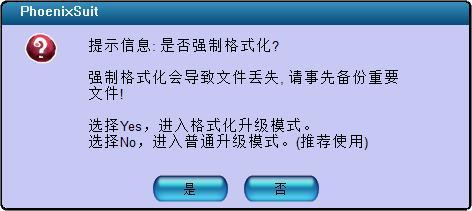
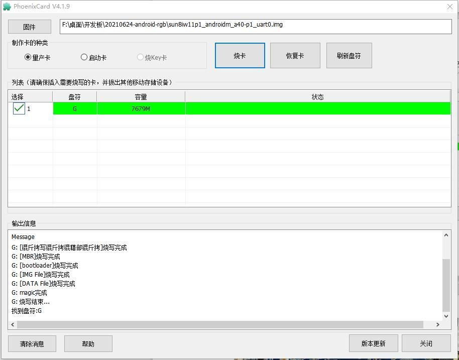
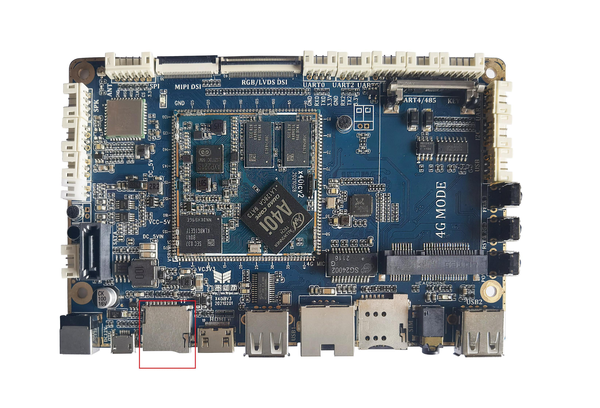

# Linux 固件烧录

## 准备工具与固件

在 Windows 主机安装配套 PhoenixSuit 和 USB 驱动，使用 Linux IMG。PhoenixSuit 安装包位于 `x40i_linux/buildroot/tools_win/`，PhoenixCard 位于 `x40i_linux/tools/tools_win/`。升级前备份需要保留的数据。

## USB 线刷

1. 用数据线连接主板 Micro USB OTG 与 PC，打开 PhoenixSuit。
2. 进入“一键刷机”，浏览选择编译生成的 IMG。
3. 按住 FEL 升级键，再接入电源；也可按住 FEL 后按一下 RESET。
4. 待工具进入烧录状态；如确认使用全量格式化升级，接受格式化提示，该操作会清除数据。
5. 等待成功提示，恢复正常启动并检查显示和外设。

Linux 固件使用 FEL + RESET 触发升级，不使用 PhoenixSuit 的“立即升级”按钮。烧录过程中保持供电与 USB 连接。

## TF 升级卡

打开 PhoenixCard，选择正确的 TF 卡盘符与固件，制作升级卡。确认卡内数据可以清除后再写入。主板断电插入升级卡，上电等待升级完成，观察屏幕进度或串口日志；完成后断电取卡，再上电启动。

