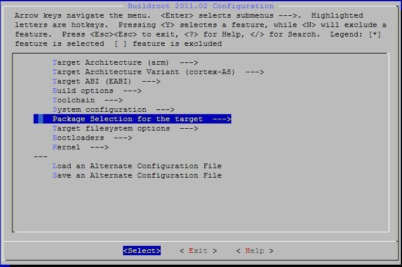
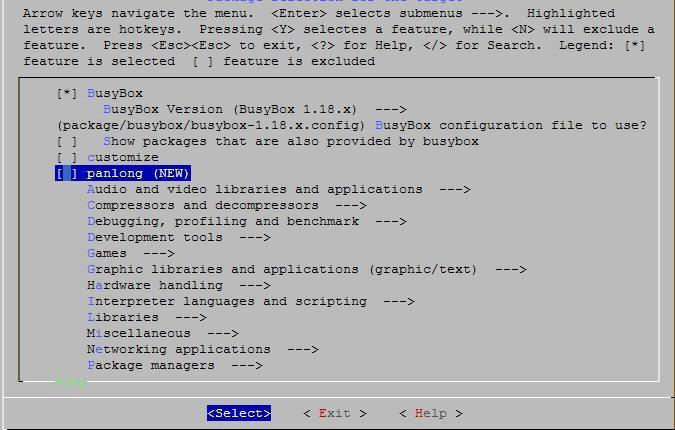

# 根文件系统与软件包

## 集成文件与启动脚本

`buildroot/target/user_rootfs_build.sh` 在生成根文件系统时执行，将 `user_rootfs_extra/` 内容复制到目标根目录。把预编译库、配置和工具放到其对应目录；驱动加载和启动命令可加入 `user_rootfs_extra/autorun.sh`。

`user_rootfs_misc/` 存放需要编译或进一步处理的项目，不会自动复制到根文件系统；在 `user_rootfs_build.sh` 中补充构建与复制步骤。常用项目包括 `sdk/` 与 `ui_qt/`。

## SDK 库与测试程序

```bash
cd x40i_linux/buildroot/target/user_rootfs_misc/sdk
make cleanall
make
```

生成 `libsdk.so` 和 `sdktest`。板端库放在 `/usr/lib/`，测试程序放在 `/`。SDK 包含 camera、cedarx、connectivity、display、storage、include、libs 和 tools 等目录。

## 增加 Buildroot 软件包

1. 在 `buildroot/package/<包名>/` 中添加 `Config.in` 与 `<包名>.mk`。
2. 在 `buildroot/package/Config.in` 中引入包配置。
3. 在配置菜单启用软件包，重新编译并打包。自有源码可参考 fsck-msdos，下载型软件包可参考 argus；二进制包可参考 mali-3d。

```text
source "package/panlong/Config.in"
```

内核驱动优先集成到 `linux-3.10/drivers/`；外部模块放在 `linux-3.10/modules/`，并在对应 `scripts/build_XX.sh` 的构建/清理函数中加入规则。交叉编译参数为 `ARCH=arm`、`CROSS_COMPILE=arm-linux-gnueabi-`。




