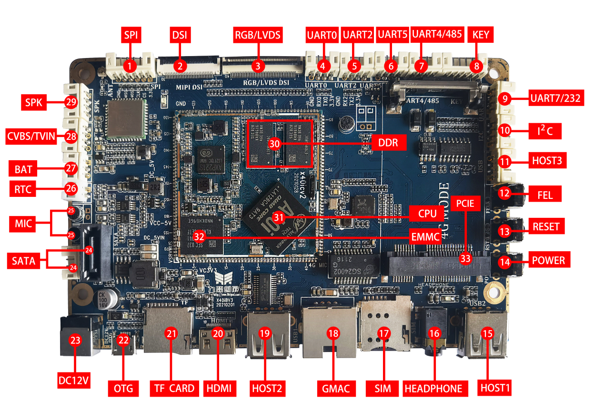

# 硬件资源

| 图号 | 名称 | 说明 |
| --- | --- | --- |
| 1 | SPI | SPI接口 |
| 2 | DSI | DSI显示接口 |
| 3 | RGB/LVDS | RGB/LVDS显示接口 |
| 4 | UART0 | UART0，TTL电平，默认为调试串口 |
| 5 | UART2 | UART2，TTL电平 |
| 6 | UART5 | UART5，TTL或RS232电平，通过电阻配置 |
| 7 | UART4/RS485 | UART4或RS485接口，通过电阻配置 |
| 8 | KEY | 6PIN PH座，可外接开关机键、独立按键、升级键等 |
| 9 | UART7 | UART7，TTL或RS232电平，通过电阻配置 |
| 10 | I2C | I2C2通道，TTL电平 |
| 11 | HOST接口 | 通过PH座引出HOST接口 |
| 12 | FEL按键 | 强制升级按键 |
| 13 | 复位按键 | 硬复位按钮 |
| 14 | POWER按键 | 开关机按钮 |
| 15 | HOST接口 | 标准TYPE A型 HOST接口 |
| 16 | 耳机座 | 耳机输出 |
| 17 | SIM卡座 | 用于外接SIM卡，用于无线上网 |
| 18 | GMAC | 千兆以太网接口 |
| 19 | HOST接口 | 标准TYPE A型 HOST接口 |
| 20 | HDMI接口 | 标准TypeC型miniHDMI接口 |
| 21 | TF卡 | TF卡座 |
| 22 | OTG接口 | 程序下载接口 |
| 23 | DC接口 | 12V直流电源输入 |
| 24 | SATA接口 | SATA电源及信号接口 |
| 25 | 麦克风 | 双麦克风输入 |
| 26 | RTC | 外部RTC电池输入 |
| 27 | BAT | 外部电池供电接口 |
| 28 | CVBS/TVIN | TVBS输出、TVIN接口 |
| 29 | 喇叭接口 | 外接喇叭输出 |
| 30 | DDR | 主控内存，标配1GB DDR3 |
| 31 | CPU | 全志A40I，四核A7 |
| 32 | EMMC | 8GB(4G,16G可选) |
| 33 | PCIE接口 | PCIE接口，4G通信模块扩展 |
| 34 | 摄像头接口 | 标准 24PIN 并口摄相头接口，主板反面 |

图中 PCIE 标识的插槽用于扩展 4G 通信模组。选型时核对模组通信方式、供电、SIM 和天线连接。UART 电平由对应电阻配置决定，接线前确认实际装配。
