# 硬件接口

## 电源输入

主板使用直流 12 V 输入。接线前核对适配器极性与容量。

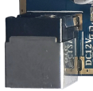

## 以太网

板载 RTL8211E 千兆以太网，连接 RJ45 网线后检查指示灯及系统 IP。

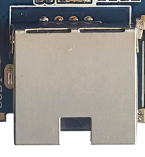

## TF 卡

TF 卡座用于扩展存储及制作升级卡。制作升级卡会改写卡内数据，先备份。

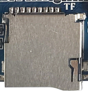

## 并口摄像头

背面 24-pin 并口摄像头接口。更换模组时核对引脚、电压、时钟及驱动；所需电压由主板 LDO 配置。

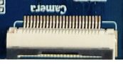

## TVIN/CVBS

通过 4-pin PH 座引出模拟视频输入/输出。

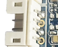

## SIM 与 4G 扩展

使用扩展 4G 模组时插入对应 SIM 卡，并连接匹配的天线。

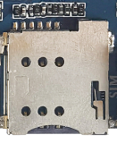

## FEL、POWER 与复位

FEL 用于强制下载。接入外部电源后，如未自动启动，长按 POWER 开机；Android 运行中短按休眠/唤醒，长按按提示关机。RESET 用于硬复位。

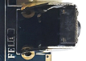

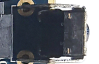

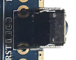

## 外接按键

6-pin PH 座可引出开机、复位和升级等按键信号，线序按原理图核对。

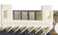

## UART0/2/4/5

UART0 默认为调试口；UART2 为 TTL；UART4 可配置 TTL/RS485；UART5 可配置 TTL/RS232。电平切换通过主板电阻配置完成。

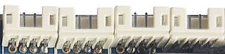

## UART7、I2C2 与 USB Host

图中从上到下为 UART7、I2C2 和 USB Host。UART7 可配置 TTL/RS232，I2C2 为 TTL；USB Host 通过 PH 座引出。

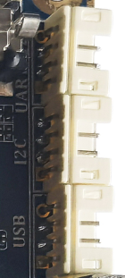

## 音频、电池与 RTC

图中从上到下为 SPK、CVBS/TVIN、BAT、RTC。电池接口先核对电压和极性；RTC 电池用于断电计时。

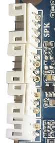

## LCD 与 HDMI

LCD 座支持 MIPI 和 RGB/LVDS 屏。使用与屏幕匹配的排线、供电和屏参；HDMI 使用 Type-C Mini HDMI 连接器。

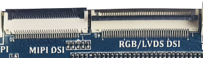

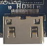

## USB Host 与 OTG

图中左右两端为 Type-A USB 2.0 Host。Micro USB OTG 用于烧录和 ADB，也可按固件配置工作为 Host。

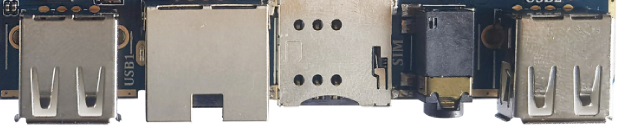

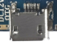

## Wi-Fi/BT

板载 2.4 GHz SDIO Wi-Fi/BT 模组；驱动和固件需与实际模组匹配。

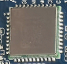

## SATA

左侧 PH 座为 SATA 电源，右侧为 SATA 数据座。外接硬盘前核对供电能力和线序。

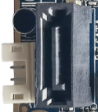

## 4G 模组插槽

用于扩展无线通信模组，配合 SIM、天线与对应驱动使用。

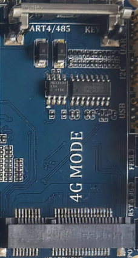
