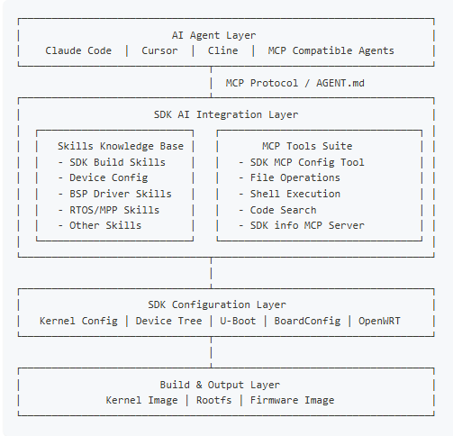

# SDK AI 辅助开发

SDK 手册介绍了 `AGENT.md`、`skills/` 和 MCP 联动方式，用于检索 SDK 知识、分析日志、编辑配置以及执行经确认的构建任务。可用功能取决于交付 SDK 是否包含这些目录和服务。



```text
AGENT.md
skills/
  sdk/
  device/v861/
  bsp/
  melis/
  eyesee-mpp/
```

使用时先提供板型、SDK 版本、目标功能和错误日志，要求工具检索相关 SKILL.md，再给出修改及验证步骤。Skills 是 SDK 内的普通技术文档，需按该 SDK 的检索配置使用。

提交前检查设备树、Kconfig、Makefile 和脚本差异，验证构建及硬件功能。AI 分析结果不能代替板上引脚、电压和波形测量。
