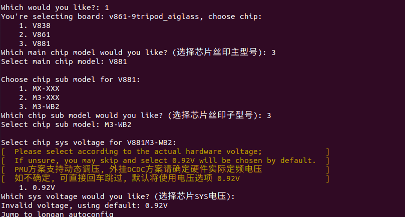
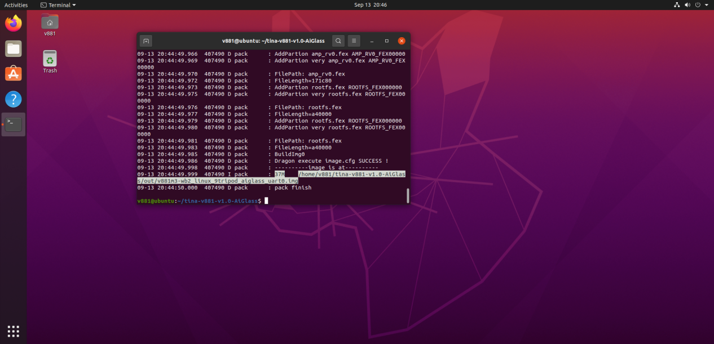
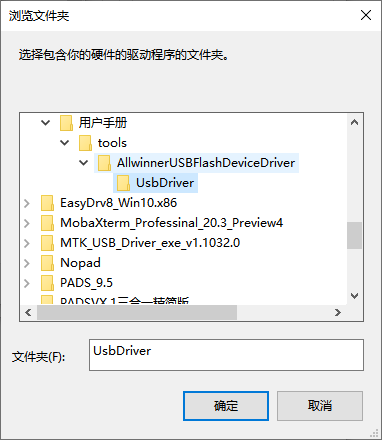
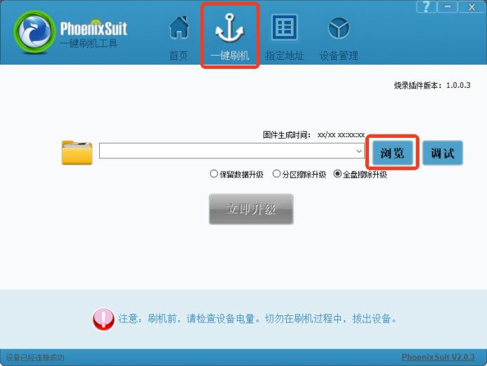
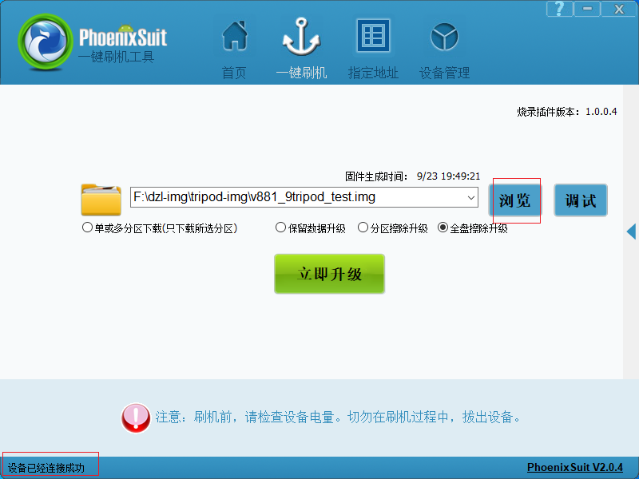
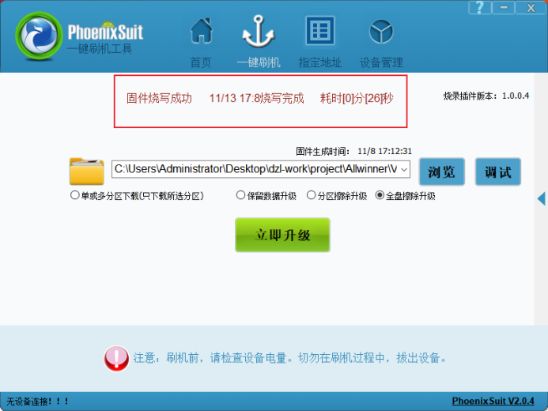

# 编译与烧录

## 解压与完整编译

```bash
tar -xzvf tina-v881-v1.0.tar.gz
# Enter the extracted SDK directory
ls
tree -L 1
cat README.txt
source build/envsetup.sh
lunch
# Select v861-9tripod_aiglass-tina
m -j4
pack
```

首次选择方案时按提示阅读许可说明并确认。`m` / `make` 执行完整编译，`mp -j4` 可编译并打包；输出镜像位置以成功日志为准。





## PhoenixSuit 驱动与烧录

1. Windows 安装 PhoenixSuit 和全志 USB 烧录驱动。
2. 设备管理器识别未知设备时，手动更新驱动并指定 `UsbDriver` 目录。
3. 打开“一键刷机”，选择生成的 `.img`，按项目要求选择擦除升级。
4. X881 手册流程为 USB 接入后，工具显示“设备已经连接成功”，再点击烧录。
5. 等待“固件烧录成功”，重新启动并检查 UART 日志。









烧录会覆盖系统数据。设备未识别时，先检查数据线、供电、驱动和当前启动状态；恢复模式入口按交付板卡说明操作。
