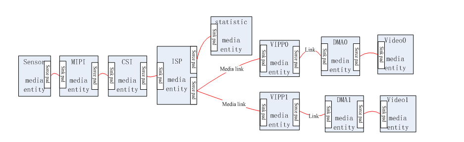

# Camera 驱动适配

X881 主板提供 20PIN MIPI CSI 摄像头连接。适配流程从硬件、电源和 Sensor ID 开始，再检查 MIPI 接收、VIN、ISP 和编码链路。



```text
bsp/drivers/vin/
bsp/drivers/vin/modules/sensor/
bsp/drivers/vin/modules/actuator/
bsp/drivers/vin/modules/flash/
```

- 核对电压、MCLK、复位、PWDN 及上下电延时。
- 通过 I2C 确认 Sensor ID。
- 设置 lane 数、顺序、RAW/YUV 格式、时钟和数据率。
- 在当前方案 `board.dts` 绑定 Sensor、I2C 地址、GPIO 与电源。
- 确认 VIN/ISP 建链和帧输出，再调曝光、增益、色彩及编码。

```bash
dmesg | grep -i -E 'sensor|vin|isp|mipi'
ls -l /dev/video*
```

参考驱动包括 `gc1084_mipi.c` 和 `gc2053_mipi.c`，选择与实物传感器一致的驱动。通用平台文档中的并行输入和分辨率上限需按当前 V881 SDK 验证。
