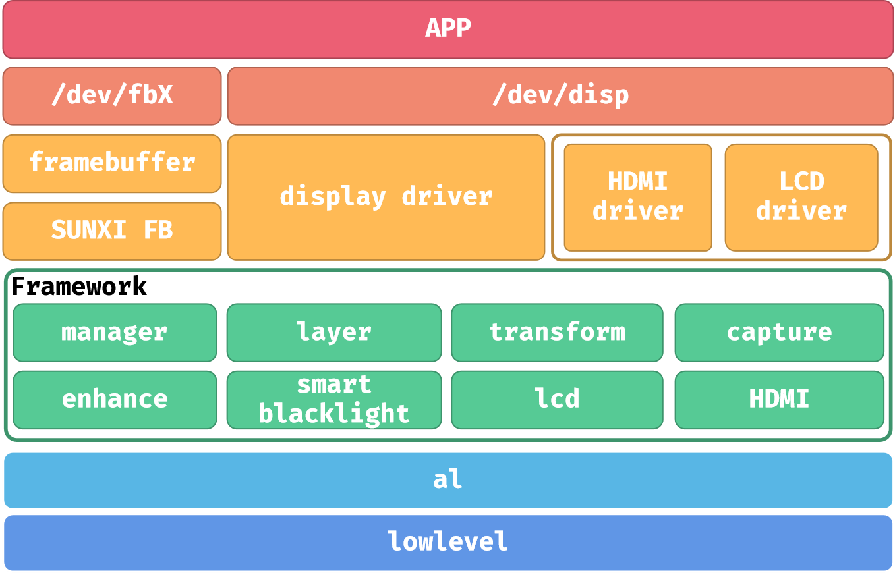
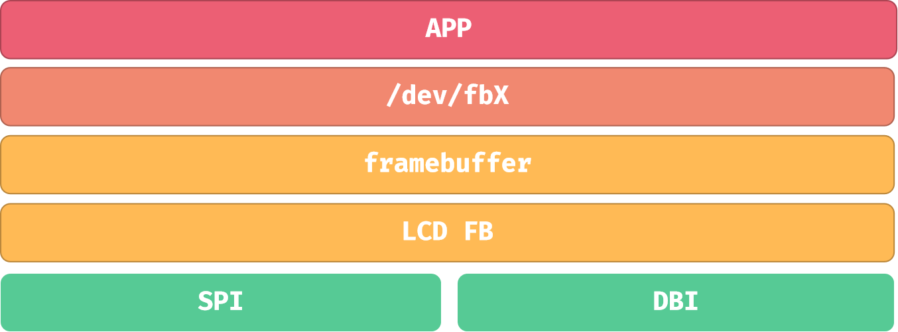
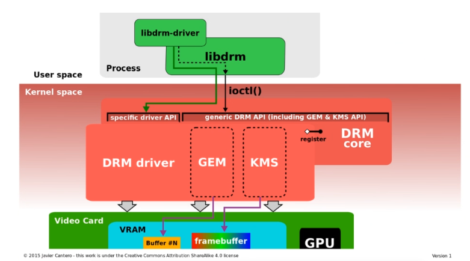
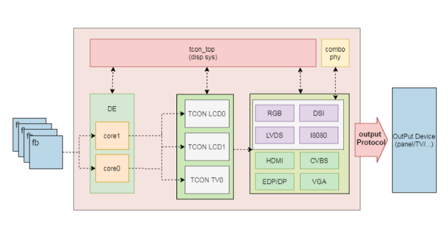

# LCD 与 DRM 显示

X881 的物理显示入口是 DBI，外接转接板可连接 SPI 屏。软件手册包含 DISP、LCD_FB、FBTFT 和 DRM 等框架，选用与当前内核和面板匹配的路径。





LCD_FB 将 RGB framebuffer 数据送入 SPI/DBI，不直接显示 YUV；FBTFT 是内核 SPI 小屏路径。排查时先检查面板供电、背光、RESET、CS/DC、SPI mode，再检查初始化命令、RGB/BGR、分辨率和刷新时序。

## DRM 组件与源码





```text
kernel/drivers/gpu/drm/
bsp/drivers/drm/
bsp/drivers/drm/sunxi_drm_drv.c
bsp/drivers/drm/sunxi_drm_crtc.c
```

Framebuffer 保存像素，Plane 表示图层，CRTC 对应扫描输出，Encoder/Connector 表示输出编码与连接。libdrm 通过 atomic commit 配置显示状态。通用框图列出的 HDMI/eDP/LVDS 不代表 X881 主板已引出这些连接。
