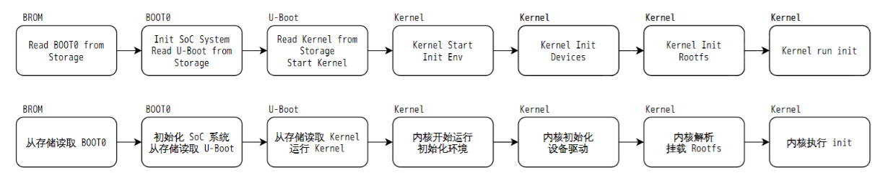
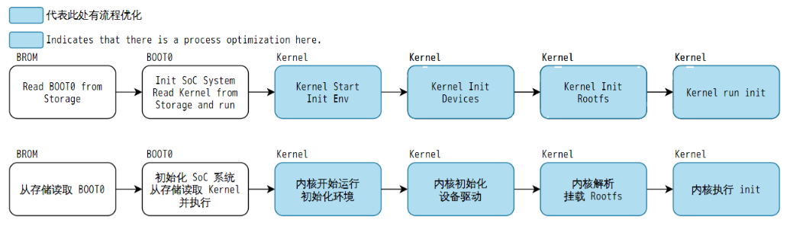

# FASTBOOT 快启系统

这里的 FASTBOOT 指 Tina 快启方案：BOOT0 直接加载经过优化的内核与设备树，跳过普通 U-Boot 阶段。

普通启动：BROM → BOOT0 → U-Boot → Kernel/DTB → rootfs/init。快启：BROM → BOOT0 → Kernel/DTB → 优化后的 rootfs/init。启动时间还取决于驱动初始化和应用启动。

裁掉 U-Boot 后，不能沿用其中的自动 OTA、U-Boot 屏幕 Logo、动态启动介质选择和 NFS 启动流程；手册也列出不支持卡烧录。选择快启前确认升级、恢复、显示和量产测试路径。
