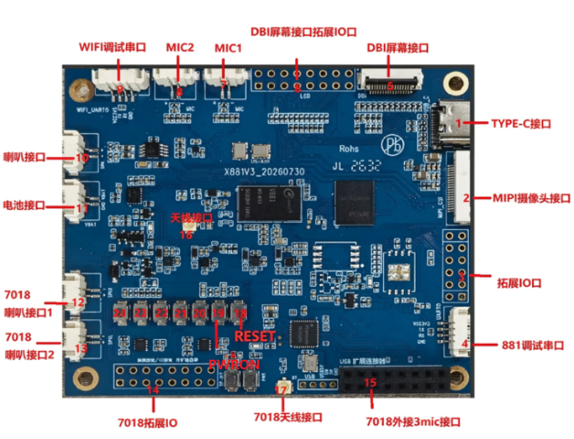

# 硬件资源

| 标号 | 名称 | 功能描述 |
| --- | --- | --- |
| 1 | TYPE-C接口 | 24PIN TypeC接口 |
| 2 | MIPI摄像头接口 | 20PIN Camera 接口 |
| 3 | 拓展IO口 | 881未使用的GPIO引脚 |
| 4 | 881调试串口 | 4PIN 1.25mm 卧式贴片座，调试串口 |
| 5 | DBI屏幕接口 | 16PIN 0.5mm FPC 座，DBI接口 |
| 6 | DBI屏幕接口拓展IO口 | 2X8X2.54mm |
| 7 | MIC1 | 2PIN 1.25mm 卧式贴片座，连接主控 |
| 8 | MIC2 | 2PIN 1.25mm 卧式贴片座，连接主控 |
| 9 | WIFI调试串口 | 4PIN 1.25mm 卧式贴片座 |
| 10 | 喇叭接口 | 2PIN 1.25mm 卧式贴片座，连接喇叭，默认 4R 3W |
| 11 | 电池接口 | 2PIN 1.25mm 卧式贴片座 |
| 12 | 7018喇叭接口1 | 2PIN 1.25mm 卧式贴片座，连接7018 |
| 13 | 7018喇叭接口2 | 2PIN 1.25mm 卧式贴片座，连接7018 |
| 14 | 7018拓展IO口 | 2X8X2.54mm |
| 15 | 7018外接3MIC接口 | 2X8X2.54mm排母 |
| 16 | 天线接口 | 使用蓝牙和网络时需外接天线 |
| 17 | 7018天线接口 | 7018外接天线接口 |
| 18 | RESET | 881复位按键 |
| 19 | PWRON | 881休眠按键 |

## 供电与信号分工

- Type-C 用于充电、供电、烧录和 ADB。
- 电池接口接单节 3.7V 锂电池，按接口极性和电池额定值连接。
- V881 提供两路 MIC 和一路喇叭，JL7018 通过扩展板提供三路 MIC、两路喇叭。
- V881 与 Wi-Fi 各有调试串口；软件控制台波特率按对应启动阶段配置。
- DBI 通过外置转接板连接 SPI 屏，触摸控制信号在 DBI 接口中引出。
